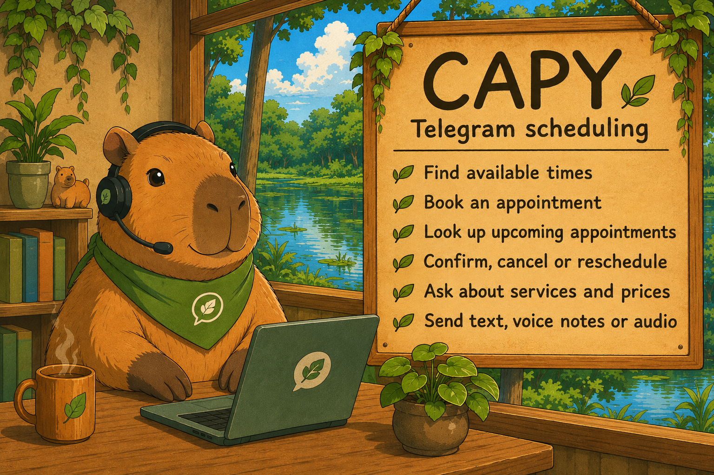
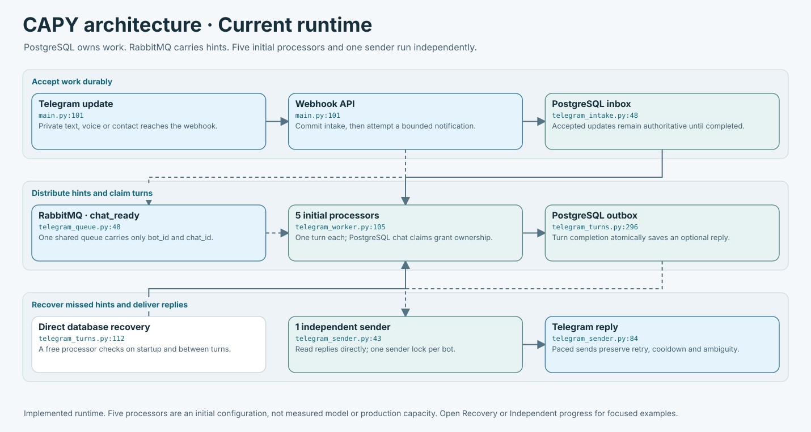

# CAPY — Telegram scheduling with text and audio

A portfolio scheduling assistant for one massage therapist. Gemma rewrites text or complete voice recordings into simple language; Laya receives that interpreted message and the conversation context, then proposes the next action. Deterministic Python services authorize changes, calculate availability and commit bookings in PostgreSQL.

<p align="center"></p>

Customers can search, choose a slot, book, look up appointments, confirm, cancel and reschedule in private Telegram chats. Numeric Telegram identity owns the customer's bookings. A phone number is optional contact information; providing someone else's number grants no access.

## Run the offline example

With Python 3.11 or later and `uv`, run the scheduling workflow locally with scripted model
responses and simulated booking services. The example runs without Telegram, PostgreSQL,
Redis, or model downloads.

```sh
uv sync --locked --extra dev
uv run --locked --extra dev python -m app.evals.scenarios run \
  --dataset evals/scenarios/golden.yaml --profile offline --repeat 1
```

The runner prints each case's status and writes a timestamped JSON receipt and HTML report under `.eval_runs/scenarios/`. The English and Portuguese cases each ask for available times, select an offered time, ask for consent, and create one booking only after the customer approves. [Read the evaluation guide](docs/evaluation-framework.md) · [Follow the booking through the code](docs/architecture.md#how-to-read-the-code).

The worker guide shows which debug events appear as CAPY books the chosen time. [Trace the offline example](docs/telegram-worker.md#run-the-example-without-telegram)

## Try the Telegram voice demo

Create a private `.env` from [`.env.example`](.env.example). Set `TELEGRAM_BOT_TOKEN` for
a dedicated test bot, set `TELEGRAM_BOT_ID` to the numeric prefix of that token,
and set `TELEGRAM_WEBHOOK_SECRET` to a random value. You can generate
the secret with `openssl rand -hex 32`.

### Run the local models on Apple Silicon

Use `uv` to download Gemma (2.59 GB) and Laya (678 MB) once into `.local-models/`, then start the model server.

```bash
uv run --locked \
  --with litert-lm-api==0.19.1 \
  --with laya-mlx==0.6.0 \
  python -m app.local_models download
uv run --locked \
  --with litert-lm-api==0.19.1 \
  --with laya-mlx==0.6.0 \
  python -m app.local_models serve
```

Check `http://localhost:8081/health`. [Model setup options](docs/model-contracts.md#local-model-service)

### Start the Telegram demo

Start the API, RabbitMQ, five processing workers and one independent sender in a second terminal.

```bash
docker compose -p capy-massage-studio --profile telegram up -d --build --wait
```

The project name gives this demo its own database volume. Compose seeds the studio and
connects the processors to the local model server. The Compose `deploy.replicas: 5` setting applies to `telegram-worker`; each process runs one turn at a time. Check
`http://localhost:8000/health`. Point a public HTTPS reverse proxy or tunnel at
`http://127.0.0.1:8000`. Telegram will send incoming messages to that HTTPS address.

Replace the example HTTPS address below with your own, then register the test bot.
Set `TELEGRAM_WEBHOOK_ROUTE` in `.env` if you want a path other than `/telegram/webhook`.

```bash
docker compose -p capy-massage-studio run --build --rm telegram-register \
  --webhook-base-url https://bot.example.com
```

The setup command tells Telegram where to send its updates. Pending Telegram updates are preserved. If the public address of your tunnel
changes, run registration again with the new address.

### Make a test booking

In a private Telegram chat with the test bot, ask for “Shiatsu 60 min” tomorrow by text or voice. Reply with an offered number to select a time. CAPY will show the exact appointment and ask for approval; say yes to create the booking. CAPY returns the saved booking details afterward.

Check the booking in the owner CLI.

```bash
docker compose -p capy-massage-studio run --rm api \
  python -m app.cli
```

Run the [bilingual golden evaluation](#evaluate-with-and-without-laya) to check routing, confirmation, and booking writes before using the bot with customers.

### Change the service menu

The demo seeds Shiatsu for 30 and 60 minutes and liberação miofascial for 60 minutes.
Prices are illustrative. Each row in `services` has a massage type, duration, price in
centavos, and optional buffers. For example, insert this row in PostgreSQL to add a
45-minute option:

```sql
INSERT INTO services (id, business_id, service_type, duration_minutes, price_minor, buffer_after_minutes)
VALUES ('shiatsu-45', 'demo-studio', 'Shiatsu', 45, 12000, 15);
```

PostgreSQL generates the catalog name “Shiatsu 45 min”. The existing conversation
matches that full name. All options share Ana's working hours and booked times.

### Add Langfuse to the demo

Set `TRACING_ENABLED=true` in the private `.env` file and start the demo with the Langfuse add-on.

```bash
docker compose -p capy-massage-studio -f docker-compose.yml -f docker-compose.observability.yml \
  --profile telegram up -d --build --wait
```

Open `http://localhost:3000` and make a test booking to generate a trace. Langfuse uses separate storage from CAPY's booking database.

## Flow and guarantees

The Telegram webhook commits each update to PostgreSQL, then makes a bounded attempt to publish bot/chat identifiers to one RabbitMQ queue, `telegram.chat_ready`. Five initial processors use PostgreSQL chat claims to run independent chats concurrently. Each has one processing slot for notifications and direct database recovery. One independent sender reads PostgreSQL replies, paced at roughly one send per second. Redis holds conversation checkpoints. Broker downtime leaves durable intake and recovery available. Five processors are an initial configuration, not a measured capacity claim.



Open the [interactive architecture atlas](docs/codebase-atlas/index.html) for ownership, transaction boundaries and recovery examples.

Availability results are references, not reservations. Selecting a time asks for approval and creates no booking. A later explicit approval allows the transaction to revalidate policy and save the booking. PostgreSQL rejects overlapping active bookings, and idempotency protects retries. Redis holds a bounded, temporary conversation draft, offered slots, pending consent and history. PostgreSQL keeps update receipts and saved replies across restarts.

## Private scheduling API

Set an owner-only `AGENDA_API_TOKEN` of at least 32 characters to enable
`/agenda`. Use it as a bearer token. The API exposes the existing catalog,
availability, and booking logic. For routes and examples, see the
[scheduling API guide](docs/agenda-api.md).

## Evaluate with and without Laya

The YAML scenario runner evaluates the actual multi-turn workflow, deterministic booking effects, and both language variants. Use `--profile live` to select Gemma and Laya. See the [scenario framework guide](docs/evaluation-framework.md) for judge setup, audio voices, replay, and reports.

```bash
# Offline bilingual golden scenarios:
uv run --locked --extra dev python -m app.evals.scenarios run \
  --dataset evals/scenarios/golden.yaml --profile offline --repeat 1
# Real text and speech through Gemma, then Laya:
uv run python -m app.evals.runner --dataset evals/data/smoke.jsonl --understanding gemma --routing laya
# Same cases through Gemma with deterministic routing:
uv run python -m app.evals.runner --dataset evals/data/smoke.jsonl --understanding gemma --routing deterministic
```

Use `--gemma-revision` and `--laya-revision` to identify checkpoints. Reports include dataset/asset hashes, predictions, errors, per-stage latency and language/modality summaries. Failed cases cause a nonzero exit. `--layer extraction`, `--layer routing` and `--layer workflow` isolate different questions; fixed-input routing uses each turn's labelled `interpreted_message` and draft context without invoking Gemma.

The seed corpus has 16 English/Portuguese text task cases and two synthetic speech cases. It checks the evaluation pipeline and common regressions. A larger grouped train/dev/test dataset will support fine-tuning and held-out comparisons.

## Verify

```bash
# Disposable PostgreSQL, Redis and RabbitMQ; does not use application data volumes:
docker compose -p capy-simplification-test -f docker-compose.test.yml run --build --rm checks
# Remove the disposable containers when finished:
docker compose -p capy-simplification-test -f docker-compose.test.yml down
```

For host tests, set `TEST_DATABASE_URL` to a disposable PostgreSQL database ending in `_test` and set `TEST_REDIS_URL` to a disposable Redis database and `TEST_RABBITMQ_URL` to a disposable RabbitMQ vhost ending in `_test`. Run `uv run --extra dev pytest -q`. CI requires all three services. ffmpeg is required for audio tests.

## Migration and current limits

Migration `0007_massage_studio` requires a fresh database and stops if an older database contains business records. Create a separate empty database and leave the old database intact. Roll back by using the earlier application with its matching database.

The smoke corpus exercises the local models with synthetic data. A live Telegram walkthrough
requires a test bot, a test chat, and a public HTTPS address for the webhook.

The demo uses one configured bot, five processors and one rate-limited sender. Transition from the combined worker by stopping it before starting the new roles; see the [changeover guide](docs/production.md#changeover-and-rollback). The production Compose file is a deployment reference.

## Documentation

The [documentation index](docs/README.md) provides a reading order and separates current guides from requirements and historical studies. Start with the [architecture code tour](docs/architecture.md#how-to-read-the-code), then use the [source map](docs/source-map.md) to find each implementation.

- [Source map](docs/source-map.md) — where to find each part of the app, the tests, and the tools
- [Architecture](docs/architecture.md) — components and booking sequence diagrams
- [Telegram worker guide](docs/telegram-worker.md) — follow one message from webhook to reply, with diagrams, code excerpts, and logs
- [Conversation graph](docs/graph.md) — routing, state, and workflow steps
- [Model contracts](docs/model-contracts.md) — Gemma and Laya setup and APIs
- [Database](docs/database.md) — tables and booking transactions
- [Ownership and data handling](docs/security.md) — customer identity and privacy
- [Idempotency and recovery](docs/idempotency.md) — duplicate updates and safe retries
- [Evaluation guide](docs/evaluation.md) — datasets, commands, and reports
- [Evaluation framework](docs/evaluation-framework.md) — YAML scenarios, audio setup, judge, replay, and HTML reports
- [Case study](docs/case-study.md) — implementation and evaluation results
- [Repository history](docs/history.md) — earlier versions and design changes
- [Portfolio roadmap](docs/ai-engineering-portfolio-roadmap.md) — planned work
- [Scale study](docs/system-design-100k.md) — workload assumptions, current architecture, and evidence needed before making capacity claims
- [Deployment reference](docs/production.md) — worker roles, cutover, recovery, and local benchmarks
