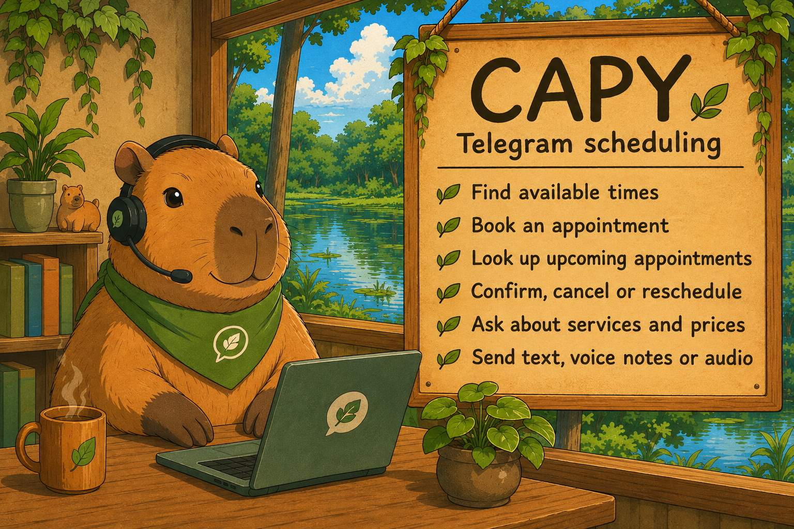
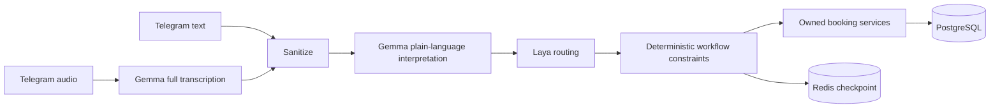

# CAPY — Telegram scheduling with text and audio

A portfolio scheduling assistant for service businesses. Gemma rewrites text or complete voice recordings into simple language; Laya receives that interpreted message and the conversation context, then proposes the next action. Deterministic Python services authorize changes, calculate availability and commit bookings in PostgreSQL.

<p align="center"></p>

Customers can search, choose a slot, book, look up appointments, confirm, cancel and reschedule in private Telegram chats. Numeric Telegram identity owns the customer's bookings. A phone number is optional contact information; providing someone else's number grants no access.

## Run the application

Requirements: Docker Compose, a Telegram bot, compatible running Gemma `/understand` and Laya `/decide` endpoints. Model servers and weights are not bundled. Set `TELEGRAM_BOT_TOKEN`, `GEMMA_BASE_URL` and `LAYA_BASE_URL` in your environment or a private `.env` using `.env.example`.

The endpoints must implement the current [model contracts](docs/model-contracts.md): Gemma returns a plain-language `message` and booking facts without an intent label; Laya accepts only `message` and `context`. Older intent/request-based servers must be updated alongside the app.

```bash
docker compose --profile telegram up --build
```

Compose starts PostgreSQL, Redis, a health API, the reminder worker and Telegram polling. It migrates the schema and seeds a synthetic studio. Open `/health` at `http://localhost:8000/health`. Customer HTTP/chat and owner HTTP routes have been retired.

The app requires Gemma and Laya. A failed model request produces a retry response and makes no booking change. Deterministic providers are explicit evaluation baselines. To inspect the owner agenda and demo reminder inbox locally:

```bash
docker compose run --rm api python -m app.cli
```

Reminders currently deliver into a database demo inbox, not Telegram. Telegram supports both voice notes and audio attachments. A recording is fully transcribed before one scheduling turn; a failed chunk prevents that turn. Size, decode, chunk and total processing budgets are configurable.

## Flow and guarantees



Availability results are references, not reservations. Booking writes revalidate policy inside their transaction. PostgreSQL rejects overlapping active bookings; idempotency protects retries. Booking and reminder changes commit atomically. Redis holds a bounded, temporary conversation draft, offered slots and history. Telegram receipts preserve update deduplication and saved replies across restarts.

## Evaluate with and without Laya

```bash
uv sync --locked --extra dev
# Offline text/task regression baseline:
uv run python -m app.evals.runner --understanding deterministic --routing deterministic
# Real text and speech through Gemma, then Laya:
uv run python -m app.evals.runner --dataset evals/data/smoke.jsonl --understanding gemma --routing laya
# Same cases through Gemma with deterministic routing:
uv run python -m app.evals.runner --dataset evals/data/smoke.jsonl --understanding gemma --routing deterministic
```

Use `--gemma-revision` and `--laya-revision` to identify checkpoints. Reports include dataset/asset hashes, predictions, errors, per-stage latency and language/modality summaries. Failed cases cause a nonzero exit. `--layer extraction`, `--layer routing` and `--layer workflow` isolate different questions; fixed-input routing uses each turn's labelled `interpreted_message` and draft context without invoking Gemma.

The seed corpus has 16 English/Portuguese text task cases and two synthetic speech cases. It is a regression corpus, not proof of general model quality. The next research step is a much larger grouped train/dev/test dataset, followed by Gemma and Laya fine-tuning and held-out comparisons. See [evaluation](docs/evaluation.md).

## Verify

```bash
# Disposable PostgreSQL and Redis; does not use application data volumes:
docker compose -p capy-simplification-test -f docker-compose.test.yml run --build --rm checks
# Remove the disposable containers when finished:
docker compose -p capy-simplification-test -f docker-compose.test.yml down
```

For host tests, provide a disposable PostgreSQL `TEST_DATABASE_URL` ending in `_test` and `TEST_REDIS_URL`, then run `uv run --extra dev pytest -q`. Without those variables, integration tests skip. CI sets them and requires integration checks. ffmpeg is required for audio tests.

Optional self-hosted Langfuse:

```bash
docker compose -f docker-compose.yml -f docker-compose.observability.yml --profile telegram up --build
```

Set `TRACING_ENABLED=true` when configuring tracing. Observability services have separate storage from business data.

## Migration and current limits

Existing databases need a coordinated cutover: stop old workers, back up PostgreSQL, then upgrade with the new application. Migration `0003_telegram_ownership` preserves bookings and verified identity links while retiring token columns. Legacy customers without a trusted link remain owner-visible. It never claims them by phone. Reverting token removal requires restoring the matching backup and application. The message/context model contract starts temporary conversations fresh under checkpoint namespace `lg:v3`; business records are unchanged.

Real Telegram journeys and Gemma/Laya model quality are not yet validated by this cleanup's automated tests. A live walkthrough requires available model endpoints and an explicitly authorized test chat. Existing running demo containers are not automatically upgraded by the code changes.

Read [architecture](docs/architecture.md), [privacy and ownership](docs/security.md), [idempotency](docs/idempotency.md), [history](docs/history.md) and the [approved plan](docs/sdd/plan-portfolio-simplification.md).

Start with [How to read the code](docs/architecture.md#how-to-read-the-code) for a walkthrough from one Telegram message to a booking transaction and its evaluation.
