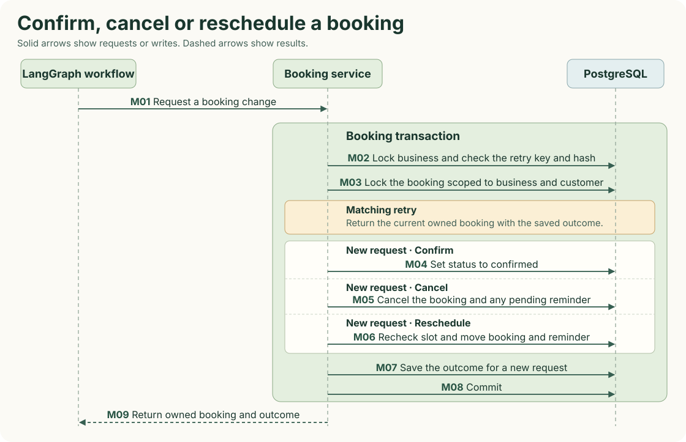

# Architecture

Telegram is the customer interface. Separate services receive updates, process conversations and deliver replies. PostgreSQL keeps business records and pending work. RabbitMQ signals that work is ready. Redis holds the conversation state used by the graph.

The graph's `understand_input` node waits for a complete transcript so a correction at the end of a recording can affect the next action. The audio chunker splits decoded speech near pauses and enforces size and time limits. The node redacts recognizable sensitive data from text and transcripts, then asks Gemma for a plain-language interpretation and booking facts. Laya receives the interpreted message and the draft context. It proposes an action, which Python checks against required facts, valid references and booking authorization. A new booking uses three turns: search, select and request consent, then approve and create. Selecting alone never writes a booking. The app loads Gemma and Laya through the same constructors used by evaluations. [Runtime](../app/runtime.py#L33) · [Graph flow](graph.md) · [Model contracts](model-contracts.md)

The workflow passes raw input through invocation context in memory. Redis stores draft details, offered slots and bounded sanitized history. Private booking results stay in request-scoped scheduling actions. Each turn loads its business catalog once and shares it across transcription, local date calculation and the graph. [Workflow](../app/graph/workflow.py#L13) · [Data handling](security.md)

`SchedulingActions` defines the operations the graph can request. `CustomerSchedulingActions` implements that contract for the trusted business and customer identity. Evaluation fixtures implement the same contract with simulated booking writes. The booking service checks ownership and current policy inside transactions. The availability service handles local time, service assignment, notice, horizon, buffers and conflicts. The business-row lock serializes writes per business for a simple idempotency boundary. PostgreSQL's exclusion constraint independently prevents overlapping bookings. [Actions](../app/graph/actions.py) · [Booking service](../app/booking.py) · [Availability service](../app/scheduling.py)

The local reminder worker saves due reminders without a Telegram destination to a demo inbox in PostgreSQL. The owner CLI shows upcoming bookings and recent inbox messages. Reminders with a Telegram destination go through the shared outbox. [Database and reminders](database.md) · [Owner CLI](../app/cli.py#L12)

The YAML scenario evaluations run sequential turns inside each conversation and run independent case repetitions concurrently. Their scheduling writes are simulated; PostgreSQL and Redis integration tests cover real persistence. [Evaluation framework](evaluation-framework.md) · [Existing JSONL evaluation guide](evaluation.md) · [Source map](source-map.md) · [Project history](history.md)

## How the Telegram worker works

Follow one message through the webhook, RabbitMQ, the conversation worker and the sender, with Python excerpts and the numbered sequence diagram. [Telegram worker guide](telegram-worker.md)

## How to read the code

Start with the customer asking for available times, choosing “1,” then approving the exact appointment. The offline YAML case supplies deterministic model outputs and checks that selection makes no writes and approval creates one booking matching the offered slot. [Golden case](../evals/scenarios/golden.yaml) · [Run the example](../README.md#run-the-offline-example)

1. **Find and offer times.** Gemma interprets the request, Laya proposes an availability search and Python applies schedule rules. The customer chooses from the numbered choices stored in the graph checkpoint. [Understand input](../app/graph/steps.py#L111) · [Choose an action](../app/graph/steps.py#L266) · [Offer slots](../app/graph/steps.py#L698)
2. **Ask before writing.** `select` resolves “1” to the first saved offer. `_prepare_create` stores that slot as `confirmation_requested_for` and returns a localized question. This turn makes no booking write. [Selection](../app/graph/steps.py#L733) · [Create preparation](../app/graph/steps.py#L853) · [Consent question](../app/graph/booking_messages.py#L44)
3. **Create only after approval.** On the next turn, `route_turn` resolves pending consent before any other booking action can change the draft. Python requires the latest user message to clearly approve, Laya to propose `BOOK`, and the selected slot to remain in state. `execute` checks the marker and message again, then returns details from the saved booking. [Consent guard](../app/graph/steps.py#L341) · [Create check and write](../app/graph/steps.py#L934) · [Reply formatter](../app/graph/booking_messages.py#L72) · [Booking transaction](../app/booking.py#L152)

| Question | Executable example |
| --- | --- |
| What can Laya see? | The unit test captures the outgoing model request and verifies that it contains only the interpreted message and context. It uses a stubbed HTTP response. [Laya contract test](../tests/unit/test_gemma_laya.py#L59) |
| What can the customer do after booking? | The journey uses real PostgreSQL services to confirm, deliver the demo reminder, reschedule, and cancel. [Booking journey test](../tests/integration/test_workflow_booking_journey.py#L17) |
| Can two retries create two appointments? | The test runs concurrent booking writes against PostgreSQL and checks replay and overlap protection. [Concurrent booking test](../tests/integration/test_postgres_booking_lifecycle.py#L256) |

## Booking sequence diagrams

### Find a time and create a booking

Follow “Book a relaxation massage tomorrow,” then “1.” Read the arrows from top to bottom and use each label to find its explanation below. The worker guide details how the Telegram steps reach each service. [Telegram sequence](telegram-worker.md#full-call-sequence)

#### Find a time

| Call | What happens and why | Source |
| --- | --- | --- |
| **C01** | The customer asks for times in a private Telegram chat. Telegram sends the message to the bot’s configured webhook. | [Webhook](../app/main.py#L77) |
| **C02** | CAPY records the incoming update. The conversation worker uses the Telegram user ID to find the customer's account. | [Worker guide](telegram-worker.md#start-reading-the-code) |
| **C03** | The graph uses the customer's text or complete transcript. It redacts the text, asks Gemma to interpret it and gives Laya the interpreted message and draft. Python checks the details required to proceed. | [`understand_input()` · L111](../app/graph/steps.py#L111) · [`route_turn()` · L266](../app/graph/steps.py#L266) |
| **C04** | The workflow requests slots for the selected service and date, applying any staff or earliest-time preference. This narrows the search to choices that address the customer’s request. | [`search()` · L698](../app/graph/steps.py#L698) · [`CustomerSchedulingActions.search()` · L49](../app/customer_scheduling_actions.py#L49) |
| **C05** | The availability service reads working hours, blocked periods and active bookings for eligible staff. These records supply the current schedule for conflict checks. | [`scheduling_data()` · L123](../app/repositories.py#L123) |
| **C06** | The service returns slots that fit working hours, duration, setup and cleanup buffers, and the business’s notice and booking horizon rules. The slots represent current availability, which may change before the booking is written. | [`AvailabilityService.search()` · L190](../app/scheduling.py#L190) |
| **C07** | The workflow formats the slots as numbered choices and saves the offered slots in the Redis checkpoint. This lets the following turn resolve a reply such as “1” to the exact time it offered. | [`_slot_message()` · L34](../app/chat_helpers.py#L34) · [Offered slots · L715–729](../app/graph/steps.py#L715-L729) · [Redis checkpoint setup · L72](../app/runtime.py#L72) |
| **C08** | The worker saves the offer reply for delivery. | [Finish the turn](../app/channels/telegram_turns.py#L384) |
| **C09** | The sender delivers the offered times through the originating bot. | [Sender](../app/channels/telegram_delivery.py#L350) |

#### Select a time and ask for consent

| Call | What happens and why | Source |
| --- | --- | --- |
| **C10** | The customer chooses one of the numbered time options. This is a selection only; it does not authorize a booking. | [Webhook](../app/main.py#L77) |
| **C11** | CAPY records the new update and claims the chat turn. The worker resumes the checkpoint created by the search turn. | [Worker guide](telegram-worker.md#start-reading-the-code) |
| **C12** | `select` matches the number to the saved offered-slot list. The selected slot ID is carried into create preparation so the next message refers to this exact offer. | [Workflow](../app/graph/workflow.py) · [Selection](../app/graph/steps.py#L733) |
| **C13** | `_prepare_create` stores the selected slot as pending consent and returns the service, professional, date, time and timezone question. It does not call the booking service. | [`_prepare_create()` · L853](../app/graph/steps.py#L853) · [Question formatter · L44](../app/graph/booking_messages.py#L44) |
| **C14** | The worker saves the consent question as its reply to this Telegram update. The selected offer remains in checkpoint state for the next turn. | [Finish the turn](../app/channels/telegram_turns.py#L384) |
| **C15** | The sender delivers the question. The customer can approve or decline before an appointment row exists. | [Outbound sender](../app/channels/telegram_delivery.py#L350) |

#### Approve and create the booking

| Call | What happens and why | Source |
| --- | --- | --- |
| **C16** | The customer explicitly approves the appointment shown by CAPY. This input arrives after the consent question. | [Webhook](../app/main.py#L77) |
| **C17** | CAPY records and claims the approval update. The worker resumes the same conversation checkpoint so Python can compare the reply with the pending slot ID. | [Worker guide](telegram-worker.md#start-reading-the-code) |
| **C18** | The graph interprets the latest message and asks Laya for a route. `route_turn` handles pending consent before allowing another booking operation to change the draft. | [`route_turn()` · L266](../app/graph/steps.py#L266) |
| **C19** | Python checks the exact consent phrase, Laya's `BOOK` proposal, confidence and pending slot. A clear matching approval can proceed; an unclear reply or changed time makes no booking mutation. | [`_route_booking_consent()` · L341](../app/graph/steps.py#L341) · [Consent phrases](../app/graph/consent.py#L49) |
| **C20** | The booking service locks the business and checks the stable update key against the request hash. A matching retry can return the prior result after a committed write; a different request reusing the key is rejected. | [Update key · L157](../app/telegram_worker.py#L157) · [`_hash_booking_request()` · L36](../app/booking.py#L36) · [`_lock_business_and_check_retry()` · L90](../app/booking.py#L90) |
| **C21** | The service rechecks the slot because availability may have changed since it was offered. It also verifies that the Telegram customer's account belongs to this business. | [`validate_slot_in_transaction()` · L43](../app/scheduling.py#L43) · [`_require_customer_in_business()` · L246](../app/booking.py#L246) |
| **C22** | The transaction inserts the booking, pending reminder and retry result. The reminder is due later; PostgreSQL's overlap constraint protects the professional's occupied time. | [`_insert_scheduled_booking()` · L256](../app/booking.py#L256) · [`_queue_booking_reminder()` · L298](../app/booking.py#L298) · [`_save_retry_result()` · L129](../app/booking.py#L129) · [Overlap constraint · L101–105](../alembic/versions/0001_general_scheduling.py#L101-L105) |
| **C23** | The database session commits these related writes together. A failure rolls them back so a reminder or successful retry result cannot exist without the booking. | [`create()` · L152](../app/booking.py#L152) · [`database_session()` · L45](../app/database.py#L45) |
| **C24** | The service returns the saved booking after the transaction exits. This is the persisted result the workflow will report. | [Read and return booking](../app/booking.py#L210) |
| **C25** | The formatter resolves names from the business catalog and converts the saved start time to the business timezone. The success message therefore reports the data the database stored. | [`booking_created_reply()` · L72](../app/graph/booking_messages.py#L72) · [`booking_details()` · L14](../app/graph/booking_messages.py#L14) |
| **C26** | The worker saves the success reply after the create transaction commits. | [Finish the turn](../app/channels/telegram_turns.py#L384) |
| **C27** | The sender delivers the saved booking details to the customer. | [Outbound sender](../app/channels/telegram_delivery.py#L350) |

### Confirm, cancel or reschedule

This diagram starts when the workflow has identified the appointment and, for a move, the replacement slot. The same Telegram intake and reply steps apply.

| Call | What happens and why | Source |
| --- | --- | --- |
| **M01** | The workflow asks for clarification until it can identify the appointment and any required replacement slot. It then passes the requested operation, trusted customer account and stable update key to the service. The service can verify the target against database ownership. | [`prepare_action()` · L771](../app/graph/steps.py#L771) · [`_prepare_reschedule()` · L792](../app/graph/steps.py#L792) · [`_prepare_booking_status_change()` · L897](../app/graph/steps.py#L897) · [`execute()` · L928](../app/graph/steps.py#L928) |
| **M02** | The service locks the business before comparing the retry key and request hash. This gives competing attempts a single order and lets the service reject a key reused for different details. | [`_lock_business_and_check_retry()` · L90](../app/booking.py#L90) |
| **M03** | The service loads and locks a booking matching all three IDs. The lock holds the state steady through the write. A matching retry returns the current owned booking with its saved outcome. A new change must meet the appointment start-time cutoff. | [`_load_customer_booking()` · L62](../app/booking.py#L62) · [Replay and cutoff · L374](../app/booking.py#L374) · [`_require_upcoming_booking()` · L412](../app/booking.py#L412) |
| **M04** | Confirmation records the customer’s acceptance and keeps the scheduled reminder. It preserves an already confirmed status and rejects confirmation of a canceled booking. | [`confirm()` · L329](../app/booking.py#L329) · [`_write_booking_status()` · L419](../app/booking.py#L419) |
| **M05** | Cancellation frees the occupied time and marks pending reminders canceled so the worker will skip them. Both changes belong to the same transaction so they take effect together. | [`cancel()` · L341](../app/booking.py#L341) · [Status and reminder updates · L441](../app/booking.py#L441) |
| **M06** | Rescheduling validates the new slot while excluding the booking’s old interval so it can move into an otherwise free time that overlaps part of its original time. It keeps the booking ID and retimes or queues the reminder to match the new appointment. A failed move preserves both original records. | [`reschedule()` · L456](../app/booking.py#L456) · [`_revalidate_booking_slot()` · L225](../app/booking.py#L225) · [`_update_booking_slot()` · L525](../app/booking.py#L525) · [`_move_booking_reminder()` · L542](../app/booking.py#L542) |
| **M07** | Save the outcome for a new request in the write transaction. This lets a later retry report the saved outcome without repeating the change. | [`_save_retry_result()` · L129](../app/booking.py#L129) |
| **M08** | Commit the booking change, any reminder change and retry record together. This keeps the appointment state and the reported outcome in sync after a successful write or a rollback. | [`database_session()` · L45](../app/database.py#L45) · [Reschedule rollback test · L126](../tests/integration/test_postgres_booking_lifecycle.py#L126) |
| **M09** | The service returns the owned booking and outcome. The workflow uses the outcome to tell the customer whether the change succeeded or, where applicable, had already taken effect. | [Status outcome · L384](../app/booking.py#L384) · [Workflow replies · L970–1005](../app/graph/steps.py#L970-L1005) |

### Deliver an appointment reminder

A booking writes its reminder schedule in the same transaction. A cancellation invalidates pending work and a reschedule advances the reminder generation. Hosted reminder scheduling queues a due generation once. The sender checks that the generation and Telegram identity still match before authorizing a send. [Booking service](../app/booking.py) · [Reminder scheduler](../app/reminders.py) · [Sender](../app/channels/telegram_delivery.py)

The local demo still writes reminders to the owner inbox. The sequence diagram below describes this local path. [Owner CLI](../app/cli.py)

