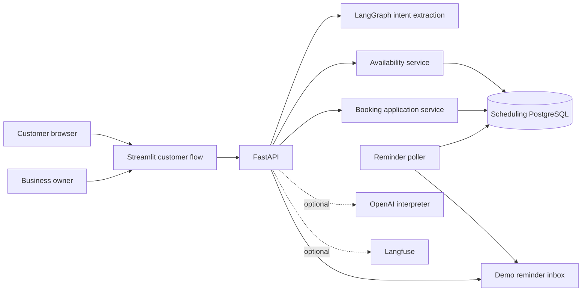

# Architecture

## Runtime components

The default local runtime uses the deterministic interpreter, so the product can be explored without model credentials. OpenAI is an optional interpretation adapter. PostgreSQL stores business configuration, schedules, customers, bookings, reminder state, idempotency records, audit events, and the demo inbox.

## Request boundaries

1. FastAPI validates transport input and, for management actions, validates the capability token before acting.
2. LangGraph extracts a typed scheduling intent from the sanitized current message. Its checkpoint contains no raw management token.
3. Application code resolves service and date references, calls the deterministic availability or booking service, and formats a response.
4. Booking writes recheck the slot in the same transaction, lock the selected professional, update reminder state atomically, and rely on a PostgreSQL exclusion constraint as the final overlap guard.
5. Logs and trace events record intent, counts, stable IDs, and outcomes without names, contact details, or tokens.

## Data model

- A **business** sets its IANA timezone, booking horizon, minimum notice, and reminder lead time.
- A **service** defines duration, before/after buffers, price, and currency.
- A **professional** has weekly local-time rules, blocked periods, and service assignments.
- A **customer** is scoped to a business and keyed by phone for the demo.
- A **booking** stores its real start/end and the occupied interval including buffers. Its status is scheduled, confirmed, or canceled.
- A **reminder** has a durable state and a unique pending reminder constraint per booking. A delivered reminder creates one demo inbox entry.
- **Idempotency records** are scoped by business, operation, and key, and store the canonical request hash.
- **Audit events** retain the operation and non-sensitive metadata.

All appointment instants are stored as timezone-aware PostgreSQL timestamps. Weekly schedules are interpreted in each business's IANA timezone. Availability uses a 15-minute candidate grid, respects configured work rules and buffer time, and returns repeated fall-back wall times with different offsets. Nonexistent spring-forward times are skipped.

## Persistence and runtime

`alembic/versions/0001_general_scheduling.py` owns schema creation, including `btree_gist` and the professional overlap exclusion constraint. The default Docker Compose stack has a separate `app-postgres` service; Langfuse's database is optional and isolated under the `observability` profile.

The API keeps short-lived chat session IDs and slot presentation results in memory for the local demo. Durable business and booking state lives in PostgreSQL. The reminder worker is a separate process that claims due rows with `FOR UPDATE SKIP LOCKED`, records inbox delivery once, and never imports or calls LangGraph.

## Deliberate limits

This release uses one configured demo business, local owner access without authentication, and a simulated reminder inbox. It has no live messaging, external calendar sync, payment handling, onboarding, multi-location routing, distributed queue, or production deployment configuration.
