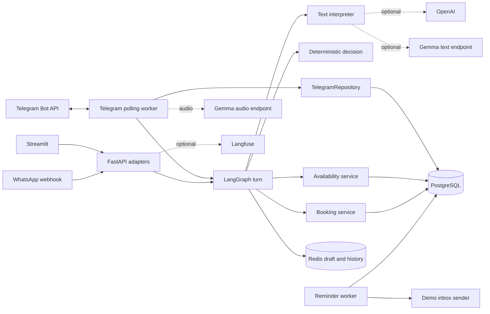
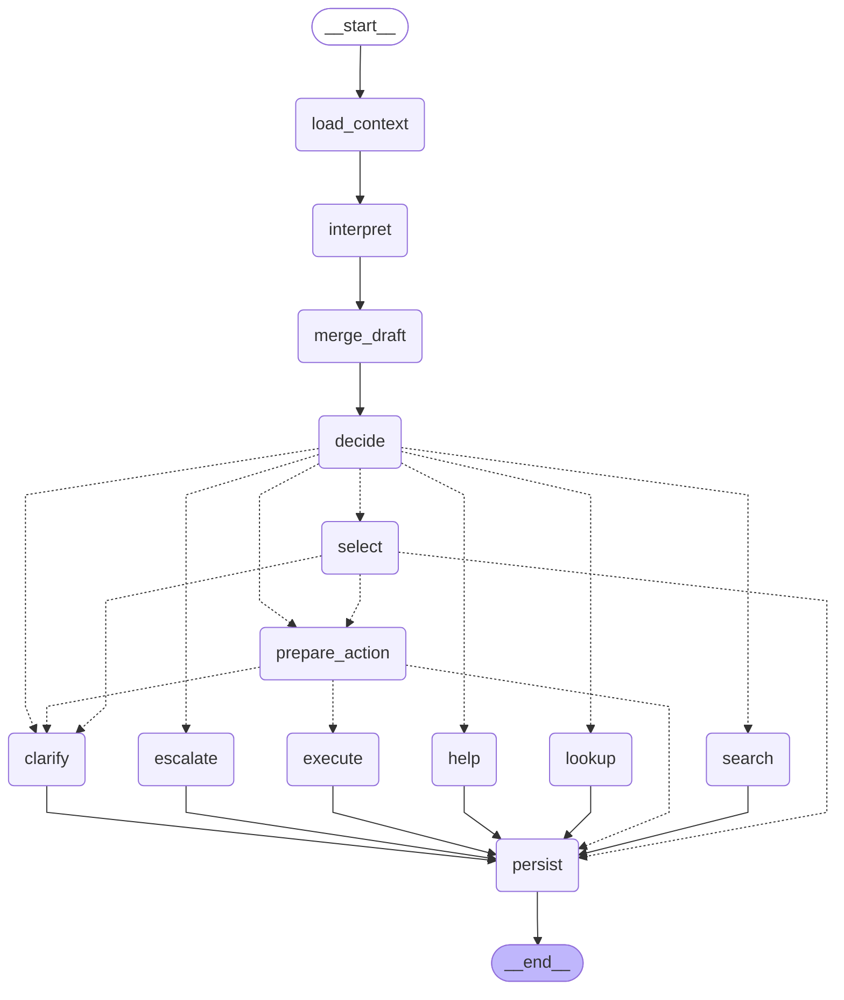
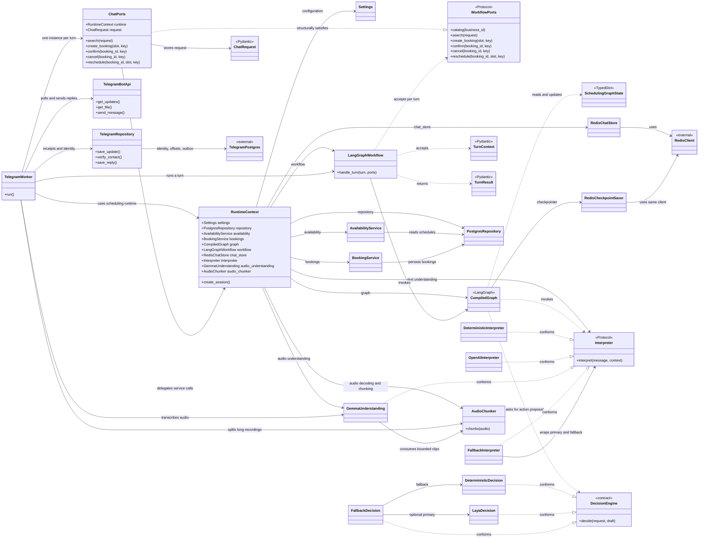
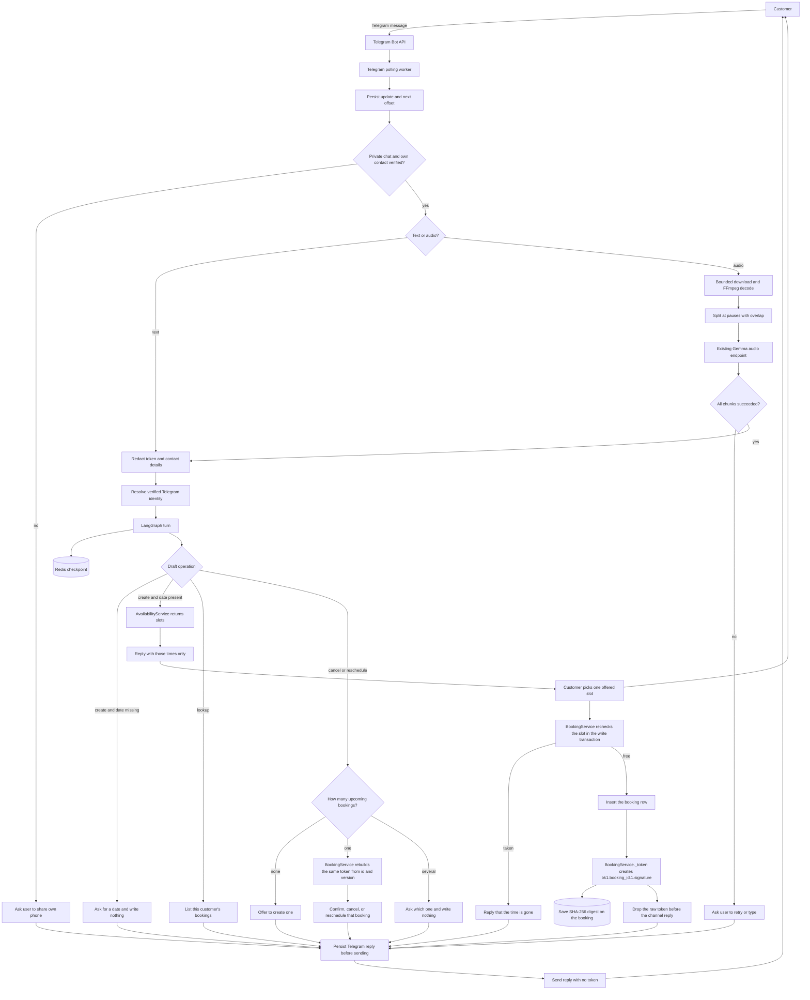
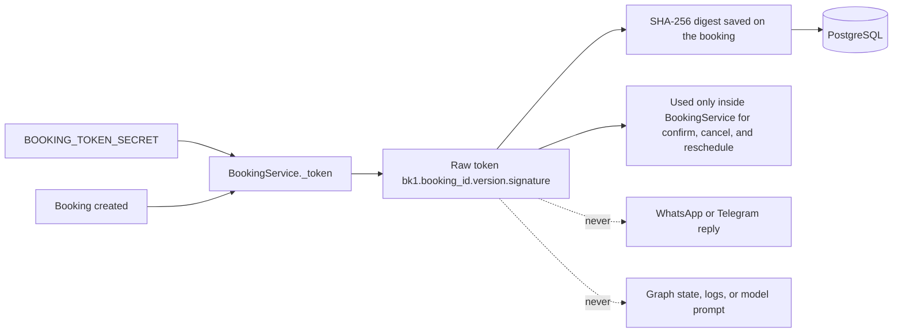

# Architecture

This note describes the code that runs today. The target product shape is in `docs/Service Scheduling Agent — Architecture.md`. Where the two differ, this file is the one to trust for reading the repository.

## What runs

PostgreSQL is appointment truth. Redis is short-lived conversation state. The model never decides that a slot is free and never writes a booking.

## Where a chat message goes

1. `POST /chat` in `app/main.py` validates the HTTP request and calls `handle_chat` in `app/chat_adapter.py`.
2. The adapter checks the session, redacts a token pasted into the message, and, if a management token was sent separately, resolves it to a `booking_id`. The raw token does not enter graph state.
3. `LangGraphWorkflow.handle_turn` runs the graph in `app/graph/builder.py`.
4. The graph loads the draft, interprets the text, merges fields, asks the decision port for a next action, and then constrains that action.
5. A domain port is called only from the `execute` node. Availability and booking rules stay in `app/scheduling.py` and `app/booking.py`.
6. The draft and offered slots are saved. The adapter maps the result back to `ChatResponse`.

### Telegram polling path

1. `TelegramWorker` calls `getUpdates`, writes each update receipt and the next polling offset in one PostgreSQL transaction, then handles the saved receipt.
2. It accepts private chats and requires a Telegram self-contact whose `contact.user_id` matches `message.from.id`. That verified phone can link an existing customer. A typed or spoken phone does not establish ownership.
3. Text goes through the configured text interpreter. Voice notes and audio attachments are downloaded within the hosted Bot API limit, decoded by FFmpeg, split at pauses where possible, and sent to the existing Gemma audio endpoint.
4. The worker waits for every audio chunk, joins the transcript, redacts contact details, and sends one normalized request through `LangGraphWorkflow` with a fresh `ChatPorts` instance.
5. It saves the final reply before sending it. If the process is interrupted during a turn, it asks the customer to check their appointments instead of running that business action again.

The Telegram worker and its media path are implemented but have not been started or verified against a live bot or Gemma server.

The direct endpoints `POST /availability/search` and `POST /bookings` do not enter the graph. The Streamlit forms use them. Web and messaging channels share the graph, while the direct endpoints remain available.

## Compiled conversation graph

Generated from `app/graph/builder.py` by `python scripts/generate_graph_diagram.py`. Solid arrows always run. Dotted arrows are choices made by the draft.

<!-- compiled-graph:start -->

<!-- compiled-graph:end -->

## Core class relationships

This diagram shows the main runtime and conversation classes. The compiled graph is built with an interpreter and a decision engine; its node flow is shown above. Dashed arrows show structural conformance to an interface or contract; explicit inheritance is not required.

`CompiledGraph`, `RedisClient`, and `TelegramPostgres` are labels for external runtime objects, not classes declared in this repository. `RuntimeContext.graph` and `LangGraphWorkflow.graph` refer to the same compiled graph. The diagram focuses on the core request path, Telegram orchestration, and provider seams; API DTOs and PostgreSQL entities are not listed individually.

## Who owns what

| Code | Owns | Does not own |
|---|---|---|
| `app/main.py` | HTTP routes, owner-token check, webhook entry | Which conversation step runs |
| `app/chat_adapter.py` | Web chat translation, token resolution, ports for this request | Booking SQL |
| `app/telegram_worker.py` | Telegram polling, self-contact verification, text/audio routing, per-user session orchestration | Booking policy or calendar availability |
| `app/channels/telegram.py` | Telegram Bot API calls, bounded file download, safe transport errors | Customer ownership or scheduling policy |
| `app/channels/telegram_repository.py` | Telegram identity links, durable update offsets/receipts, and reply retries | Booking records |
| `app/channels/audio_chunks.py` | Bounded FFmpeg decoding, pause-aware cuts, and chunk cleanup | Speech interpretation or booking intent |
| `app/llm/` | Extract intent, service, date, and time from text; Gemma transcribes audio | Choosing a graph node or claiming a slot is free |
| `app/graph/decision.py` | Propose `BOOK`, `RESCHEDULE`, `CANCEL`, `CHECK_AVAILABILITY`, `FAQ`, `CONFIRM`, `ESCALATE`, or `LOOKUP_BOOKING` | Forcing a transition the workflow does not allow |
| `app/graph/steps.py` | Draft merge, clarification, search, selection, FAQ, lookup, escalation, and the execute call | Overlap policy and token generation |
| `app/scheduling.py` | Which times are valid | Conversation copy |
| `app/booking.py` | Create, confirm, cancel, reschedule, idempotency, audit, token digest | Reading the customer's sentence |
| `app/channels/whatsapp.py` | Signature check, sender mapping, dedupe, same workflow call | A second copy of the booking flow |
| `app/telegram_worker.py` | Telegram self-contact links the numeric user ID to the verified phone/customer | Trusting a username or a phone typed in chat |
| `app/reminders.py` | Claim due reminders and send through a sender port | LangGraph |

## Conversation rules that matter

The draft remembers the operation: `create`, `reschedule`, `confirm`, `cancel`, or `none`. It also remembers the service, date, offered slot ids, and the missing field.

A management token authorizes the web caller. A verified WhatsApp sender or Telegram self-contact authorizes the linked customer. Neither one changes the operation. Saying "book another" while a token is present creates a booking. Saying "move it" is what starts a reschedule.

If the bot asked for a date and the reply contains a date, the draft continues even when the interpreter returns `unknown`. An invalid date asks again and writes nothing.

"When is my appointment?" uses the verified customer and PostgreSQL. A phone number typed or spoken in a message is not proof of identity. Telegram requires sharing the account's own contact; the numeric Telegram user ID is the durable channel key, and the username is optional display metadata. On the web demo, the page holds the management token and sends it outside the chat text.

## State

| State | Where | Lifetime |
|---|---|---|
| Services, hours, bookings, reminders, audit | PostgreSQL | Durable |
| Scheduling draft, offered slots, and redacted messages | LangGraph checkpoint in Redis, keyed by the session id | `SESSION_TTL_MINUTES` |
| Request-scoped customer details and raw token | `ChatPorts` object | One turn |
| Telegram identity, verified phone, and optional username | PostgreSQL `telegram_identities` | Durable |
| Telegram update receipt and polling offset | PostgreSQL `telegram_updates` and `telegram_poll_offsets` | Delivered receipts: 30 days; active receipts until completion |
| Telegram reply waiting for delivery | PostgreSQL `telegram_updates.reply_text` | Until successfully sent |

Restarting the API does not delete a booking. It can drop an in-progress Redis draft after the TTL. The web demo can still manage the booking with the saved token.

## Messaging channels

The customer channels are WhatsApp and Telegram. Streamlit is only a local demo surface. A customer authorizes themself by messaging from a verified account. They do not paste a token into the chat.

Telegram uses an optional polling worker and calls the same graph as the web adapter. It accepts text, voice notes, and audio uploads. The worker requires verified phone sharing and does not deliver the booking management token. The WhatsApp webhook handles inbound text but has no live Meta send integration.

`BookingService` creates the booking token. The graph and the channel do not. It happens only after the customer picks an offered slot and the create write is allowed. The service signs `booking-manage:v1:{booking_id}:1` with `BOOKING_TOKEN_SECRET`, saves the SHA-256 digest on the new booking row, and keeps the raw token out of the reply.

The diagram shows Telegram's implemented polling path and the shared scheduling graph. The WhatsApp webhook still handles inbound text separately and has no live Meta send.

## Tokens the application creates

A booking still gets a management token. The chat does not show it. The token is an internal capability for that booking, not the customer's login.

| Token | Created when | Who sees it | What it authorizes |
|---|---|---|---|
| Booking management token | Every successful `BookingService.create`, and again on an idempotent replay of that create | No customer. The service rebuilds it from the booking id, version, and `BOOKING_TOKEN_SECRET` when a verified sender changes that booking. | One booking. Stored as a digest. |
| Idempotency key | One per create, confirm, cancel, or reschedule call | The channel adapter, not the customer | Replaying the same write does not create a second booking |
| Conversation id | First message from a sender on a channel | Nobody. It is a hash of business, channel, and sender. | Redis checkpoint for that thread |
| Provider message id | Assigned by WhatsApp or Telegram | Stored by the channel adapter | Deduplicate webhook messages and Telegram polling updates |
| Webhook verify token | Configured in `WHATSAPP_VERIFY_TOKEN`, not created per user | Meta during webhook setup | Proves this server owns the callback URL |
| App secret | Configured in `WHATSAPP_APP_SECRET` | Nobody. It checks `X-Hub-Signature-256`. | Proves the webhook body came from Meta |
| Owner token | Configured in `OWNER_API_TOKEN` | The business owner, on owner routes only | Read the agenda and change reminder settings |

`BOOKING_TOKEN_SECRET` is not a customer token. It is the signing key. Rotating it invalidates every management token already issued. The booking rows remain. A verified WhatsApp or Telegram sender can still manage their own booking because the service checks `customer_id` before it rebuilds the internal token.

## What is not built

WhatsApp signature verification and inbound text handling exist, but there is no live Meta send. Telegram polling, identity persistence, voice chunking, and safe reply delivery are implemented in the working tree; they have not been validated against a live bot, database migration, or Gemma audio server. Gemma and Laya call configured local servers; model weights are not bundled here. Reminders still land in the demo inbox unless a different sender is injected. Owner routes stay open unless `OWNER_API_TOKEN` is set. There is no calendar, payment, location, or deposit adapter.
