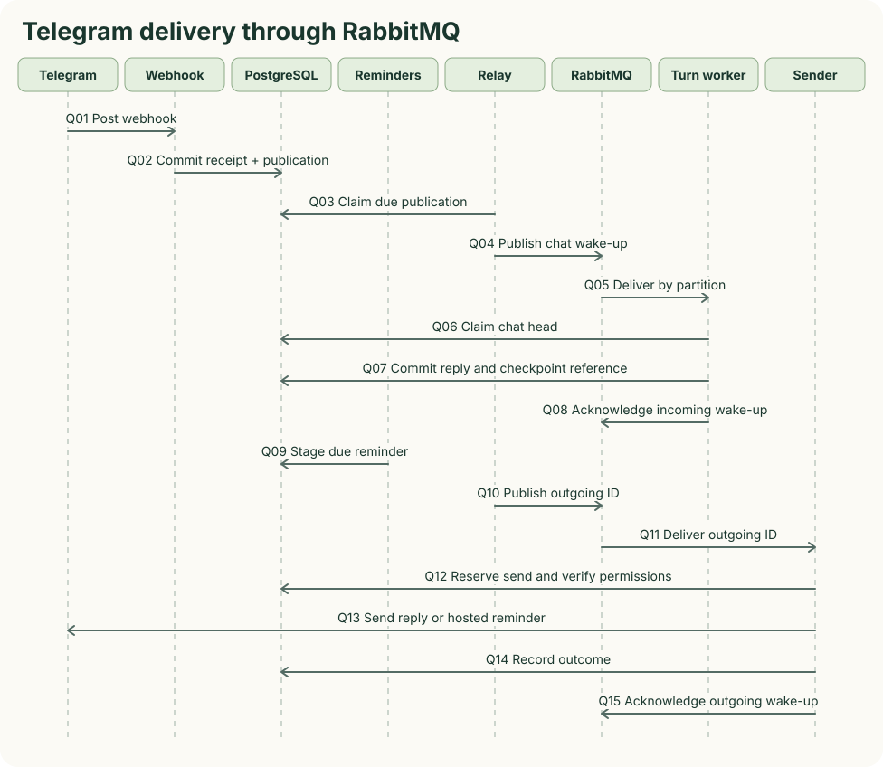
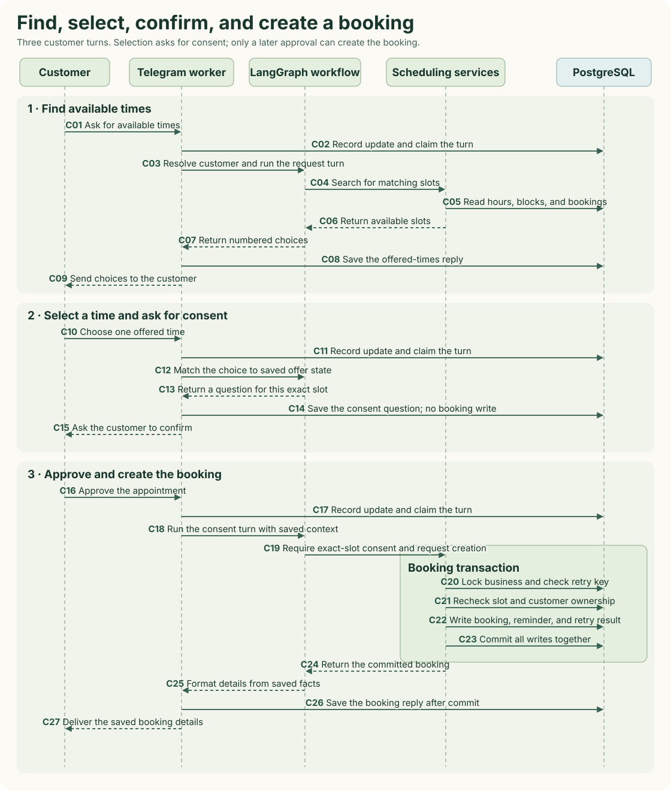
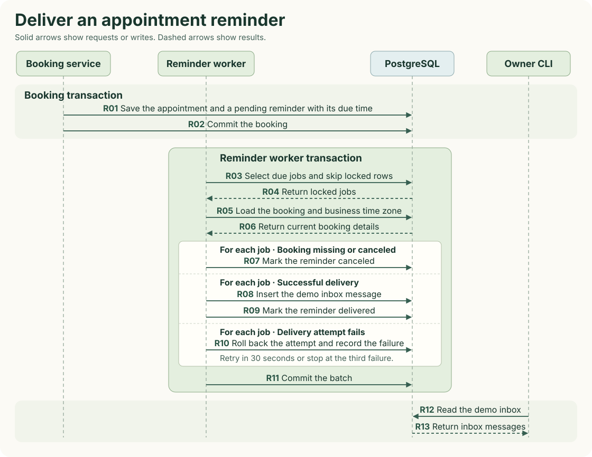

# Architecture


Telegram is the customer interface. Intake saves messages and publication records to PostgreSQL. The relay publishes wake-ups through RabbitMQ. A conversation worker resolves the private-chat sender and runs the scheduling workflow. A sender delivers the saved reply. The diagram above focuses on the model and booking flow.

`app/llm/gemma.py` rewrites a message in simple language and extracts booking facts for Python, without assigning an intent or next action. It also transcribes full recordings. `app/channels/audio_chunks.py` splits decoded audio near pauses with overlap and enforces size/time budgets. No chunk can execute a booking. The completed transcript enters the same interpreter as typed text.

`app/runtime.py` constructs Gemma and Laya directly through the same provider constructors used by evaluations. The normal app rejects deterministic overrides. Provider errors propagate to a safe retry response before writes. `app/graph/laya.py` sends only Gemma's interpreted `message` and draft `context` to Laya. Laya proposes the action; Python enforces required facts, valid references and booking authorization. External servers must follow the [model contracts](model-contracts.md).

`app/graph/workflow.py` invokes one graph turn at a time per conversation. Redis stores draft details, offered slots and at most 24 history messages. Each worker writes to a private checkpoint thread. PostgreSQL publishes the thread reference only when that worker completes the claimed turn. Private booking results stay in request-scoped `CustomerSchedulingActions`, outside checkpoints.

`app/graph/actions.py` defines `SchedulingActions`, the protocol for operations the workflow may request. `CustomerSchedulingActions` in `app/customer_scheduling_actions.py` implements that contract for the trusted business/customer identity and calls deterministic services. Evaluation fixtures implement the same contract without real booking writes. `app/booking.py` checks ownership and current policy inside transactions; `app/scheduling.py` handles local time, service assignment, notice, horizon, buffers and conflicts. PostgreSQL's exclusion constraint independently prevents overlaps. The business-row lock deliberately serializes writes per business for a simple idempotency boundary; this limits throughput and should be measured before changing.

`app/channels/telegram_repository.py` provisions Telegram identities. Phone data never chooses the customer record. Intake deduplicates each update by bot and update ID. A worker that recovers an interrupted turn asks the customer to check their appointments. The sender works from a saved reply without rerunning booking operations.

`app/reminders.py` keeps the local demo inbox and can enqueue hosted Telegram reminders in the shared outbox. `app/cli.py` exposes the owner agenda and demo inbox. `app/main.py` provides health and webhook intake. Only conversation workers load the full model and graph runtime.

See the [database guide](database.md) for table relationships and reminder delivery.

`app/evals/` runs the real workflow with synthetic service boundaries or isolates extraction/routing. It does not establish database correctness: PostgreSQL/Redis integration tests cover that separately. The local model server implements both inference contracts. Training is future work.

## How to read the code

Start with `process_turn()` and follow the reply “1.” The example conversation starts with “Book Massage,”
asks for a date, and offers times after “tomorrow.” The offline `en-booking` case supplies the model
outputs and checks that choosing “1” creates exactly one booking. [Worker](../app/telegram_service.py#L64) · [Offline case](../evals/data/smoke-text.jsonl#L1)

1. **Receive “1.”** The webhook saves the update in PostgreSQL. The worker claims the chat, verifies the sender, and loads the last saved conversation state. [Save the update](../app/channels/telegram_intake.py#L41) · [Claim the chat](../app/channels/telegram_turns.py#L108)
2. **Match the number to an offered time.** Gemma interprets the message and Laya proposes the next action. The workflow uses the conversation state from Redis to resolve “1” to the first offered time. [Interpret](../app/graph/steps.py#L83) · [Choose an action](../app/graph/steps.py#L184) · [Select the time](../app/graph/steps.py#L388)
3. **Write the booking.** The booking service checks the customer and whether the slot still fits the schedule. One SQLAlchemy session commits the booking, pending reminder and retry result together. [Execute the action](../app/graph/steps.py#L554) · [Create the booking](../app/booking.py#L152)
4. **Send the reply.** `finish()` marks the incoming turn complete, publishes its Redis state reference, and saves the reply in the outbound queue. The sender reads the saved reply and delivers it through the same bot. [Finish the turn](../app/channels/telegram_turns.py#L221) · [Send the reply](../app/channels/telegram_delivery.py#L350)

| Question | Executable example |
| --- | --- |
| What can Laya see? | The unit test captures the outgoing model request and verifies that it contains only the interpreted message and context. It uses a stubbed HTTP response. [Laya contract test](../tests/unit/test_gemma_laya.py#L59) |
| How does the next worker know what “1” means? | The test completes an offer and checks that the next attempt can load those choices from Redis. [Checkpoint test](../tests/integration/test_telegram_production.py#L161) |
| What can the customer do after booking? | The journey uses real PostgreSQL services to confirm, deliver the demo reminder, reschedule, and cancel. [Booking journey test](../tests/integration/test_workflow_booking_journey.py#L17) |
| Can two retries create two appointments? | The test runs concurrent booking writes against PostgreSQL and checks replay and overlap protection. [Concurrent booking test](../tests/integration/test_postgres_booking_lifecycle.py#L256) |

The README gives the [offline command](../README.md#run-the-offline-example). See the [evaluation guide](evaluation.md) for experiments that isolate Gemma, Laya and the full workflow. The [project history](history.md) records earlier designs and the [onboarding plan](sdd/plan-ai-portfolio-onboarding.md) records the implementation scope.

## Follow one booking in the debug logs

Run the offline example with debug logging. It uses a sample conversation and simulated
booking services, so you can follow the workflow without a Telegram bot or model server.

```bash
CAPY_LOG_LEVEL=DEBUG uv run --locked python -m app.evals.runner \
  --understanding deterministic --routing deterministic
```

The first example, `en-booking`, asks for a massage, supplies a date, and chooses
option 1. Find `eval.turn.started` with `number: 3`. Then read these events in order.

| Event | What happened |
| --- | --- |
| `workflow.route.selected` with `action: BOOK` and `route: select` | The router proposed booking and the workflow moved to the selection step. |
| `workflow.slot.matched` with `offered: 2` and `option_number: 1` | CAPY looked up option 1 in the two times it offered earlier. |
| `workflow.action.executing` with `operation: create` | The workflow asked the booking service to create the appointment. |
| `workflow.turn.completed` with `has_booking: True` | The turn finished and had a booking to report. |

For a local test bot, start CAPY with debug logging. Follow the normal
[Telegram demo setup](../README.md#try-the-telegram-voice-demo) first.

```bash
CAPY_LOG_LEVEL=DEBUG docker compose --profile telegram up -d --build
docker compose --profile telegram logs -f api telegram-worker telegram-sender
```

Find the `bot_id` and `update_id` in `telegram.inbox.recorded`. Use that pair to follow
the same message across the three services. Each customer message has its own update ID.

- `workflow.checkpoint.forked` shows whether Redis found the previous conversation state.
- `availability.slot.validated` shows that the slot passed the latest availability checks.
- `booking.saved` appears after PostgreSQL commits the booking and its reminder.
- `telegram.turn.saved` shows whether a reply was saved for the sender.
- `telegram.outbox.result` shows what the sender recorded. `sent` means Telegram accepted
  the reply. `ambiguous` means the sender could not tell whether Telegram accepted it.

The new debug events record stages, outcomes, counts, and the Telegram bot and update
IDs. They omit message and reply bodies, recordings, customer contact details,
and credentials. To return to normal logging, set `CAPY_LOG_LEVEL=INFO` and start
the services again.

## How the Telegram worker works



| Call | What runs and why |
| --- | --- |
| **Q01** | Telegram posts the update to the registered webhook. The webhook checks the bot route and secret. [Webhook](../app/main.py#L77) |
| **Q02** | The API commits the receipt and a publication record together. Telegram can repeat a webhook call, so the receipt key includes both bot and update ID. [Intake](../app/channels/telegram_intake.py#L41) |
| **Q03** | The relay reads a due publication and holds a short database lease on that publication record. [Relay storage](../app/channels/telegram_publications.py#L39) |
| **Q04** | The relay publishes the bot and chat IDs. It clears the PostgreSQL record after a broker confirmation. An interruption between confirmation and deletion can produce a duplicate wake-up. [Publishing](../app/channels/telegram_broker.py#L62) |
| **Q05** | RabbitMQ delivers the wake-up to one active worker for its partition. A partition is a queue for a fixed group of bot/chat pairs. Chats in other partitions can make progress during a slow voice turn. [Partition routing](../app/channels/telegram_broker.py#L27) |
| **Q06** | The worker selects the next turn for that chat and tries to reserve a business slot. Message date and update ID resolve ordering within the reorder window. A late message gets an offer-refresh reply. A blocked head gets a new wake-up. [Claim](../app/channels/telegram_turns.py#L108) |
| **Q07** | The worker commits the reply, checkpoint reference and next publications. [Finish](../app/channels/telegram_turns.py#L221) |
| **Q08** | After durable work succeeds, the worker acknowledges the broker delivery. RabbitMQ can redeliver a wake-up if the consumer disconnects before the acknowledgement. An expired attempt cannot change a booking or publish a checkpoint. [Acknowledgement](../app/channels/telegram_broker.py#L105) · [Write guard](../app/channels/telegram_turns.py#L74) |
| **Q09** | For the reminder path, the scheduler selects the current due generation and saves its outgoing job and publication together. [Hosted scheduling](../app/reminders.py#L71) |
| **Q10** | The same relay publishes the outgoing ID to a separate queue so inference cannot occupy sender capacity. [Outgoing route](../app/channels/telegram_broker.py#L62) |
| **Q11** | RabbitMQ delivers the ID to an available sender. Senders can run independently of the turn workers. [Sender loop](../app/telegram_service.py#L181) |
| **Q12** | The sender looks up the outgoing ID, checks chat ordering and limits, and checks whether the reminder generation still matches the booking. [Authorize delivery](../app/channels/telegram_delivery.py#L111) |
| **Q13** | The sender calls Telegram once for the reserved attempt. If Telegram may have accepted the message and its response is lost, the sender records an ambiguous outcome. [Send and classify](../app/channels/telegram_delivery.py#L350) |
| **Q14** | The sender records the outcome or a safe retry in PostgreSQL. [Finish dispatch](../app/channels/telegram_delivery.py#L260) |
| **Q15** | The sender acknowledges after the outcome or replacement wake-up is durable. A repeat wake-up observes the existing delivery status. [Acknowledgement](../app/channels/telegram_broker.py#L105) |

The worker renews its PostgreSQL **turn lease** during inference. The lease gives one attempt temporary ownership of the chat. Its generation identifies the attempt that may write a booking or update the checkpoint reference. A later worker can recover an expired lease and ask the customer to check their appointments. [Lease renewal](../app/telegram_service.py#L87) · [Recovery](idempotency.md) · [Deployment and cutover](production.md)

## Booking sequence diagrams

### Find a time and create a booking



Follow “Book a relaxation massage tomorrow,” then “1.” Read the arrows from top to bottom and use each label to find its explanation below.

#### Find a time

| Call | What happens and why | Source |
| --- | --- | --- |
| **C01** | The customer asks for times in a private Telegram chat. Telegram sends the message to the bot’s configured webhook. | [Webhook](../app/main.py#L77) |
| **C02** | The webhook commits the update receipt before returning success. A processing worker claims the chat, verifies the private sender, and resolves the linked customer for that bot and business. | [Receipt](../app/channels/telegram_intake.py) · [Claim](../app/channels/telegram_turns.py) · [Identity lookup](../app/channels/telegram_repository.py) |
| **C03** | The worker passes sanitized text and the trusted customer context into the workflow. Gemma extracts scheduling details, then Laya proposes the next action from the interpreted message and draft. Python checks the details required to proceed so missing information leads to a clarification. | [`_run_turn()` · L151](../app/telegram_worker.py#L151) · [`interpret()` · L83](../app/graph/steps.py#L83) · [`route_turn()` · L184](../app/graph/steps.py#L184) |
| **C04** | The workflow requests slots for the selected service and date, applying any staff or earliest-time preference. This narrows the search to choices that address the customer’s request. | [`search()` · L353](../app/graph/steps.py#L353) · [`CustomerSchedulingActions.search()` · L46](../app/customer_scheduling_actions.py#L46) |
| **C05** | The availability service reads working hours, blocked periods and active bookings for eligible staff. These records supply the current schedule for conflict checks. | [`scheduling_data()` · L123](../app/repositories.py#L123) |
| **C06** | The service returns slots that fit working hours, duration, setup and cleanup buffers, and the business’s notice and booking horizon rules. The slots represent current availability, which may change before the booking is written. | [`AvailabilityService.search()` · L190](../app/scheduling.py#L190) |
| **C07** | The workflow formats the slots as numbered choices and saves the offered slots in the Redis checkpoint. This lets the following turn resolve a reply such as “1” to the exact time it offered. | [`_slot_message()` · L34](../app/chat_helpers.py#L34) · [Offered slots · L370–385](../app/graph/steps.py#L370-L385) · [Redis checkpoint setup · L59](../app/runtime.py#L59) |
| **C08** | Completing the turn saves its reply in the outbound queue and publishes its Redis checkpoint reference. | [Finish the turn](../app/channels/telegram_turns.py) |
| **C09** | A sender claims the reply and delivers the choices through the originating bot. | [Sender](../app/channels/telegram_delivery.py) |

#### Create the booking

| Call | What happens and why | Source |
| --- | --- | --- |
| **C10** | The customer replies with an offered choice such as “1.” This separate turn lets the customer choose the time before CAPY attempts the booking. | [Webhook](../app/main.py#L77) |
| **C11** | Intake saves this selection as a separate update. The conversation worker claims it for the same chat and loads the last published checkpoint. | [Process the turn](../app/telegram_service.py) |
| **C12** | The workflow retrieves the offered slots and matches the selection against those choices. An unknown or expired offer requires a fresh selection. | [Workflow](../app/graph/workflow.py) · [Selection](../app/graph/steps.py#L388) |
| **C13** | The workflow hands the selected slot, trusted customer account and stable update key to the booking service. This gives the service concrete inputs it can verify before writing. | [Create action · L554–573](../app/graph/steps.py#L554-L573) · [`create_booking()` · L51](../app/customer_scheduling_actions.py#L51) |
| **C14** | The booking service locks the business and checks the key derived from the bot and update IDs against the request hash. If a booking committed before the caller received its reply, a matching retry can return the owned booking without creating it again. This is idempotency. The lock keeps concurrent attempts from both treating the key as new, and a changed request with that key is rejected. | [Update key · L168](../app/telegram_worker.py#L168) · [`_hash_booking_request()` · L36](../app/booking.py#L36) · [`_lock_business_and_check_retry()` · L90](../app/booking.py#L90) |
| **C15** | For a new booking, the service locks the professional and rechecks the slot because the offer may have gone stale. It verifies that the customer belongs to the business before linking that account as the owner. | [`validate_slot_in_transaction()` · L43](../app/scheduling.py#L43) · [`_require_customer_in_business()` · L246](../app/booking.py#L246) |
| **C16** | Write the booking, pending reminder and retry result. The reminder’s due time lets a worker deliver it later. PostgreSQL’s overlap constraint protects the professional’s occupied time, including buffers, even if another write conflicts. | [`_insert_scheduled_booking()` · L256](../app/booking.py#L256) · [`_queue_booking_reminder()` · L298](../app/booking.py#L298) · [`_save_retry_result()` · L129](../app/booking.py#L129) · [Overlap constraint · L101–105](../alembic/versions/0001_general_scheduling.py#L101-L105) |
| **C17** | The SQLAlchemy session commits the three writes together. A failure rolls them all back, so CAPY cannot end up with a reminder or saved successful outcome for a booking that failed. | [`create()` · L152](../app/booking.py#L152) · [`database_session()` · L45](../app/database.py#L45) |
| **C18** | The service returns the owned booking and outcome after the transaction exits. This gives the workflow the result of the verified write. | [Read and return the booking · L210](../app/booking.py#L210) |
| **C19** | The workflow returns a booking reply with the selected local time and professional, so the customer can check what was booked. | [Build the booking reply · L573–582](../app/graph/steps.py#L573-L582) · [Return reply text](../app/telegram_worker.py) |
| **C20** | Completing the turn atomically saves the reply and clears the inbox payload. An expired, interrupted claim asks the customer to check their appointments. | [Turn recovery and completion](../app/telegram_service.py) · [Outbox insert](../app/channels/telegram_turns.py) |
| **C21** | The sender attempts the saved reply. Retries for retryable Telegram errors reuse the saved message. If the HTTP response is lost, the sender marks the outcome `ambiguous` for review because Telegram may have accepted it. | [Outbound sender](../app/channels/telegram_delivery.py#L350) |

### Confirm, cancel or reschedule


This diagram starts when the workflow has identified the appointment and, for a move, the replacement slot. The same Telegram intake and reply steps apply.

| Call | What happens and why | Source |
| --- | --- | --- |
| **M01** | The workflow asks for clarification until it can identify the appointment and any required replacement slot. It then passes the requested operation, trusted customer account and stable update key to the service. The service can verify the target against database ownership. | [`prepare_action()` · L425](../app/graph/steps.py#L425) · [`_prepare_reschedule()` · L446](../app/graph/steps.py#L446) · [`_prepare_booking_status_change()` · L523](../app/graph/steps.py#L523) · [`execute()` · L554](../app/graph/steps.py#L554) |
| **M02** | The service locks the business before comparing the retry key and request hash. This gives competing attempts a single order and lets the service reject a key reused for different details. | [`_lock_business_and_check_retry()` · L90](../app/booking.py#L90) |
| **M03** | The service loads and locks a booking matching all three IDs. The lock holds the state steady through the write. A matching retry returns the current owned booking with its saved outcome. A new change must meet the appointment start-time cutoff. | [`_load_customer_booking()` · L62](../app/booking.py#L62) · [Replay and cutoff · L374](../app/booking.py#L374) · [`_require_upcoming_booking()` · L412](../app/booking.py#L412) |
| **M04** | Confirmation records the customer’s acceptance and keeps the scheduled reminder. It preserves an already confirmed status and rejects confirmation of a canceled booking. | [`confirm()` · L329](../app/booking.py#L329) · [`_write_booking_status()` · L419](../app/booking.py#L419) |
| **M05** | Cancellation frees the occupied time and marks pending reminders canceled so the worker will skip them. Both changes belong to the same transaction so they take effect together. | [`cancel()` · L341](../app/booking.py#L341) · [Status and reminder updates · L441](../app/booking.py#L441) |
| **M06** | Rescheduling validates the new slot while excluding the booking’s old interval so it can move into an otherwise free time that overlaps part of its original time. It keeps the booking ID and retimes or queues the reminder to match the new appointment. A failed move preserves both original records. | [`reschedule()` · L456](../app/booking.py#L456) · [`_revalidate_booking_slot()` · L225](../app/booking.py#L225) · [`_update_booking_slot()` · L525](../app/booking.py#L525) · [`_move_booking_reminder()` · L542](../app/booking.py#L542) |
| **M07** | Save the outcome for a new request in the write transaction. This lets a later retry report the saved outcome without repeating the change. | [`_save_retry_result()` · L129](../app/booking.py#L129) |
| **M08** | Commit the booking change, any reminder change and retry record together. This keeps the appointment state and the reported outcome in sync after a successful write or a rollback. | [`database_session()` · L45](../app/database.py#L45) · [Reschedule rollback test · L126](../tests/integration/test_postgres_booking_lifecycle.py#L126) |
| **M09** | The service returns the owned booking and outcome. The workflow uses the outcome to tell the customer whether the change succeeded or, where applicable, had already taken effect. | [Status outcome · L384](../app/booking.py#L384) · [Workflow replies · L583–618](../app/graph/steps.py#L583-L618) |

### Deliver an appointment reminder

A booking writes its reminder schedule in the same transaction. A cancellation invalidates pending work and a reschedule advances the reminder generation. Hosted reminder scheduling queues a due generation once. The sender checks that the generation and Telegram identity still match before authorizing a send. [Booking service](../app/booking.py) · [Reminder scheduler](../app/reminders.py) · [Sender](../app/channels/telegram_delivery.py)

The local demo still writes reminders to the owner inbox. The sequence diagram below describes this local path. [Owner CLI](../app/cli.py)


