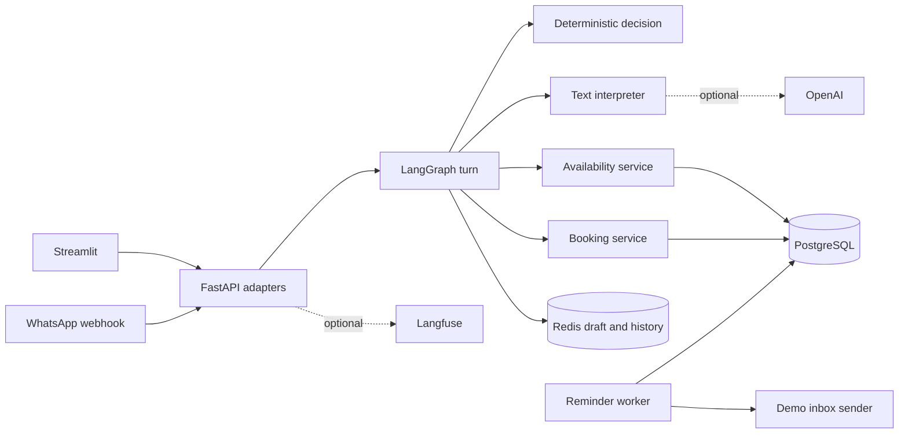

# Architecture

This note describes the code that runs today. The target product shape is in `docs/Service Scheduling Agent — Architecture.md`. Where the two differ, this file is the one to trust for reading the repository.

## What runs

PostgreSQL is appointment truth. Redis is short-lived conversation state. The model never decides that a slot is free and never writes a booking.

## Where a chat message goes

1. `POST /chat` in `app/main.py` validates the HTTP request and calls `handle_chat` in `app/chat_adapter.py`.
2. The adapter checks the session, redacts a token pasted into the message, and, if a management token was sent separately, resolves it to a `booking_id`. The raw token does not enter graph state.
3. `LangGraphWorkflow.handle_turn` runs the graph in `app/graph/builder.py`.
4. The graph loads the draft, interprets the text, merges fields, asks the decision port for a next action, and then constrains that action.
5. A domain port is called only from the `execute` node. Availability and booking rules stay in `app/scheduling.py` and `app/booking.py`.
6. The draft and offered slots are saved. The adapter maps the result back to `ChatResponse`.

The direct endpoints `POST /availability/search` and `POST /bookings` do not enter the graph. The Streamlit forms use them. Chat and a future channel must not be the only way to book.

## Who owns what

| Code | Owns | Does not own |
|---|---|---|
| `app/main.py` | HTTP routes, owner-token check, webhook entry | Which conversation step runs |
| `app/chat_adapter.py` | Web chat translation, token resolution, ports for this request | Booking SQL |
| `app/llm/` | Extract intent, service, date, time, and customer fields from text | Choosing a graph node or claiming a slot is free |
| `app/graph/decision.py` | Propose `BOOK`, `RESCHEDULE`, `CANCEL`, `CHECK_AVAILABILITY`, `FAQ`, `CONFIRM`, `ESCALATE`, or `LOOKUP_BOOKING` | Forcing a transition the workflow does not allow |
| `app/graph/steps.py` | Draft merge, clarification, search, selection, FAQ, lookup, escalation, and the execute call | Overlap policy and token generation |
| `app/scheduling.py` | Which times are valid | Conversation copy |
| `app/booking.py` | Create, confirm, cancel, reschedule, idempotency, audit, token digest | Reading the customer's sentence |
| `app/channels/whatsapp.py` | Signature check, sender mapping, dedupe, same workflow call | A second copy of the booking flow |
| `app/reminders.py` | Claim due reminders and send through a sender port | LangGraph |

## Conversation rules that matter

The draft remembers the operation: `create`, `reschedule`, `confirm`, `cancel`, or `none`. It also remembers the service, date, offered slot ids, and the missing field.

A management token authorizes the web caller. A verified WhatsApp sender authorizes that customer. Neither one changes the operation. Saying "book another" while a token is present creates a booking. Saying "move it" is what starts a reschedule.

If the bot asked for a date and the reply contains a date, the draft continues even when the interpreter returns `unknown`. An invalid date asks again and writes nothing.

"When is my appointment?" uses the verified customer and PostgreSQL. A phone number typed in the message is not proof of identity. On the web demo, the page holds the management token and sends it outside the chat text.

## State

| State | Where | Lifetime |
|---|---|---|
| Services, hours, bookings, reminders, audit | PostgreSQL | Durable |
| Draft, offered slots, redacted history | Redis session | `SESSION_TTL_MINUTES` |
| Request-scoped customer details and raw token | `ChatPorts` object | One turn |
| Graph checkpoint | Not used | `InMemorySaver` is not conversation memory |

Restarting the API does not delete a booking. It can drop an in-progress Redis draft after the TTL. The web demo can still manage the booking with the saved token.

## What is not built

WhatsApp signature verification and dedupe exist, but there is no live Meta send. Audio is a fixture port, not Gemma. The decision port is deterministic, not a trained Laya model. Reminders still land in the demo inbox unless a different sender is injected. Owner routes stay open unless `OWNER_API_TOKEN` is set. There is no calendar, payment, location, or deposit adapter.
