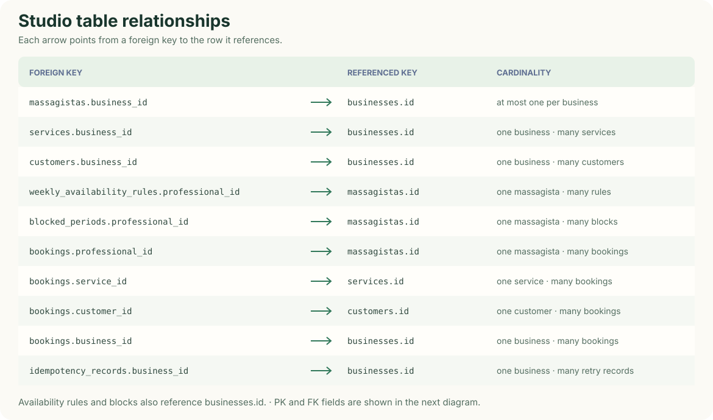

# Database

PostgreSQL stores the catalog, working schedules, customers, bookings, reminders and Telegram update receipts. Redis holds the temporary conversation draft, offered slots and conversation history. The schema below reflects the [scheduling migration](../alembic/versions/0001_general_scheduling.py), [Telegram migration](../alembic/versions/0002_telegram_channel.py) and [ownership migration](../alembic/versions/0003_telegram_ownership.py).

## Tables and relationships

Every table below except `businesses` and `telegram_poll_offsets` has a required `business_id` foreign key to `businesses.id`. The relationship column lists the other foreign keys and relevant application-level links.

| Table | Role | Relationships and key constraints |
| --- | --- | --- |
| `businesses` | Time zone, booking notice, booking horizon and reminder lead time | One business can own many rows in each business-scoped table. |
| `professionals` | Staff who can take appointments | Referenced by assignments, availability rules, blocks and bookings. |
| `services` | Duration, buffers, price and description | Referenced by assignments and bookings. |
| `professional_services` | Services each professional can offer | Joins `professionals` and `services`. The pair `(professional_id, service_id)` is the primary key. |
| `weekly_availability_rules` | Recurring local working hours | Each rule references one professional. |
| `blocked_periods` | Explicit intervals when a professional is unavailable | Each block references one professional. |
| `customers` | Customer records with optional phone and email | A customer can have many bookings. Telegram ownership uses an identity link. |
| `bookings` | Appointment times, occupied interval including buffers, and status | Each booking references one customer, service and professional. An exclusion constraint prevents overlapping occupied intervals for the same professional when bookings are scheduled or confirmed. |
| `reminders` | Reminder jobs with due time, status and retry state | Each reminder references a booking. A booking can have multiple reminder records over time and at most one pending reminder. |
| `reminder_inbox` | Simulated reminder deliveries | Each entry references one reminder and one booking. The unique `reminder_id` allows at most one inbox entry per reminder. |
| `idempotency_records` | Request hash and saved result for each booking write key | The primary key is `(business_id, operation, idempotency_key)`. The app stores the booking ID in `resource_id` as plain text. |
| `audit_events` | Schema for audit records | `booking_id` is an optional foreign key. The current booking service records write outcomes in `idempotency_records`. |
| `telegram_identities` | Links numeric Telegram senders to customer records | The primary key is `(business_id, bot_id, telegram_user_id)`. `customer_id` is optional and unique within a business and bot when present. |
| `telegram_updates` | Deduplicated incoming updates and saved replies | The primary key is `(bot_id, update_id)`. Reply delivery can retry from this row. |
| `telegram_poll_offsets` | Next update ID to poll | One row per `bot_id`. The app stores the update receipt and advances this offset in the same transaction. |

## Booking and reminder workflow

1. **Receive and resolve.** Telegram intake saves the update and advances the polling offset in one transaction. The worker claims the update and resolves the customer from the numeric sender’s identity link. [Telegram repository](../app/channels/telegram_repository.py)
2. **Read availability.** The app calculates slots from eligible professionals, working hours, blocks and active bookings. It applies service duration and buffers, minimum notice and the booking horizon. Offered slots are temporary references held in Redis. Appointment lookup reads the linked customer’s future scheduled and confirmed bookings. [Availability service](../app/scheduling.py) · [PostgreSQL repository](../app/repositories.py)
3. **Commit a write.** The booking service locks the business row and checks the idempotency key and request hash. New bookings and moves also lock the professional and revalidate the requested slot. PostgreSQL rejects overlapping active occupied intervals. A rejected write rolls back the transaction. [Booking service](../app/booking.py) · [Idempotency and recovery](idempotency.md)
4. **Save the reply and process reminders.** The Telegram worker saves the reply before sending it. The reminder worker independently locks due rows with `FOR UPDATE SKIP LOCKED`, writes the demo inbox entry and marks the reminder delivered in the same transaction. [Telegram worker](../app/telegram_worker.py) · [Reminder worker](../app/reminders.py)

| Booking write | Reminder effect in the same transaction |
| --- | --- |
| Create | Insert a pending reminder timed from the appointment start and the business’s reminder lead time. |
| Confirm | Keep the existing reminder schedule. |
| Cancel | Cancel the pending reminder, if present. |
| Reschedule | Move the pending reminder to the new time, or insert one if there is no pending reminder. |

See the architecture page’s [booking sequence diagrams](architecture.md#booking-sequence-diagrams) and [reminder delivery sequence](architecture.md#deliver-an-appointment-reminder) for the function-by-function walkthroughs.
