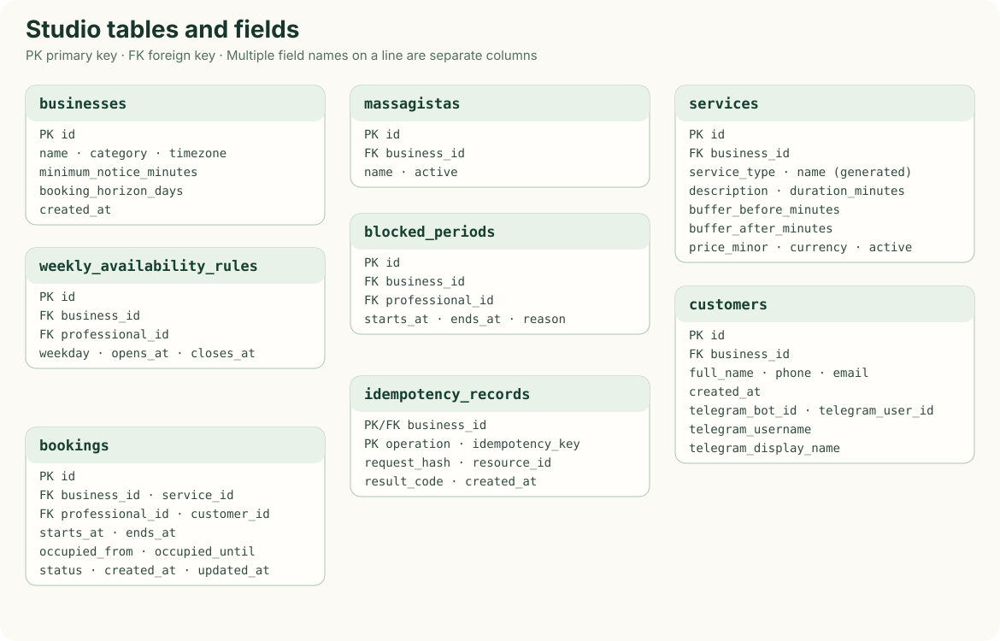
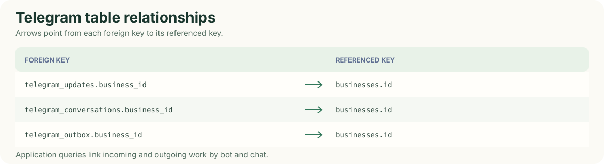
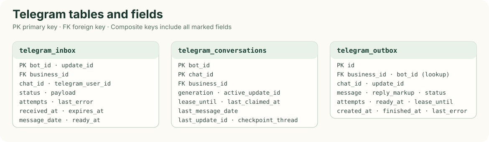

# Database

PostgreSQL stores the massage catalog, working hours, customers, bookings, and Telegram work. Redis stores the temporary conversation draft, offered slots, and history. Alembic defines the schema and SQLAlchemy maps its runtime columns. [Migrations](../alembic/versions) · [Mappings](../app/db_models.py)

## Business tables

The arrows show the columns that reference another table. The unique index on
`professionals.business_id` allows at most one professional for each business.

The field map shows the columns in each studio table. Composite primary keys
span every field marked PK. `idempotency_records.business_id` is also a
foreign key to the business.

| Table | Purpose |
| --- | --- |
| `businesses` | Studio name, timezone, booking notice, and booking horizon. |
| `professionals` | The massage therapist who takes appointments. |
| `services` | One row per massage type and duration, with price and buffers. PostgreSQL generates the name from the type and minutes. |
| `weekly_availability_rules` | Recurring local work intervals. A day can have multiple intervals. |
| `blocked_periods` | Dates and times when the professional is unavailable. |
| `customers` | Customer details and optional Telegram sender IDs and profile fields. |
| `bookings` | Customer, service, actual appointment times, occupied interval including buffers, and status. |
| `idempotency_records` | Request hash and result for each booking write key. |

A unique index prevents duplicate service type and duration combinations. All services share the professional's calendar. The booking stores its interval at creation, so later catalog changes do not change an appointment's recorded time. PostgreSQL excludes overlapping occupied intervals for scheduled and confirmed bookings.

The combination of business, bot, and Telegram user ID identifies a single
customer row. A phone number is optional contact information.

## Telegram tables

These three tables store incoming work, per-chat state and outbound replies.

| Table | Purpose |
| --- | --- |
| `telegram_inbox` | Incoming Telegram updates, deduplication and pending turn state. |
| `telegram_chat_processing_state` | Per-chat lease, ordering information and reference to the completed Redis checkpoint. |
| `telegram_outbox` | Replies, pending delivery state, retry timing and send outcomes. |

Bot configuration comes from the environment. The worker queries pending updates and replies directly. [Telegram worker guide](telegram-worker.md).

Alembic also maintains `alembic_version`, which records the applied migration.

## Booking transaction

The booking transaction checks the retry key and customer, locks the
professional, and validates the selected slot again. The booking and retry result
commit together. PostgreSQL also checks that the customer, service, and professional
each belong to the booking's business through composite foreign keys.

[Availability](../app/scheduling.py) · [Booking service](../app/booking.py)

## Start with a fresh database

Migration `0007_massage_studio` requires an empty business database. It refuses an upgrade when business data exists. Create a separate empty database for the massage demo and retain the previous database with its matching application for rollback. The seed is repeatable and supplies illustrative services and prices. See the [demo instructions](../README.md#try-the-telegram-voice-demo).

An existing massage-studio database can upgrade from `0007_massage_studio` to
`0008_telegram_customers`. The migration copies sender identities onto their
existing customer rows and creates customer rows for unlinked identities.
`0009_telegram_postgres_queue` removes the broker publication and delivery coordination tables while preserving pending messages and replies. `0010_telegram_inbox` renames the incoming update table in place. `0011_clarify_schema` renames the chat-state and professional tables, converts completed inbox rows to `processed`, and adds the booking foreign keys. See the [deployment guide](production.md) for upgrade and rollback steps.
