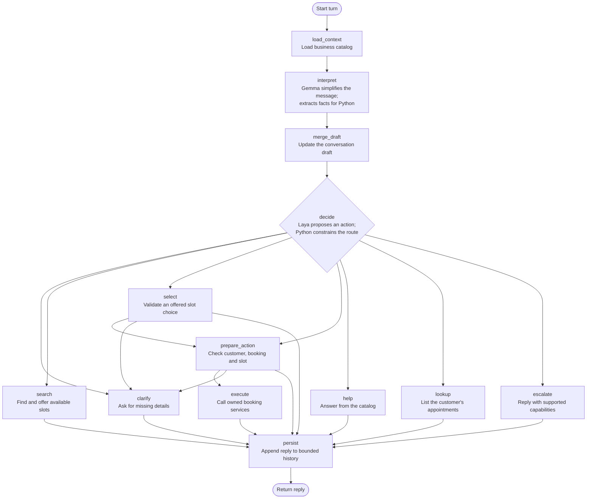

# Conversation graph

A turn loads its catalog and checkpoint draft. Gemma rewrites the sanitized message in simple terms and extracts booking facts without classifying intent. Python merges those facts into the draft, then asks Laya to route using only the interpreted message and conversation context. Deterministic constraints enforce required details and valid references before execution. Execution calls owned domain operations through `SchedulingActions`; persistence adds the reply to bounded history.

The arrows mirror the graph edges in [builder.py](../app/graph/builder.py). `decide` calls Laya and applies deterministic constraints in `route_turn`. Preparation helpers run inside `prepare_action`; they are not separate graph nodes. Redis checkpoints state throughout graph execution; the `persist` node appends the reply to history.

Laya's HTTP body has exactly two keys: `message` (Gemma's interpreted text) and `context` (the current `WorkflowDraft`). The original message, Gemma facts object, intent labels, confidence guesses and customer identity are not additional routing inputs. Laya owns the action decision, including `CLARIFY` when the meaning remains ambiguous. Python checks ownership, offered slots and current booking policy. See the [model contracts](model-contracts.md) for seed-based payload examples.

Text and complete audio transcripts enter the same interpretation path. Audio chunk outputs never reach execution. Gemma and Laya are required for normal turns; evaluations explicitly substitute deterministic implementations. Neither provider can authorize an account, invent an offered slot or bypass booking policy.

`prepare_action` dispatches to `_prepare_create`, `_prepare_reschedule` or `_prepare_booking_status_change`. These functions check the required slot and booking references before routing to `execute`. `CustomerSchedulingActions` connects those workflow operations to services for the trusted customer; `SchedulingActions` is the protocol also implemented by evaluation fixtures.

The Redis checkpoint is the only conversation store. Under `lg:v3`, it contains draft, offered slots, sanitized interpretation/decision fields and at most 24 messages. Tokens and private customer/booking objects are absent. The workflow requires a valid result instead of silently inventing a fallback reply for a malformed graph result.

An unsupported response is not an operational human handoff; there is no staffed handoff queue.
