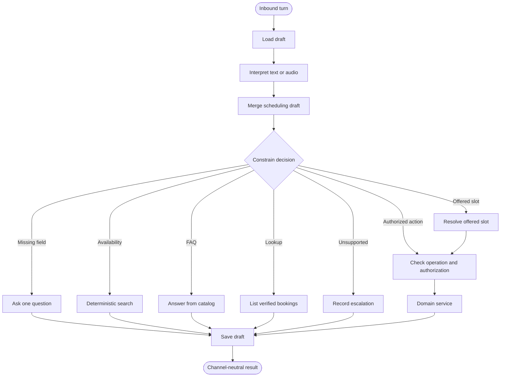

# Conversation and LangGraph

LangGraph owns one inbound turn. It loads the scheduling draft, interprets the sanitized message, chooses the next step, and calls a domain port only when a write is allowed. Understanding does not choose the node. A management token or verified customer authorizes the caller; it does not choose create versus reschedule.

The graph does not authorize a customer, decide that a slot is free, mutate a booking, or generate a management token. Those operations belong to deterministic application services. A provider failure falls back to the deterministic interpreter for the narrow extraction fields.

## Booking journey

1. The customer asks for a service and date, or searches using the form.
2. Availability returns sorted slots with an opaque `slot_id`, professional, offset-aware instant, local label, duration, and price.
3. Selecting a slot is a presentation choice only. `/bookings` recomputes policy and conflicts inside the write transaction.
4. The booking service persists the booking, token digest, audit event, and pending reminder atomically.
5. The UI keeps the returned private management token outside conversation state and sends it separately when managing that booking.

## Read the turn in this order

1. `app/chat_adapter.py` builds the turn and the request-scoped ports.
2. `app/graph/builder.py` shows the allowed edges.
3. `app/graph/steps.py` contains the step behavior.
4. `app/graph/decision.py` proposes an action. `route_turn` in `steps.py` rejects an action that the draft does not allow.
5. `app/booking.py` performs the write. Search the called method, not the graph, for SQL and token handling.

`app/graph/workflow.py` is the public entry, `handle_turn`. It binds the ports for that call and returns text, intent, slots, and, for the web caller only, a management token. The token is not stored in the draft.

## Reminder reply

The worker claims due reminder rows and sends through `DemoInboxSender` by default. It does not import LangGraph. A simulated reply in Streamlit is a new `/chat` request. The page sends the capability token in a separate field. The adapter resolves that token before the graph runs.

## Session behavior

The graph checkpoint in Redis stores the scheduling draft, offered slots, and redacted messages for the session id. It expires after `SESSION_TTL_MINUTES`. This is not LangGraph's in-memory saver, and it is not appointment truth. Booking records remain in PostgreSQL. A new session can manage an existing web booking with the saved capability token.
