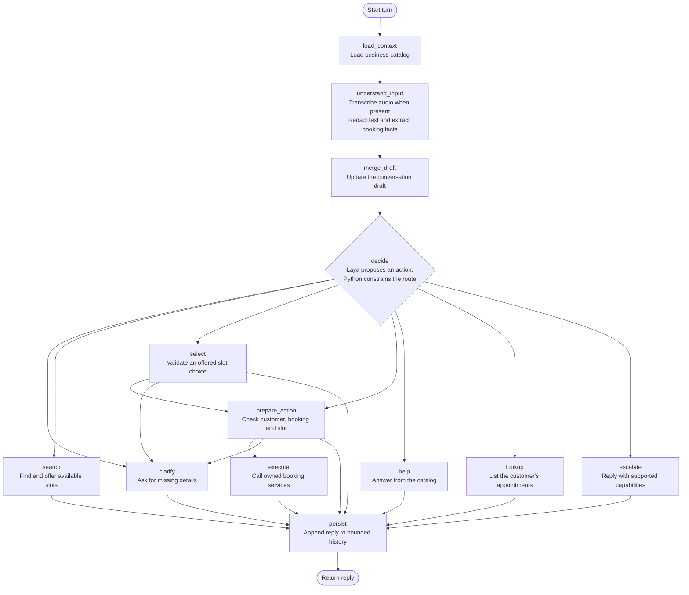
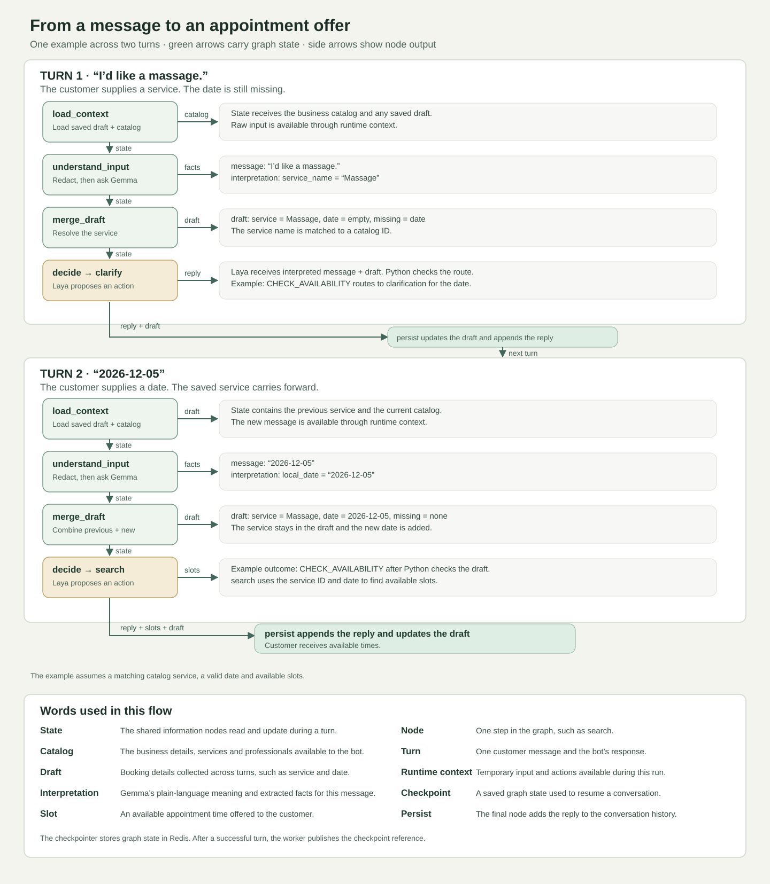

# Conversation graph

A turn loads its catalog and checkpoint draft. The `understand_input` node accepts typed text or asks Gemma to transcribe a complete recording. It redacts the resulting text, then uses Gemma to rewrite the message in simple terms and extract booking facts. Python merges those facts into the draft, then asks Laya to choose the next action from the interpreted message and draft context. Deterministic checks enforce required details and valid references before execution. A new booking uses three distinct turns: offer times, select one and ask for consent, then create only after a later clear approval. Execution calls owned domain operations through `SchedulingActions`, and persistence adds the reply to bounded history.



The arrows mirror the graph edges in [builder.py](../app/graph/builder.py). `decide` calls Laya and applies deterministic constraints in `route_turn`. Preparation helpers run inside `prepare_action`; they are not separate graph nodes. When a new slot is selected, `_prepare_create` records `confirmation_requested_for` and returns the consent question through `persist`. On the next turn, `route_turn` resolves that marker before changing the draft for any booking action. It requires an affirmative latest message, Laya's `BOOK` proposal, and the same still-offered slot before creation. A refusal or changed time clears the pending choice without writing a booking. [Consent guard](../app/graph/steps.py#L341) · [Draft marker](../app/graph/contracts.py#L37) · [Confirmation text](../app/graph/booking_messages.py#L44)

Redis checkpoints state throughout graph execution; the `persist` node appends both the sanitized user message and CAPY's actual reply to history. The reference replies in an evaluation YAML file never enter this runtime history.

## Follow a message through the graph



The example follows one possible route. The full graph above shows the other routes Laya can propose and Python can select. [Node implementations](../app/graph/steps.py) · [Draft fields](../app/graph/contracts.py)

Use the compiled graph to check the arrows against the implementation after changing a route.
This prints Mermaid using the offline providers.

```sh
uv run --locked python scripts/generate_graph_diagram.py
```

Laya's HTTP body has exactly two keys: `message` (Gemma's interpreted text) and `context` (the current `WorkflowDraft`). The original message, Gemma facts object, intent labels, confidence guesses and customer identity are not additional routing inputs. The draft includes `confirmation_requested_for` while a new booking waits for approval. Python also checks the latest sanitized customer message with a narrow English/Portuguese consent rule; Laya's `BOOK` proposal alone cannot authorize a write. For a pending selection, a changed time, refusal, ambiguous reply, or mismatched Laya action returns without mutating a booking. See the [model contracts](model-contracts.md) for seed-based payload examples.

Telegram downloads a bounded recording and passes it to the workflow in memory. The workflow passes raw text, audio, the display name and scheduling actions through LangGraph’s per-run `context`. Nodes that need them declare a `Runtime[TurnRuntime]` argument. The input node writes sanitized text to graph state, and the checkpointer saves that state using the thread ID passed in `config`. [Runtime context](../app/graph/context.py) · [Graph builder](../app/graph/builder.py) · [Invocation](../app/graph/workflow.py)

The graph waits for all chunks before interpreting a voice message, so a late correction can change the request Laya sees. A failed transcription stops the turn before routing. Gemma and Laya are required for normal turns. Offline text evaluations use deterministic test providers.

`prepare_action` dispatches to `_prepare_create`, `_prepare_reschedule` or `_prepare_booking_status_change`. `_prepare_create` first asks the customer to approve the exact selected offer. On the later approval turn, `execute` checks the consent marker and latest message again before calling the create service. The success reply is formatted from the returned saved booking, in the business timezone. `CustomerSchedulingActions` connects those workflow operations to services for the trusted customer; `SchedulingActions` is the protocol also implemented by evaluation fixtures.

Redis holds the draft, offered slots, sanitized interpretation and decision fields, including the temporary consent marker, and at most 24 messages. Telegram's optional sender language code selects English or Portuguese replies; unknown locales default to English. Raw inputs and the display name used for redaction are scoped to the invocation. The node appends one sanitized user message after interpretation succeeds, and `persist` adds the actual reply. Each worker attempt writes to a separate thread. A successful turn publishes the thread reference on the PostgreSQL conversation row.

An unsupported response is not an operational human handoff; there is no staffed handoff queue.
