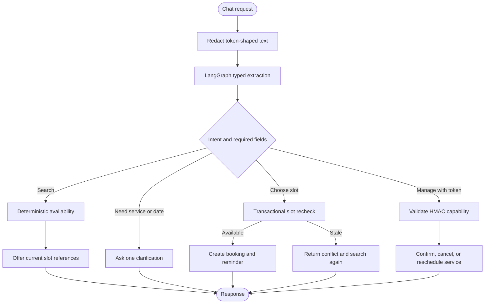

# Conversation and LangGraph

LangGraph handles one bounded responsibility per `/chat` turn: extract a scheduling intent and optional service, professional, date, time, ordinal, or customer fields from the sanitized current message. The output is validated against `SchedulingExtraction`.

The graph does not authorize a customer, decide that a slot is free, mutate a booking, or generate a management token. Those operations belong to deterministic application services. A provider failure falls back to the deterministic interpreter for the narrow extraction fields.

## Booking journey

1. The customer asks for a service and date, or searches using the form.
2. Availability returns sorted slots with an opaque `slot_id`, professional, offset-aware instant, local label, duration, and price.
3. Selecting a slot is a presentation choice only. `/bookings` recomputes policy and conflicts inside the write transaction.
4. The booking service persists the booking, token digest, audit event, and pending reminder atomically.
5. The UI keeps the returned private management token outside conversation state and sends it separately when managing that booking.

## Reminder reply

The worker only reads and updates PostgreSQL reminder/inbox rows. When the customer submits a simulated reply from the UI, the UI calls `/chat` again with the active session ID (or creates a fresh one) and the capability token in a separate request field. The API validates it and invokes the appropriate application service. No worker touches graph state or checkpointer data.

## Session behavior

Session IDs and chat slot references are local demo state with a configurable TTL. Booking records and reminders remain durable. If the API restarts, a customer can start another session and continue managing the booking with the saved capability token.
