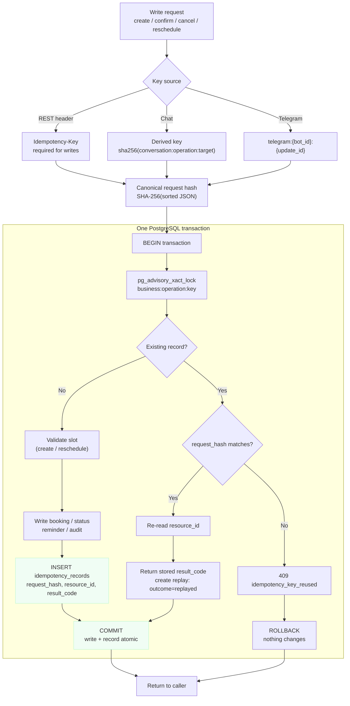
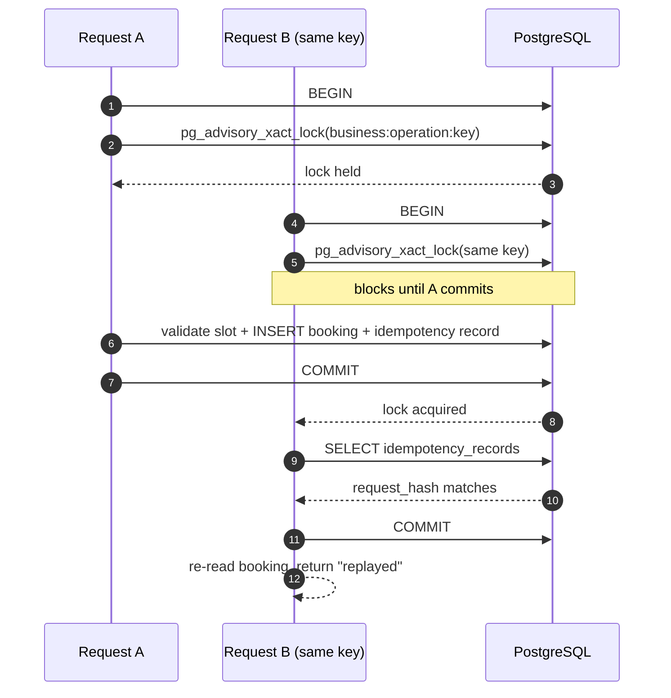

# Idempotency

Every booking write can be retried: a client times out after the server committed, a worker restarts, or a messaging platform redelivers an update. Idempotency makes those retries safe without making the caller coordinate.

The guarantee is scoped to `(business_id, operation, idempotency_key)`. A retry with the same key and the same request returns the recorded outcome. A retry with the same key but a different request is rejected. The record and the business write commit in one PostgreSQL transaction.

## Where keys come from

| Channel | Key | Stability |
|---|---|---|
| REST create, confirm, cancel, reschedule | `Idempotency-Key` header, required | Caller-controlled; 1–200 characters |
| `POST /chat` | Header if supplied, otherwise `chat-` plus the first 48 characters of a SHA-256 over `conversation_id:operation:target` | Stable for a retried turn in the same conversation |
| Telegram worker | `telegram:{bot_id}:{update_id}` | Stable per Telegram update |

Sources: `app/main.py:144`, `app/main.py:164-209`, `app/main.py:326`, `app/chat_helpers.py:24`, `app/graph/steps.py:459`, `app/telegram_worker.py:414`.

## Stored record

`idempotency_records` is keyed by the triple, so the same key can be used for a `create` and a `reschedule` without collision.

| Column | Purpose |
|---|---|
| `business_id`, `operation`, `idempotency_key` | Primary key and scope |
| `request_hash` | Detects key reuse with a different body |
| `resource_id` | Booking to re-read on replay |
| `result_code` | Outcome to return, e.g. `confirmed` or `already_canceled` |
| `created_at` | Record age; there is no expiry |

Schema: `alembic/versions/0001_general_scheduling.py:130`.

## Write path

The canonical hash uses `json.dumps(..., sort_keys=True, separators=(",", ":"), default=str)` before SHA-256 (`app/booking.py:30`), so field order does not matter.

## Concurrent retries

The advisory lock is transaction-scoped and released on commit or rollback. The second request waits, then either replays the committed record or, if the first request rolled back, performs the write itself.

## What is hashed per operation

| Operation | Hash input | First result | Replay result |
|---|---|---|---|
| `create` | Entire `BookingCreateRequest`, including customer details | `created` | `replayed` |
| `confirm` | `{booking_id, operation}` | `confirmed` or `already_confirmed` | Stored code |
| `cancel` | `{booking_id, operation}` | `canceled` or `already_canceled` | Stored code |
| `reschedule` | `{booking_id, ...reschedule payload}` | `rescheduled` | Stored code |

Consequences:

- Reusing a create key with a corrected phone number or name returns `409`; edit the booking through management instead of replaying a changed create.
- A create replay rebuilds the same management token from the booking id and `token_version` (`app/booking.py:113`), so a lost response does not lose the capability.
- Confirm and cancel are also naturally idempotent with a **new** key: the second call reports `already_confirmed` or `already_canceled`. With the **same** key, the request short-circuits before that logic.
- Manage operations validate the management token and load the booking before the idempotency lookup, so a replay still requires a valid capability.

## Failure cases

| Situation | Behavior |
|---|---|
| Commit succeeded, response lost | Retry with the same key returns the original booking |
| Failure before commit | Transaction rolls back; no booking and no record, so a retry runs normally |
| Same key, different payload | `409 idempotency_key_reused` |
| Same key, concurrent requests | Advisory lock serializes; one writes, the other replays |
| Different key, same slot | Slot validation or the exclusion constraint returns `409` |
| Replay after the booking changed | Returns the booking's current state, not the state at first response |

## Concurrency backstops

Idempotency is not the only duplicate guard:

- `pg_advisory_xact_lock` serializes requests sharing a key (`app/booking.py:72`).
- The `(business_id, operation, idempotency_key)` primary key rejects a duplicate record as a final backstop.
- `FOR UPDATE` serializes status changes and reschedules on the booking row (`app/booking.py:211`).
- A PostgreSQL exclusion constraint rejects overlapping active bookings for the same professional (`app/booking.py:159`, `app/booking.py:282`).

## Limits

- Records never expire. The table grows with each distinct key, and a key can never be reused.
- It is not an HTTP response cache: only `resource_id` and `result_code` are stored. There is no saved body, status, or header.
- A replay does not revalidate availability. The returned booking reflects any later cancellation or change.
- The derived chat key is only as stable as the Redis draft. If the draft expires, a retry derives a new key; the overlap constraint still blocks a duplicate for the same slot.
- Keys are validated in the service (`1–200` characters), so direct callers of `BookingService` get the same `422` contract as HTTP callers.
- A create replay returns the management token only when the full request hash matches, so the key alone does not expose a booking without the original payload.

## Code map

| Code | Responsibility |
|---|---|
| `app/booking.py:68` | Key validation, advisory lock, lookup, hash comparison |
| `app/booking.py:82` | Insert the idempotency record |
| `app/booking.py:104` | Create: check, replay, or write |
| `app/booking.py:199` | Confirm and cancel status mutation |
| `app/booking.py:234` | Reschedule and reminder update |
| `app/database.py:10` | Transaction boundary: commit on success, rollback on exception |
| `app/chat_helpers.py:24` | Chat key derivation |
| `app/graph/steps.py:459` | Seed used for the derived chat key |
| `app/telegram_worker.py:414` | Telegram update-derived key |

## Tests

- `tests/integration/test_postgres_booking_lifecycle.py:31` covers replay, changed-payload rejection, token stability, and slot conflict.
- `tests/unit/test_booking_tokens.py:46` covers hash stability across dictionary ordering.
