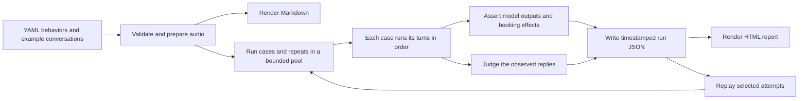

# Implementation plan — CAPY chatbot evaluation

**Status** · Implemented in the current worktree. Astra reviewed the plan before implementation. Formal tests were not run in this implementation pass.

## Source and intent

The [PRD](prd-chatbot-evaluation.md) records the behavior and acceptance criteria. The [golden dataset](../../evals/scenarios/golden.yaml) gives complete scripts for the same booking behavior in English and Brazilian Portuguese. Use the shared behavior ID to trace both scenarios from the spec to deterministic checks, judge verdicts, and database coverage.

The implemented baseline lets a developer author a behavior in YAML, replay it against the actual graph, and diagnose which layer failed. The reference illustration motivates using the same behavior IDs for controlled checks, model simulations, and later production feedback.

## Implemented behavior

CAPY accepts one text message or recording per invocation and stores conversation history in LangGraph. The YAML runner invokes that workflow one turn at a time, with an isolated graph checkpoint and synthetic scheduling service per attempt. It captures validated Gemma and Laya outputs, checks every booking write counter, and compares saved booking facts with an earlier offer. PostgreSQL integration tests remain the boundary for persistence behavior. [Graph invocation](../../app/graph/workflow.py) · [Scenario runner](../../app/evals/scenarios/runner.py) · [Synthetic scheduling actions](../../app/evals/fixtures.py)

Creating a booking now follows **offer → select and ask for confirmation → explicit consent → create and return saved details**. The selected slot is stored in `confirmation_requested_for`; a later exact approval and Laya `BOOK` proposal must both agree before `execute` calls the service. The saved booking supplies the localized success reply. [Consent route](../../app/graph/steps.py#L341) · [Create path](../../app/graph/steps.py#L853) · [Booking journey](../../tests/integration/test_workflow_booking_journey.py)

### Confirmation before a new booking

1. On selection, resolve the offered slot and verified customer as today. Store the selected slot together with a marker that a confirmation question was presented for it. Return a question naming the service, date, local time and time zone, and assigned professional. This turn makes zero booking writes. The YAML cases explicitly assert that invariant.
2. Resolve a pending offer before applying Laya's proposal to the draft or routing to an existing-booking operation. Only a later, affirmative message in the same conversation can authorize this exact slot. Use a narrow bilingual rule in Python on the latest sanitized message or transcript so a paraphrase that drops a negation cannot authorize a write. Start with `"Yes, book it."` and `"Sim, pode agendar."`. A rejection withdraws the pending offer. A revised time invalidates it and requires a fresh search. An unclear answer repeats the explicit yes/no question; other booking actions stay blocked until the customer resolves this pending choice. Assert zero writes across create, confirm, cancel, and reschedule for refusal and changed-time cases, even when Laya proposes one of those actions.
3. Teach the existing Laya `BOOK` criterion and deterministic baseline to recognize assent to the pending new appointment. Preserve `CONFIRM` for an existing booking. Keep the provider contract at `message` and `context`. For a pending new appointment, affirmative text and a `BOOK` proposal must agree before execution. A different proposal during assent returns a clarification and makes zero writes. Carry proof of consent for the selected slot only within the approving invocation. Check it immediately before calling `create_booking` so paths that carry a slot ID cannot bypass the question.
4. Use the affirmative turn's stable idempotency key. Let the existing transaction revalidate availability and ownership. After success, build the reply from the committed booking's date and time in the business time zone and resolve its service and professional IDs to display names. Consume the pending confirmation so another yes cannot create another booking. If the slot has gone stale or the write fails, tell the customer to refresh their options. Test the case where the booking commits and reply handling is interrupted using the existing claim recovery and booking idempotency boundaries.
5. Localize the confirmation question and booking success details in English and Brazilian Portuguese. Telegram's sender locale selects Portuguese when it starts with `pt`; unavailable or other locales use English. The scenario language supplies the test context and expected language. Keep service names as configured in the business catalog.

Treat old checkpoints without the confirmation marker as unapproved. Existing pending slots still need a fresh question before creation. PostgreSQL schema changes are unnecessary because the pending selection lives in conversation state.

## YAML input and evaluation flow

Versioned dataset files live under `evals/scenarios/`. Each file declares `schema_version`, `dataset_id`, and an ordered list of cases. Each case has `id`, `spec_id`, `category`, `language`, `split`, `group_id`, provenance, fixture setup, `example_conversation`, `judge`, and `final_assertions`. Keep text, speech, and language variants of a scenario in one group. Each group belongs to exactly one split across all selected datasets.

Each step in `example_conversation` holds a unique step ID, one `user` input, an optional `assistant_example`, and typed assertions. The user entry is either `modality: text` with nonblank `text`, or `modality: audio` with a reference transcript and a file path or a synthesis source. Use a single declared asset root, portable relative paths, and checksums for materialized audio. There is no separate list of executable user messages.

The loader validates YAML with a safe loader and typed schemas, rejecting duplicate mapping keys, unknown fields, invalid action labels, and references to later or missing turns. `render-spec` produces readable Markdown from the validated object, including setup, both sides of the example, per-turn assertions, and the judge rubric. The [golden dataset](../../evals/scenarios/golden.yaml) is the current executable contract; [this SDD example](examples/chatbot-eval-golden.yaml) remains a compact design illustration.



For every case attempt, the runner creates an isolated `InMemorySaver`, graph, fixture scheduling state, and conversation ID. It uses stable idempotency keys inside that attempt, with a new namespace per repetition. It passes only the current input to `LangGraphWorkflow.handle_turn`. The normal checkpoint and history reducer carry forward prior actual user messages and actual assistant replies. The runner records the completed reply before advancing to the next scripted user input. It keeps a sanitized observed transcript for the judge and report. A provider error preserves results already collected and records the attempt as an execution error.

### Model and booking assertions

| Evidence | Capture point | Example expectation |
| --- | --- | --- |
| Gemma's interpreted request | Capture the validated, sanitized `SchedulingInterpretation` emitted by `understand_input` before `merge_draft`. | The first turn identifies `Massage` and `2026-10-20`. The slot reply produces `slot_index: 1`. |
| Laya's decision | Snapshot `DecisionOutput` at `decide`. In deterministic runs, record the actual baseline provider in the same evidence shape. | `next_action: CHECK_AVAILABILITY` for the first message and `BOOK` for slot selection and approval. |
| Workflow outcome | Read `TurnResult`, offers at the time they were returned, and fixture operation deltas. Use the existing PostgreSQL test seam to verify committed changes independently. | Selection returns `request_booking_confirmation` with zero writes. Consent returns `create` with one create and a booking matching the first previously offered slot. |

The runner wraps each provider to capture timing and typed evidence at the call boundary. `ObservedInterpreter` captures Gemma's validated object before graph merge can change it; `ObservedDecision` captures Laya's validated action, confidence, and handoff flag separately from workflow behavior. The runner compares only authored Gemma fields. It reports allowlisted booking facts and sanitized transcript text, not nested customer records. Raw provider output remains inside the existing application boundary. [Gemma schema](../../app/llm/schemas.py) · [Laya schema](../../app/graph/contracts.py) · [Graph merge and routing](../../app/graph/steps.py) · [Provider capture](../../app/evals/scenarios/runner.py)

Require a `writes` map in the assertions for each turn and each completed case. Unlisted operations within a provided map mean zero. Compare deltas for `create`, `confirm`, `cancel`, and `reschedule`, so an unintended operation fails even if total bookings look correct. Identify fixture effects as simulated and keep call counts distinct from committed database effects. The synthetic fixture enforces per-key idempotency but does not model real database conflicts or stale availability. Use disposable PostgreSQL evidence for stale offers and retry after commit. Resolve `matches_offer` against the actual offer list from the specified earlier turn, then compare the saved booking's slot fields. Treat missing referenced offers or missing model output as explicit assertion or execution errors. A judge verdict cannot override a deterministic failure.

## Audio preparation and judge

### Select and record the voice

Use an explicit preparation command to produce or import audio before a run. Ordinary runs and replays use those bytes. Keep audio generation settings separate from Gemma's transcription, Laya's routing, and the judge model.

| Backend ID | Default voice | Override |
| --- | --- | --- |
| `recorded` | The supplied fixture and its manifest identity | Select a different file. If the original speaker metadata is unknown, display it as unknown. |
| `local-qwen3` | `documentary` for English and `storyteller` for Brazilian Portuguese. `playful-host` is also available. | Choose a local preset via `--voice en=...` or `--voice pt=...`. The adapter declares compatible locales. Start with the Qwen3-TTS MLX VoiceDesign path used in `~/projects/voice-project/generate_voice.py`. |
| `openrouter` | For English, `microsoft/mai-voice-2.1-flash` with `en-US-Harper:MAI-Voice-2.1-Flash`, matching the example implementation in `~/projects/Englishfordevs/backend/src/englishfordevs/tts.py`. | Select an explicit compatible model and voice. A Brazilian Portuguese OpenRouter run requires a verified matching locale voice before it can run. |

The implemented local adapter invokes the configurable voice-project script with an argument vector and uses the actual `documentary`, `storyteller`, and `playful-host` presets. OpenRouter's current English default is `microsoft/mai-voice-2.1-flash` with `en-US-Harper:MAI-Voice-2.1-Flash`; Portuguese requires both an explicit compatible model and voice. Prepared output is bounded to 20 MB, cached by text/backend/model/voice, hashed, and reused for repeated evaluation. The fixture-based suite remains offline without keys or sibling checkouts.

The audio manifest and report record the effective backend, model, voice or local preset, language, reference transcript, asset checksum, generation ID when supplied, and whether the asset was reused. The current report does not calculate clip duration or word error rate. A configured voice applies to synthesis. A pre-recorded or previously generated file keeps its actual manifest identity.

### Judge expected behavior

Keep `judge.prompt` and named criteria inline in the YAML test file. Each criterion specifies the target turn and what should be visible in the assistant's reply. The optional `facts_from` value selects `selected_offer` or `saved_booking` as the source of the expected appointment details. Supply only the service and professional display names, local date and time, and timezone for that turn. This lets the judge flag a fluent reply that states the wrong time or professional. The judge receives one request per target turn, with the sanitized conversation prefix, that turn's criteria, and scoped facts; it cannot inspect later replies while scoring an earlier turn. The output is one validated verdict per criterion with its ID, status, evidence, and short explanation. Transcript and judge text are sanitized before they enter the receipt.

The available profiles are `off`, `local` using an OpenAI-compatible server, and `openrouter` for explicitly opted-in synthetic evaluations. Structured responses undergo validation. An unavailable provider, invalid verdict, or missing evidence becomes an execution error; requests have a bounded timeout. Judge failures remain visible even when they do not gate attempt status. Keys stay in environment variables, and provider error bodies, raw audio, and real customer conversations stay out of artifacts. [Structured outputs](https://openrouter.ai/docs/guides/features/structured-outputs) · [Local llama.cpp server interface](https://github.com/ggml-org/llama.cpp/blob/master/tools/server/README.md)

## Concurrency, replay, and artifacts

- Use a bounded executor over independent `(dataset, case, repetition)` attempts. Each attempt has its own provider instrumentation, fixture booking state, and checkpoint store. Keep its turns sequential, including while other cases use different voices. Use immutable prepared files across repetitions. The defaults are `--jobs 4` offline and `--jobs 2` with live providers. Use `--jobs 1` to run cases serially for diagnosis.
- Record scheduled attempts, effective concurrency, queue wait, and execution duration. The local model server currently runs inference on its server thread, so simultaneous attempts may queue at that server. Report measured latency and throughput before raising parallelism. Default to serial audio preparation and serial PostgreSQL integration when using the existing fixture that clears the shared test database. [Local model server](../../app/local_models.py) · [Disposable test fixture](../../tests/integration/conftest.py)
- Write one versioned JSON receipt per invocation to `.eval_runs/scenarios/run-<UTC timestamp>-<unique suffix>.json`. Include dataset hashes and scenario snapshots, source revision and working-tree digest, provider profiles, voice manifests, per-turn evidence, per-criterion outcomes, and an ID for every attempt. Keep the audio manifest needed for replay. Replay starts each selected attempt from fresh state and links the new run and attempt IDs to the originals. Select exact attempt IDs or a status filter. `failed` selects assertion or gated judge failures. `error` selects execution errors, including judge errors where applicable. `unsuccessful` selects both. `all` selects every attempted case repetition. Rerun the whole conversation for each selected attempt, including turns after the original error. The simulated scheduling fixture is represented in code and source-tree identity; the runner does not claim a separate database fixture hash.
- Render a self-contained HTML report from one or more receipts. Group by dataset, category, language, modality, backend, and voice. Show attempted, passed, failed, and errored counts. Show mean, p50, and p95 elapsed time, provider timings, judge outcomes, write failures, and cases that passed on some repeats and failed on others. Each case expands to actual transcript and expected/actual Gemma, Laya, and booking evidence. Escape scenario and model text. Generate a coverage table by behavior ID and evaluation layer. The scenario runner marks database coverage unobserved because its scheduling effects are synthetic; a PostgreSQL result would need its own evidence source.

## CLI contract

The YAML scenario CLI is implemented under `app/evals/scenarios`. Runs accept repeated `--dataset` flags, optional `--case` and `--category` filters, and bounded `--jobs` / `--repeat` settings. Replay accepts `all`, `failed`, `error`, `unsuccessful`, or exact comma-separated attempt IDs. Audio preparation selects `--backend`, `--model`, and `--voice en=...` / `--voice pt=...`. Existing JSONL commands remain available.

```sh
uv run --locked --extra dev python -m app.evals.scenarios render-spec \
  --dataset evals/scenarios/golden.yaml --output .eval_runs/golden.md
uv run --locked --extra dev python -m app.evals.scenarios prepare-audio \
  --dataset evals/scenarios/challenge.yaml --backend local-qwen3 \
  --voice en=documentary --voice pt=storyteller \
  --local-script ~/projects/voice-project/generate_voice.py \
  --local-python /path/to/qwen3-venv/bin/python
uv run --locked --extra dev python -m app.evals.scenarios run \
  --dataset evals/scenarios/golden.yaml --dataset evals/scenarios/challenge.yaml \
  --profile live --audio-manifest .eval_runs/scenarios/audio-manifest.json \
  --judge-provider local --judge-model YOUR_LOCAL_MODEL --repeat 3 --jobs 2
uv run --locked --extra dev python -m app.evals.scenarios replay \
  --from .eval_runs/scenarios/run-EXAMPLE.json --attempts unsuccessful --jobs 2
uv run --locked --extra dev python -m app.evals.scenarios report \
  .eval_runs/scenarios/run-EXAMPLE.json --output .eval_runs/scenarios/report.html
```

Use `--profile offline` for deterministic interpretation and routing. For offline audio, the runner exercises the audio path with the YAML reference transcript as a fixture transcriber; live audio uses Gemma transcription. The live profile selects Gemma and Laya. The scenario service simulates scheduling writes; the PostgreSQL integration suite verifies persistence in its disposable database and does not use a live Telegram account. Run and replay produce JSON and matching HTML reports. Report generation from existing receipts performs no model or audio provider calls. OpenRouter audio and judging require explicit `--allow-remote` and synthetic scenarios. Exit 0 means enabled checks passed, 1 means an assertion failed, and 2 means setup/provider/execution error.

## Work packages

These IDs preserve the reviewed work breakdown. Implementation status is shown explicitly; formal execution checks remain pending where noted.

| ID | Priority | Requirement | Start → end | Owner and migration | Dependencies | Status |
| --- | --- | --- | --- | --- | --- | --- |
| E01 | P0 | FR-01 | YAML fixture, behavior IDs, and schema → validation and Markdown export with stable scenario and turn IDs | Dataset format. No storage migration. | None | Implemented |
| E02 | P0 | FR-02, FR-04, FR-07 | Validated cases and CAPY provider/service seams → isolated bounded execution, typed model observations, and write assertions | Evaluation runner. No storage migration. | E01 | Implemented |
| E03 | P0 | FR-10, FR-11 | Offered-slot selection → explicit consent before create and localized saved details after it | Graph and reply formatting. No PostgreSQL migration. | E01 behavior contract | Implemented; verification pending |
| E04 | P1 | FR-03 | Declared audio sources and voice options → verified, reusable audio files and manifests | Audio prep. Existing WAVs can be registered by metadata. | E01 | Implemented |
| E05 | P1 | FR-05 | Inline rubric and observed transcript → local or explicitly enabled remote judge verdicts | Evaluation judging. No storage migration. | E01, E02 | Implemented |
| E06 | P1 | FR-06, FR-09, FR-10, FR-11 | Bilingual examples and edge cases → golden/challenge datasets and PostgreSQL confirmation coverage | Scenario authors and integration tests. Uses existing test migrations. | E01, E02, E03, E04 | Partial; broaden cases and verify DB path |
| E07 | P1 | FR-07, FR-08, FR-09 | Attempt evidence → versioned receipts, replay selection, HTML and coverage | Evaluation reporting. Existing JSONL outputs stay readable by their original tooling. | E02, E04, E05 | Implemented; verification pending |
| E08 | P1 | FR-12 | CLI, datasets, and report fields → framework guide | Evaluation documentation. No storage migration. | E06, E07 | Implemented |

## Verification and rollout

The current golden set covers the English and Portuguese three-turn booking journey. The challenge set covers refusal while preserving an existing booking, a changed-time response, cancellation after a successful create, and synthetic Portuguese spoken approval. Missing-date and lookup flows, ambiguous booking references, expired offers, late speech corrections, stale PostgreSQL slots, and commit-then-retry recovery remain follow-up cases.

The scenario runner uses synthetic scheduling effects and does not verify PostgreSQL. The existing PostgreSQL booking journey was updated for consent, but formal verification was not run in this implementation pass. Follow-up checks should run the offline golden dataset, focused framework tests, and the disposable PostgreSQL journey; then exercise optional audio and judge providers with test doubles before an opt-in live model run. Compare serial and concurrent results and confirm that within-conversation history stays ordered.

The current rollout is a local CLI plus focused evaluation tests in CI. Run live providers and challenge datasets explicitly. Promote a finding from a real interaction into an authored, sanitized challenge scenario when production feedback becomes available. Automatic production ingestion, model fine-tuning, vendor-specific dashboards, and changes to Telegram transport are outside this implementation.

## Review status

Astra's plan review flagged the need to guard all four booking mutations while resolving consent, tie reply checks to the selected offer and saved booking, verify stale slots and retry after commit in PostgreSQL, collect redacted model evidence, and specify replay at the attempt level. These points informed the implementation. Remaining verification and broader dataset coverage are follow-up work, not open scope decisions.
