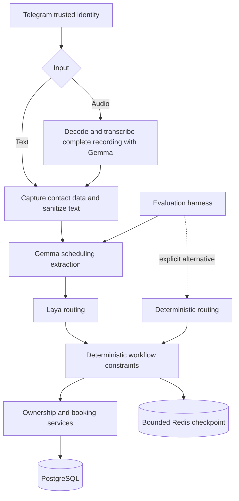

# Portfolio simplification implementation plan

Status: approved in Plannotator with no annotations; local implementation and automated verification are complete; live model/channel validation is pending. Created 2026-11-11.

## Source artifacts and intent

- [Requirements](prd-portfolio-simplification.md)
- [Existing Telegram requirements](prd-telegram-text-voice.md) and [existing implementation plan](plan-telegram-text-voice.md)
- Current booking, graph, Telegram, audio, evaluation and deployment implementation reviewed in this conversation.

Deliver a smaller scheduling application with Telegram text/audio, Gemma understanding and mandatory Laya routing. Establish a reproducible evaluation seam for comparisons with deterministic routing and future English/Portuguese datasets and fine-tuning.

This plan supersedes the earlier proposal to defer audio or remove Laya. Neither removal is in scope. Existing requirements for mandatory phone proof and public token-based interfaces are replaced by stable Telegram ownership and optional contact data.

## Planning defaults

The user asked to proceed with the plan after the clarification batch. These defaults are recorded explicitly:

1. A failed Gemma/Laya call stops the turn and makes no booking change. There is no silent deterministic fallback in normal operation.
2. Preserve existing records with forward migrations. No automatic database reset.
3. Retire public customer HTTP mutation/chat interfaces. Keep a local owner CLI and a small health surface.
4. Automated checks can finish independently; live Telegram and real audio evidence remain a release acceptance gate when endpoints and an authorized test destination are available.
5. Keep the large dataset and actual fine-tuning as future work. Build only a small representative regression corpus and the mechanisms to expand it.

## Target flow



Audio transcription and scheduling extraction are separate stages. The complete transcript reaches the same scheduling interpreter used by text, exactly once. A partial transcript cannot reach a booking action. Model output never supplies the trusted customer identity.

## Inputs, outputs and configuration

| Boundary | Inputs | Outputs / behavior |
| --- | --- | --- |
| Normal app | `TELEGRAM_BOT_TOKEN`, `DATABASE_URL`, `CHAT_REDIS_URL`, `DEMO_BUSINESS_ID`, `GEMMA_BASE_URL`, `LAYA_BASE_URL`; existing bounded audio settings | Telegram replies, scoped booking changes, temporary checkpoint state and redacted operational events. Gemma and Laya are required. |
| Identity | Business ID configured by the operator, bot ID and numeric sender ID verified at the transport boundary | Stable customer ID. Username/name are display metadata; phone is optional contact data. |
| Booking operations | Trusted business/customer IDs, requested booking or slot, stable update-derived idempotency key | Owned booking result or domain error; atomic database changes. No management token in inputs or outputs. |
| Conversation | Stable scoped thread ID, sanitized text, business-local date and trusted identity | Bounded draft/history/offered slots in one checkpoint, plus a response. Private customer records stay outside state. |
| Audio | Supported Telegram recording, download/decode/chunk/time budgets | Complete ordered transcript or explicit error; cleanup of temporary audio files. |
| Evaluation | Versioned JSONL dataset; explicit understanding and routing selection; endpoint/model revision labels; fixed fixture date/catalog/state | Per-case predictions, expected values, mismatches, provider errors, latency and grouped summary. Nonzero exit on failures/errors. |

Proposed evaluation CLI, implemented by WP6:

```bash
uv run python -m app.evals.runner --dataset evals/data/smoke.jsonl --understanding gemma --routing laya
uv run python -m app.evals.runner --dataset evals/data/smoke.jsonl --understanding gemma --routing deterministic
uv run python -m app.evals.runner --dataset evals/data/smoke-text.jsonl --understanding deterministic --routing deterministic
```

Normal application startup must reject deterministic provider overrides intended only for evaluation. Share provider construction functions, with explicit caller-selected modes and validated values; avoid environment precedence between `LLM_PROVIDER` and `UNDERSTANDING_PROVIDER`. Remove obsolete OpenAI settings. Keep endpoint settings independent so Gemma and Laya model revisions can change later.

Deterministic understanding is a text-only baseline. Audio comparisons retain the same Gemma transcription path. Missing audio/provider prerequisites must be reported as errors or explicit excluded cases, never passes. A cached-transcript routing comparison must be labelled separately from an end-to-end audio run.

## Scope and complexity gates

- Keep transactional availability, overlap constraints, idempotency, timezone rules and reminder atomicity.
- Keep Telegram durable receipts, duplicate detection, saved replies and interrupted-turn handling.
- Keep audio limits, chunk ordering, overlap reconciliation, failure handling and temporary-file cleanup.
- Consolidate conversation persistence before deleting its old APIs. Do not remove Redis or LangGraph as a shortcut.
- Keep the custom Redis saver initially; changing the checkpoint backend is a separate decision requiring evidence.
- Remove unused contracts/helpers only after checking real callers, including tests and CLI.
- Resolve visible TODOs when their behavior is addressed; preserve unrelated TODOs until resolved.
- Preserve current user edits. The pre-work diff was saved at `/private/tmp/capy-before-simplification.patch`; this is a local convenience, not the release backup strategy.
- Split work by independently verifiable boundary. Roughly 500 changed lines is a signal to split a work package, not a quota.

## Work packages and dependencies

This is the approved implementation design, retained as a record. File lists include the pre-change modules that were removed. For the current reading order use [architecture](../architecture.md); completed local checks and remaining live checks are recorded in [implementation evidence](../case-study.md).

These are proposed work-package labels, not registered SDD task IDs. No mutable task statuses are maintained in this document.

| Package | Priority | Requirement coverage | Depends on | Owner / migration responsibility |
| --- | --- | --- | --- | --- |
| WP1 Provider modes and failure behavior | P0 | R2, R3, R9 | None | Model/runtime boundary; no migration |
| WP2 Telegram customer ownership | P0 | R4, R11, R12 | None | Identity/booking persistence; owns customer/link migration |
| WP3 Retire token interfaces | P1 | R5, R12 | WP2 | API/CLI/contracts; owns token-column migration |
| WP4 Single private conversation state | P0 | R6, R7 | WP1, WP2, WP3 | Workflow/state; owns checkpoint namespace transition |
| WP5 Preserve text/audio orchestration | P1 | R1, R8, R11 | WP1, WP2, WP4 | Telegram/audio boundary; no new schema expected |
| WP6 Comparable bilingual evaluations | P0 | R9, R10 | WP1, WP4, WP5 | Evaluation boundary; dataset schema versioning |
| WP7 Deployment and dead-code cleanup | P1 | R5, R12 | WP3, WP4, WP5 | Runtime/deployment/docs; no further data migration |
| WP8 CI and demonstrated release | P1 | R11, R13 | WP6, WP7 | Verification/release; verifies all migrations |

### WP1 — Explicit model modes

**Why:** require Laya in the app while enabling honest experiments without it.

**Start / inputs:** `app/runtime.py`, `app/config.py`, `app/llm/provider.py`, `app/llm/gemma.py`, `app/graph/laya.py`, existing provider tests and endpoint contracts.

**Implementation:** centralize interpreter/router construction; use Gemma and Laya directly for runtime; retain deterministic implementations for explicit evaluation; remove OpenAI integration and silent fallback wrappers from runtime. Validate provider output and bounded timeouts. Preserve the deterministic constraint layer after Laya. Distinguish provider errors from successful predictions.

**End / outputs:** normal turns never silently bypass Laya; evaluation can select deterministic routing without editing application code. No model failure produces a booking side effect.

**Acceptance / verification:** provider contract tests for valid/invalid output, timeout, oversized response and unavailable endpoints; shared constructor selection tests; adversarial Laya decisions cannot bypass ownership or invent slots. `uv run --extra dev pytest -q tests/unit/test_provider.py tests/unit/test_gemma_laya.py` after adapting obsolete cases.

**Non-goals:** serving model weights, fine-tuning, retry frameworks or new provider plugins.

### WP2 — Stable Telegram ownership

**Why:** remove duplicated authorization without allowing phone-based account claims.

**Start / inputs:** `app/channels/telegram_repository.py`, `app/telegram_worker.py`, `app/booking.py`, `app/repositories.py`, `app/models.py`, migrations `0001`/`0002`, existing transaction tests.

**Implementation:** create or retrieve a customer from the scoped Telegram identity; preserve existing verified links. Replace phone-based customer upsert with trusted customer-ID lookup. Make optional contact storage compatible with customers sharing or omitting a phone. Authorize booking reads and changes by business/customer/booking in the same transaction as the mutation. Include customer identity in idempotency request matching and verify replay ownership.

**Migration owner:** WP2 adds a forward Alembic migration for contact constraints and identity relationships. Existing bookings/customers remain intact; never auto-link an unclaimed old customer by typed phone. Document owner-visible legacy records needing explicit future recovery. Validate same-user restart/username changes and different users supplying the same phone.

**End / outputs:** stable ownership across restarts; direct owned booking service operations; no internal token minting needed for trusted customer operations.

**Acceptance / verification:** cross-customer and cross-business read/confirm/cancel/reschedule denied; forged model identity ignored; duplicate updates and idempotent replay cannot change ownership; concurrency/rollback tests pass; migration tested with populated legacy records. `uv run --extra dev pytest -q tests/integration/test_postgres_booking_lifecycle.py` plus new Telegram identity integration tests.

**Non-goals:** cross-channel account merging, phone verification/recovery service or new login system.

### WP3 — Retire management-token surfaces

**Why:** remove the second customer authorization mechanism and its maintenance burden.

**Start / inputs:** WP2 service contracts; `app/main.py`, `app/chat_adapter.py`, `app/customer_scheduling_actions.py`, `app/cli.py`, `app/models.py`, booking token tests and API tests.

**Implementation:** remove `/chat`, `/sessions/new` and public customer booking mutation/token routes; remove token fields, signing/version/digest logic and secret configuration after their consumers are migrated. Keep owner agenda/settings/reminder inspection in a local CLI; remove owner HTTP routes, or require authentication if an explicitly justified route remains. Keep health endpoints. Migrate useful API scenario tests to the retained service/workflow boundary instead of losing their assertions.

**Migration owner:** WP3 drops obsolete token columns after application cutover. Historical Alembic migrations remain unchanged. Rollback after token removal requires a pre-migration database backup; never fabricate replacement token digests.

**End / outputs:** no unauthenticated customer mutation route; no customer token lifecycle; useful owner operations still available locally.

**Acceptance / verification:** removed routes return 404; local owner operations work; response/schema/config no longer expose tokens; retained service tests verify booking lifecycle. Retain redaction of pasted legacy tokens until old checkpoints and messages have expired. Run API/CLI contract checks and the booking integration suite.

**Non-goals:** replacement web frontend or public login/auth API.

### WP4 — One conversation state and privacy boundary

**Why:** avoid inconsistent state, unbounded history and accidental contact persistence.

**Start / inputs:** `app/chat_history.py`, `app/customer_scheduling_actions.py`, `app/graph/{contracts,state,workflow,steps,actions,memory,redis_checkpoint}.py` and checkpoint/graph tests.

**Implementation:** checkpoint owns draft, offered slots and sanitized history. Remove separate Redis copies and unused pending-slot/history/draft APIs after callers migrate. Use a bounded history reducer (initially 24 messages), with the same bounded input supplied to interpretation. Capture known contact data outside the graph and sanitize free text before the first checkpoint write. Remove test-only production fallbacks/no-op methods through explicit fixtures. Require a valid workflow result instead of silently generating default text for malformed results. Keep private booking/customer result objects outside persistent graph state.

**Migration owner:** WP4 versions the checkpoint namespace for the changed state/privacy contract. Restarting a conversation does not delete bookings. Old temporary keys expire under their existing TTL; document that historical personal data requires an explicit scoped purge if immediate removal is needed. Do not silently migrate old raw text into new checkpoints.

**End / outputs:** one state owner, bounded model context, clear expiry and thread isolation. Phone/email/known name/legacy token regression examples are absent from new checkpoints and model payloads. Document limitations of arbitrary free-text name detection.

**Acceptance / verification:** multi-turn corrections, restart with real Redis, TTL expiry, two-user isolation, history bound, no stale offered slots after an empty search, privacy inspection of every new checkpoint and failed-turn state. Update and run `tests/unit/test_conversation_graph.py`, `tests/unit/test_redis_checkpoint.py`, plus Redis integration tests.

**Non-goals:** semantic memory, vector storage, checkpoint engine replacement or automatic summarization.

### WP5 — Preserve complete audio and unify scheduling interpretation

**Why:** retain the user's reason for choosing Gemma and make text/audio share predictable behavior.

**Start / inputs:** WP1/WP4 contracts; `app/telegram_worker.py`, `app/channels/{telegram,audio,audio_chunks}.py`, `app/llm/gemma.py` and current recording budgets.

**Implementation:** Telegram verifies transport identity and validates input. Audio downloads/decode/chunks/transcribes completely, then follows the same sanitized scheduling interpretation as text. Remove duplicate scheduling interpretation/normalization branches where they serve no external contract. Preserve chunk order, overlap reconciliation and late corrections. Keep numeric identity, receipt deduplication, saved-reply retries and safe interrupted-turn recovery. Remove obsolete phone-proof onboarding and the typed-phone demo bypass after WP2.

**End / outputs:** text→audio→text conversations continue one draft; incomplete audio never runs a scheduling action; provider failure returns a retry/type response. Replies contain no obsolete web/token-control instructions.

**Acceptance / verification:** real-format short/long recordings, silence, malformed media, failed middle chunk, total timeout, late cancellation/correction and duplicate delivery; one action only after the entire message. Test with mocked endpoints for contracts and real Gemma recordings for speech quality. Live Telegram needs an explicitly authorized test chat. Test transport retries without sending unsolicited messages.

**Non-goals:** dropping long-audio support, implementing a model server, or promising perfect transcription.

### WP6 — Bilingual evaluation foundation and Laya comparison

**Why:** produce trustworthy baseline evidence and a reusable path to future datasets and fine-tuning.

**Start / inputs:** shared provider constructors, actual workflow/constraints, `app/evals/`, existing extraction cases, product outcome tests and small synthetic/consented English/Portuguese recordings.

**Implementation:** version a simple JSONL schema containing case ID, language, modality, split, context/initial state, text or relative audio path, reference transcript when applicable, expected extraction fields/action and optional multi-turn expected outcomes. Validate duplicate IDs, missing assets and invalid labels before executing cases. Add a small corpus covering search, selection, correction, lookup, confirm/cancel/reschedule, ambiguity, unsupported requests, ownership attempts and audio late corrections in both languages.

Run three layers separately: extraction; routing from fixed normalized inputs; complete workflow outcomes using isolated fixture services. Keep database correctness in integration tests. For Laya on/off comparisons, use identical cases/state and record a shared dataset hash. Record model/checkpoint revision labels, configuration, requested/actual providers, per-stage latency, errors and outputs. Report language/modality breakdowns, field accuracy, routing accuracy and task success; report transcription quality on reference audio cases. Do not invent model cost when the local endpoint supplies no usage data.

Errors, schema-invalid outputs and task failures cause nonzero exit status. Live model runs do not silently substitute deterministic predictions. Offline CI uses deterministic providers or explicit contract doubles and is labelled accordingly. Any future fallback experiment must record fallback separately and cannot count as model success.

**End / outputs:** runnable matrix commands above; machine-readable JSON results and a compact comparison summary. Dataset schema includes train/dev/test split and provenance; paired recordings/paraphrases share a grouping ID to avoid future split leakage. Do not automatically turn customer conversations into training data.

**Acceptance / verification:** failing extraction makes CLI fail; runtime/eval provider construction agrees; comparison preserves case order/IDs and input hashes; English/Portuguese text/audio are reported separately; outage produces errors, not passes; multi-turn case resets state between cases. Run `uv run --extra dev pytest -q tests/evals` and the explicit offline smoke command. Live comparison is required before publishing measured Gemma/Laya performance.

**Non-goals:** a big dataset, annotation platform, training pipelines, model selection claims from the small smoke corpus, or benchmark-driven production routing changes.

### WP7 — Focused deployment and repository cleanup

**Why:** make the supported product easy to run and understand.

**Start / inputs:** completed callers from WP3–WP5; Dockerfile, Compose, dependencies, README, architecture/security/evaluation docs and `.archived/`.

**Implementation:** move optional self-hosted Langfuse services into a separate Compose file while retaining useful instrumentation. Keep ffmpeg and audio dependencies. Remove obsolete OpenAI/token/web configuration. Remove unused chat helpers, `ToolResult`, unused `DecisionEngine`, `default_decision`, test-only production fixtures and obsolete fallback stores after checking callers. Preserve all useful tests at their new boundaries. Remove archived implementations after preserving committed history and copying any uncommitted-only material to a recoverable backup. Preserve current artwork and user documentation edits where still applicable.

Update AGENTS.md, README, architecture diagram, security, idempotency and evaluation docs to the final scope. Mark old Telegram specs as superseded where identity/provider rules changed. Document that normal operation requires Gemma and Laya servers; offline evaluation is a separate command. Keep the roadmap focused on bilingual evaluation expansion and fine-tuning both models.

**End / outputs:** concise main Compose setup, explicit observability opt-in, clean project map and accurate demo instructions.

**Acceptance / verification:** Compose configuration validates for core and observability combinations; imports/package build succeed; no active references to deleted interfaces; audio dependencies remain; all removed files are recoverable from history or backup. No database/data-volume deletion.

**Non-goals:** replacing observability with a new platform or adding orchestration infrastructure.

### WP8 — CI and release evidence

**Why:** make the retained behavior demonstrable and independently reproducible.

**Start / inputs:** WP6/WP7 outputs, migration scripts, existing unit/integration tests, disposable PostgreSQL database ending in `_test`, isolated Redis database/namespace.

**Implementation:** add CI with PostgreSQL and Redis service containers; run migrations, unit/contract tests, database/Redis integration tests and offline bilingual evaluation. Make missing database/Redis dependencies fail the CI job rather than silently skip required integration checks. Keep live model/audio runs explicit and resource-bounded. Record a local scripted walkthrough and a live Telegram walkthrough using synthetic data.

**End / outputs:** automated evidence, measured live Gemma/Laya results when endpoints exist, and a concise portfolio case study covering tradeoffs and limitations.

**Acceptance / verification:** search→book→lookup→confirm→reschedule→cancel through text/audio; duplicate update produces one booking; simultaneous overlap commits once; interrupted turn/reply recovery; provider outage makes no booking write; cross-user access denied; populated migration preserves ownership. Show p50/p95 latency and task success with sample counts and language/modality breakdowns; do not imply a tiny sample is a production benchmark.

Commands: `uv run --extra dev pytest -q`, offline evaluation command, `docker compose config`, and `docker compose -f docker-compose.yml -f docker-compose.observability.yml config` once that file is introduced. Live credentials/assets are prerequisites, never committed fixtures. If unavailable, report live checks as pending and do not claim end-to-end validation.

**Non-goals:** deploying to production, sending reminders to real customers, training either model or collecting real personal conversations.

## Rollout and rollback

1. Capture the baseline and preserve the current working tree. Run existing meaningful checks before replacing their boundaries.
2. Introduce trusted customer operations and test populated forward migration before retiring token consumers.
3. Stop old application/worker instances during the coordinated interface/schema cutover. Back up PostgreSQL and verify restoration to a disposable instance.
4. Apply migrations, deploy the new app and start with a fresh checkpoint namespace. Existing bookings and verified links remain valid.
5. Perform scoped synthetic smoke checks before reopening customer traffic.
6. Before destructive token-column removal, rollback may use the compatible previous app/schema. After removal, rollback restores the matching database backup and app version. Avoid mixed-version writers.

## Plan review and task registration

The local artifacts are the complete proposed plan and requirements. `sdd-mcp` tools are unavailable in this session, so no feature or task IDs have been registered and none are implied by WP labels. When available, register feature `portfolio-simplification`, attach both artifact paths, and create bounded tasks from these work packages with their requirements, owners, dependencies, inputs, outputs and verification.

Plannotator returned `decision: approved` with zero annotations on 2026-11-11. Implementation should follow this reviewed document. Plan creation itself makes no application changes and runs no migrations.


## Implementation evidence

See [local verification evidence](../case-study.md). The full container suite passed 70 tests, Compose configurations validated, and all 16 bilingual text task cases passed with deterministic providers. Gemma audio and mandatory application Laya routing are preserved. Live Gemma/Laya and Telegram validation remain pending because model endpoints were unreachable and no live test chat was supplied. No production/demo database migration or deployment was performed. SDD task registration remains unavailable in this session.
