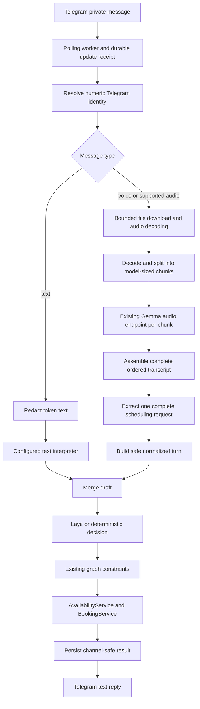

# Telegram text and audio integration — implementation plan

Status: implementation authorized by the user and present in the working tree. Migration, worker, Docker image, and real Gemma/Telegram behavior have not been run or verified. Work-package labels below are planning references, not registered tracker tasks.

## Source artifacts

- User request: connect `@capy_appointment_bot` to the existing scheduling workflow, accepting text and audio. Keep phone numbers required. Support long recordings by splitting audio when needed. Telegram is the first customer chat interface; WhatsApp follows. The user does not want a Streamlit chatbot frontend or audio-server implementation work.
- Current architecture: [architecture](../architecture.md), [conversation graph](../graph.md), and [Gemma/Laya direction](../gemma-laya-default-plan.md).
- Code: `app/channels/`, `app/chat_ports.py`, `app/runtime.py`, `app/graph/`, `app/llm/gemma.py`, and `alembic/`.
- External contracts: [Telegram Bot API](https://core.telegram.org/bots/api) and [Gemma 3n developer guide](https://developers.googleblog.com/en/introducing-gemma-3n-developer-guide/).

## Intent checkpoint

- **Confirmed intent:** implement Telegram text and audio input using the existing scheduling application.
- **Why:** customers should be able to use a messaging app and send a voice message to continue a booking conversation.
- **Confirmed scope:** Telegram adapter; both text and audio; required phone numbers; long-audio chunking. WhatsApp is the next channel, with its launch outside this Telegram delivery. No Streamlit chatbot development or new audio server.
- **Identity preference:** show the Telegram username where available. Engineering recommendation: use the authenticated numeric `from.id` as the durable identity, since usernames are optional and are unsuitable as ownership keys.
- **Desired outcome:** a real bot receives a message, obtains scheduling fields, runs the existing graph, and replies with the resulting text.
- **Constraints:** availability and booking policy remain deterministic; raw booking management tokens stay out of model requests, graph state, URLs created by this integration, logs, and replies. Preserve existing web, SMS, and WhatsApp behavior and the current in-progress workspace changes.
- **Confirmed contact policy:** retain the existing required phone field. Telegram account identity does not replace booking contact information.
- **Confirmed provider boundary:** reuse the configured Gemma endpoint; discard building or deploying an audio server from this feature. Verify its existing audio capability as an integration check. If unavailable, text remains usable and voice reports unavailability; do not represent the client wrapper as working speech recognition.
- **Confirmed audio goal:** accept the longest voice messages practical for the selected Telegram transport; split at model input limits rather than rejecting everything over 30 seconds. Never silently trim a recording or execute individual chunks as separate requests.
- **Implementation defaults:** private chats; one configured business per bot; existing booking operations and English text replies. Evaluate English and Portuguese speech initially; no additional language guarantee or localization work is implied. These defaults are engineering proposals for review, not additional user-confirmed requirements.
- **Acceptance:** phone-backed customers can complete existing booking flows through Telegram text and voice; a multi-chunk recording is interpreted as one complete message before any business write. Real-audio acceptance depends on the existing endpoint's demonstrated capability.

### Decision record and remaining readiness checks

1. **Resolved — phone required:** keep existing customer validation and database phone constraints; verify ownership before linking an existing customer.
2. **Resolved — no server work:** only consume the configured `/understand` API. An unavailable or incompatible audio endpoint is a voice-readiness blocker, not authorization to implement a server.
3. **Resolved — long voice messages:** no product-level 30-second cap. The standard hosted Telegram Bot API currently limits downloads to 20 MB. Chunking addresses the model's input window, not that upstream download limit. A local Telegram Bot API server removes the download limit, but would add deployment work and is a separate future extension. [Telegram transport limits](https://core.telegram.org/bots/api#using-a-local-bot-api-server).
4. **Resolved — frontend direction:** Telegram now, WhatsApp next; Streamlit is not the customer chatbot delivery surface. Existing owner agenda and other web/API flows remain compatible; deleting frontend code is outside this feature.
5. **Readiness checks:** prove real audio compatibility, measure long-recording latency/resource use, and review the implementation defaults. No application or bot worker has been started during planning.

## Goal

Ship a Telegram channel that handles real text and audio messages through the same graph and deterministic services. Telegram account identity, audio understanding, and business authorization must remain separate responsibilities.

## Proposed architecture

Start with a single long-polling worker for the local MVP. It avoids public HTTPS ingress and matches the repository's local-demo deployment. A webhook service is a later transport option, not part of this proposal. Polling startup must detect an existing webhook and explain the conflict; it must not delete an existing webhook automatically.

The diagram abbreviates the existing graph's branches. Text interpretation occurs inside its `interpret` node. Audio chunks are processed before the graph. Their complete transcript is interpreted once through the configured text interpreter; chunk-level scheduling decisions are discarded. `TurnContext.normalized` supplies the final validated result and skips duplicate extraction in the graph. Preserve slot/contact fields through the contract changes in WP4. The graph runs once per complete voice message.

## Inputs and outputs

### Telegram boundary

- Read `Update.update_id`, `message.message_id`, `message.from.id`, `message.chat.id`, optional `username`, and the message content. Store IDs as integers wide enough for Telegram identifiers.
- Accept ordinary text, native voice notes, and audio attachments in explicitly supported codecs. General documents, video, groups, edited messages, and other update types receive a defined ignore/help behavior.
- Use the hosted Bot API's full documented 20 MB download allowance, rather than the previous proposed 5 MiB/30-second limits. Check metadata early and count actual downloaded bytes. Decode incrementally using bounded memory, temporary storage, decoder subprocess timeouts, and cleanup on completion/failure; a small compressed file can expand substantially. Processing budgets are explicit operational configuration, measured on the target hardware; never imply unlimited compute or silently shorten input.
- If Telegram cannot make a file available, explain its transport limit and ask for smaller recordings. Splitting after download cannot fix an upstream file-download rejection. Deploying a local Bot API server is outside the initial feature.
- Use `getUpdates`, `getFile`, and `sendMessage`; persist received update receipts before advancing the polling offset. Telegram confirms updates through its offset mechanism. [API contract](https://core.telegram.org/bots/api#getupdates).
- Output text, offered slots, and booking summaries appropriate for Telegram. Never send `TurnResult.manage_token` or web-only instructions saying a token is displayed in booking controls.
- Use a stable idempotency key derived from bot ID and update ID for any business write in that turn. Never use a username, a timestamp, or a freshly generated UUID on replay.

### Model boundary

- Reuse `GemmaUnderstanding` and its existing custom `/understand` endpoint. Validate deployed audio support without adding server implementation/deployment work.
- Input: validated audio bytes encoded as base64, `modality="audio"`, and bounded context containing catalog names, business-local date, offered-slot presence, and permitted recent history.
- Pin the encoding contract in the provider compatibility step. Telegram voice notes require codec support; either the verified server decodes them or the application normalizes them using a bounded decoder. Own this conversion in one place.
- Model output: an ordered transcript for each chunk. Validate every chunk response and combine transcripts before extracting one `SchedulingExtraction`, including `slot_index`, from the complete message. Keep customer fields in a request-scoped result; typed/spoken contact details do not establish ownership.
- Build conversation ID and authorization fields from application context. Ignore any model-supplied identity or authorization claim.
- Gemma 3n's documented audio window is 30 seconds. Split longer recordings into windows within the verified endpoint limit, preferably at silence boundaries with a short overlap when needed. Record ordering/time boundaries and remove only overlap duplicates when assembling text; do not erase intentional repetitions. [Model guide](https://developers.googleblog.com/en/introducing-gemma-3n-developer-guide/).
- Complete all chunks before interpreting or executing anything. A later correction such as “actually, don't book that” must affect the whole request. If any chunk fails, speech is ambiguous, or the complete transcript exceeds the interpreter's verified context budget, request clarification or shorter messages without any booking write. Do not silently truncate, summarize away corrections, or execute a successful prefix.
- Empty speech, invalid structured output, unsupported audio, and provider failures return a useful request to retry or type. A deterministic text parser cannot recover speech from raw audio bytes.

### Persistence boundary

- PostgreSQL remains booking truth. Redis remains the existing expiring conversation checkpoint.
- Add durable Telegram identity and update-receipt storage. Store only the content needed to resume a turn; remove transient message/transcript content after a documented short retention window. Never persist raw audio or token-bearing download URLs.
- Preserve numeric identity when a username changes or is absent.
- Keep customer phone mandatory using the current schema and validators. Never invent a phone number; the migration adds channel identity/update storage, not nullable phone fields.
- No backfill is expected for newly introduced Telegram rows. Migration ownership is part of the persistence work package.

## Existing gaps that must be addressed

1. `AudioUnderstanding.understand` and `GemmaUnderstanding.understand_audio` have different interfaces. Connect them through one explicit audio dependency in runtime, independently of text-provider overrides.
2. The current audio-to-`NormalizedRequest` conversion drops slot index and contact fields. Spoken selection such as “the second time” would lose essential information.
3. `LangGraphWorkflow.handle_turn` only supplies `normalized_request` when present. A checkpoint can retain an old normalized request, and `route_turn` may read it on the next text turn. Initialize or clear this per-turn value explicitly.
4. The audio wrapper fabricates confidence `0.9` for any recognized intent. Intent recognition is not a calibrated measure of speech quality. Do not use that number as an authorization or write gate.
5. Existing channel dedupers and outboxes are memory-only fixtures. A real Telegram sender needs restart-aware update handling and delivery retries.
6. Telegram identity is not the phone-based identity used by the existing SMS and WhatsApp adapters. Copying their phone lookup would be incorrect.

## Identity and booking ownership

Store `(business_id, bot_id, telegram_user_id)` as the account key, with username as optional display metadata. Derive the conversation ID from that key. A username typed in chat never grants access to an account.

Keep the phone requirement. Use Telegram's own-contact sharing flow to verify a phone before linking an existing customer. Require the contact's `user_id` to match `message.from.id`. Validate contact data using the existing customer contract. A typed or spoken phone can be contact information but cannot authorize lookup or linking. Do not silently replace an existing account link. Never grant booking ownership from a model-extracted phone; the current booking upsert by phone makes unverified account linking unsafe.

Existing bookings from other channels require a deliberate verified linking flow. The graph receives a customer ID only after that identity boundary has established ownership.

## Reliability and operations

- Use a small PostgreSQL update ledger that also holds the reply awaiting delivery; avoid adding a separate queue platform.
- Run one polling worker per bot initially and enforce a singleton lease/lock. Process turns in order so two messages cannot concurrently mutate one conversation checkpoint.
- Keep receipt, processing, reply-ready, and delivered stages distinct. Delivery retries resend the saved reply and do not rerun Gemma or the graph.
- Pass stable business idempotency keys into `TurnContext`. Define recovery for a crash between a committed booking and a saved reply: reconcile the matching business idempotency receipt/outcome before deciding what to send; do not blindly rerun model-driven execution after an unknown write outcome.
- Telegram reply delivery can be ambiguous after a network timeout. Document possible duplicate replies; do not promise exactly-once external delivery. Booking changes must remain idempotent.
- Keep audio/model work outside the API process's request loop; the polling worker owns bounded download/decode/per-chunk inference timeouts, an explicit total processing budget, and graceful shutdown. Use incremental decoding rather than loading an entire long recording into memory. Preserve per-conversation order and report a recoverable failure when a budget is exceeded; never perform business writes for incomplete media.
- Telegram API paths contain the bot credential. Sanitize network failures and client logging so URLs, tokens, audio bytes, transcripts, and contact details are absent from logs/traces. Record stage, latency, modality, outcome code, and sanitized failure type.

## Proposed work packages

These are design boundaries, not registered SDD task state. SDD IDs will be allocated when tooling is available and requirements are confirmed.

### WP1 — Validate the existing Gemma audio contract

- **Why:** prove real speech can be processed before claiming an end-to-end bot works.
- **Start / end:** existing custom client and a real server deployment -> verified request/response examples, codec ownership, timeouts, and successful real-audio smoke evidence.
- **Owner:** AI/provider integration. **Migration owner:** N/A; no database change.
- **Inputs:** `app/llm/gemma.py`, model-server details, synthetic speech samples, official model documentation.
- **Outputs:** verified existing endpoint identity, supported encoding and response shape, timeouts and measured latency. Report unavailable/incompatible audio as a voice-readiness blocker; include no server setup, implementation, or deployment deliverable.
- **Acceptance:** real speech within one model window produces a nonempty transcript; malformed/silent input fails predictably. Confirm chunk transcripts can be combined and interpreted through existing APIs without changing the server.
- **Dependencies:** access to the configured endpoint. **Non-goals:** building/hosting a model server, fine-tuning, model migration, or bundling weights.

### WP2 — Persist Telegram identity and update outcomes

- **Why:** preserve ownership and avoid duplicate business writes across restart/retry.
- **Start / end:** existing required-phone policy -> Alembic migration, repository/service methods, and persistent update/identity contracts.
- **Owner and migration owner:** persistence/domain boundary.
- **Inputs:** current customer uniqueness, `BookingService` idempotency receipts, Telegram account and update IDs.
- **Outputs:** identity rows with customer linkage; update ledger with stage, stable key, saved reply, and sanitized failure/recovery state; retention behavior.
- **Acceptance:** username changes keep ownership; another account cannot access a booking by typing a username or phone; duplicate update IDs are detected after process restart; failed/replayed booking outcomes can be reconciled.
- **Dependencies:** none beyond existing PostgreSQL/customer contracts. **Non-goals:** nullable phone migration, generic account system or automatic cross-channel account merging.

### WP3 — Add the Telegram Bot API client and polling runner

- **Why:** receive real updates and send real replies without requiring a public endpoint for this MVP.
- **Start / end:** bot token and receipt repository -> restartable polling intake, bounded file download, and text delivery.
- **Owner:** channel transport/runtime. **Migration owner:** WP2.
- **Inputs:** `app/config.py`, `app/runtime.py`, new Telegram client/runner modules, Bot API methods, and update ledger.
- **Outputs:** optional `TELEGRAM_BOT_TOKEN`, polling/download timeout configuration, worker entry point, and sanitized transport errors. The transport uses Python's standard-library HTTP client, so it adds no HTTP dependency. Use the supplied `@capy_appointment_bot` configuration; the credential is local environment data, never plan/source content.
- **Acceptance:** missing configuration leaves the existing application usable; existing webhook conflicts are reported without deleting them; batches are durably received before offset advances; API failures and rate limits are bounded and retryable where appropriate.
- **Dependencies:** WP2. **Non-goals:** public webhooks, multiple workers, Telegram framework adoption, or generic transport infrastructure.

### WP4 — Preserve audio meaning through the graph boundary

- **Why:** retain spoken selections and make voice/text switching reliable.
- **Start / end:** WP1 existing audio contract -> incrementally decoded chunks, a complete ordered transcript, and one validated request that becomes a safe `TurnContext`.
- **Owner:** AI adapter and workflow contracts. **Migration owner:** N/A; checkpoint values remain compatible or are explicitly initialized per turn.
- **Inputs:** `app/channels/audio_chunks.py`, `app/llm/gemma.py`, `app/llm/provider.py`, `app/graph/contracts.py`, `app/graph/workflow.py`, and `app/graph/steps.py`.
- **Outputs:** explicit runtime audio capability; bounded decoder/chunker using an explicit media dependency such as FFmpeg in the worker image; ordered overlap-aware transcript assembly; one final extraction through the existing text interpreter; preserved slot selection; contact capture outside normalized state; corrected per-turn normalized-request lifecycle.
- **Acceptance:** a recording over 30 seconds invokes Gemma per chunk and the graph once after complete extraction. Verify words/dates/corrections across chunk boundaries, intentional repetitions, late negation, failed middle chunks, resource cleanup, and context-budget failure. Audio->text->audio does not reuse a stale request; model identities are ignored; incomplete audio and provider failures produce no booking write.
- **Dependencies:** WP1. **Non-goals:** ASR fallback providers, fabricated confidence, spoken replies, or changes to Laya's authority.

### WP5 — Connect Telegram messages to the shared workflow

- **Why:** complete the user-facing booking journey through Telegram.
- **Start / end:** verified Telegram update and runtime collaborators -> saved graph result and a channel-safe text reply.
- **Owner:** channel orchestration. **Migration owner:** WP2.
- **Inputs:** new `app/channels/telegram.py`, `ChatPorts`, `TurnContext`, text/audio adapters, identity service, stable update idempotency key.
- **Outputs:** text and audio routing, session creation, required-phone onboarding using own-contact sharing, existing availability/booking calls, reply formatting, and delivery-only retry handling. Telegram is the active customer chatbot interface; no Streamlit chat frontend is required for these journeys.
- **Acceptance:** search, slot choice, booking, authorized management, catalog questions, and unsupported requests follow existing deterministic policy. New users cannot access another customer's appointments. Telegram responses contain no management token or misleading references to web-only controls.
- **Dependencies:** WP2, WP3, WP4. **Non-goals:** copying the scheduling graph, changing overlap policy, or model-driven authorization.

### WP6 — Verify real behavior and document deployment

- **Why:** distinguish adapter correctness from actual speech/model quality.
- **Start / end:** integrated bot -> focused regression evidence, a real-model evaluation, and reproducible setup.
- **Owner:** integration/quality; provider quality owned with WP1. **Migration owner:** WP2 supplies migration verification.
- **Inputs:** Telegram fixtures, real small audio fixtures with synthetic identities, current graph tests, PostgreSQL/Redis, running Gemma/Laya services, and a test bot.
- **Outputs:** transport/ownership/retry tests; mixed-modality checkpoint tests; actual codec validation; speech evaluation report; `.env.example`, Compose worker profile, README, and updated architecture/graph documentation.
- **Acceptance:** test two users and changed/missing usernames; duplicate/restarted updates; failed delivery after booking commit; provider downtime; all accepted intents; unclear/negated speech; clipped/corrupt/oversized media. Audio/bytes/credentials must be absent from logs and saved graph state. Exercise real speech separately from mocked provider contracts.
- **Dependencies:** WP1-WP5. **Non-goals:** claiming real speech works from HTTP mocks alone or changing unrelated TODOs.

## Task decomposition and complexity gates

The packages follow provider, persistence, transport, workflow, and integration boundaries. Split a package if its implementation becomes too large to review coherently; do not introduce abstractions just to satisfy a line count. WP2 and WP4 may proceed independently after their input decisions are settled; integration depends on both. Existing booking policy remains in its current services.

## Verification strategy

- Run focused Telegram/audio/workflow tests with deterministic provider doubles to verify contracts, ownership, and failure behavior.
- Add PostgreSQL coverage for migration, account linking, durable receipts, idempotent writes, and crash/retry recovery; use a disposable `TEST_DATABASE_URL` ending in `_test`.
- Add a checkpointed mixed voice/text scenario so stale `normalized_request` cannot pass unnoticed.
- Use actual audio fixtures for decoder checks, including recordings longer than 30 seconds, near the hosted download limit, corrupt media, expanded decoded content, and a failed middle chunk. Verify chunk boundaries, repeated phrases, last-chunk corrections/negation, and whole-transcript context overflow. Maintain a small labeled English/Portuguese evaluation set without implying unmeasured language coverage. Set accuracy and latency targets after a baseline on the existing server; do not invent a confidence threshold from the existing `0.9` constant.
- Run the existing `uv run --extra dev pytest -q` suite and `uv run python -m app.evals.runner` when integration is complete. Manually exercise a real test bot and model server against synthetic business data.
- No application tests were run during planning.

## Rollout and rollback

Deploy the optional Telegram worker after migration and provider compatibility checks. Keep bot/model credentials in environment configuration. The worker is disabled when its profile/configuration is absent. Roll back by stopping the worker; the web/API and reminder flows continue. Retain receipt/identity data until cleanup is explicitly authorized. Do not automatically reset bot webhooks or discard pending updates.

## Execution notes and review state

- **WP1 — Existing Gemma contract: partial.** The configured `/understand` endpoint is called with bounded WAV chunks and the expected audio response must contain a nonempty `transcript`. The deployed server's audio support and response shape have not been demonstrated with real audio.
- **WP2 — Identity and update persistence: implemented in code.** Alembic migration `0002_telegram_channel` and `TelegramRepository` provide unique Telegram/customer/phone links, durable update receipts, offsets, interrupted-turn recovery, and reply retries. The migration has not been applied to a database.
- **WP3 — Telegram transport and runner: implemented in code.** `TelegramBotApi` and `app.telegram_worker` provide private-chat polling, contact sharing, bounded media download, token-safe API errors, webhook conflict detection, a single-worker lock, and polling configuration. The worker has not been started and no Telegram API calls were made.
- **WP4 — Audio and graph boundary: implemented in code.** `AudioChunker` uses bounded FFmpeg decoding, pause-aware cuts between seconds 25 and 29, a 30-second fallback, and one-second overlap. `GemmaUnderstanding.transcribe_recording` returns a combined transcript only after every chunk succeeds. The runtime routes the transcript through the existing text interpreter and graph once; slot selection survives normalization, and contact fields are excluded from normalized graph input. Boundary phrase merging remains heuristic without word timestamps.
- **WP5 — Scheduling workflow: implemented in code.** Telegram text/audio turns use verified self-contact phone data and the existing graph and deterministic booking services. The worker redacts contact details and management tokens, and retries reply delivery without rerunning a business write. End-to-end ownership and booking behavior have not been exercised.
- **WP6 — Operations and quality: partially implemented.** Compose, Docker FFmpeg installation, environment examples, and operator documentation are in place. No tests, Docker build, real media, live provider, database migration, or bot walkthrough were run in this pass; these remain release checks. The host has no FFmpeg executable, so real media decoding requires the worker image or a local FFmpeg installation.
- No bot worker was started, no Telegram messages were sent, and no webhook configuration was changed. The supplied bot credential remains in ignored local environment configuration and is not part of source or plan content.
- `sdd-mcp` and Plannotator are unavailable in this session; work-package labels are document references, and no external review or tracker registration is claimed.
- Existing repository work, including the extracted `ChatPorts` class and readability changes, was preserved.

## Out of scope

Streamlit chatbot/audio frontend work, deleting existing frontend/owner tools, WhatsApp launch in this delivery, spoken/TTS replies unless requested, audio/model-server implementation or deployment, local Telegram Bot API server deployment, model training, unrestricted assistant tools, public hosting, Telegram reminders, group conversations, broad localization, and unrelated refactors. The shared workflow/audio boundary should be reusable by the later WhatsApp channel without introducing a speculative channel framework.
