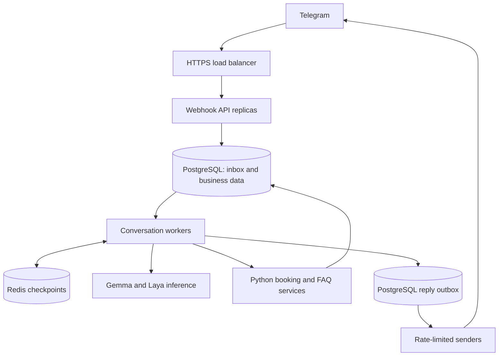

# CAPY system design for 100,000 monthly active users

The capacity figures and process layout below describe the original PostgreSQL queue design. The current demo uses RabbitMQ to distribute identifier-only work to chat-partition workers and a separate sender. PostgreSQL still owns accepted updates, deliveries and due reminder schedules. Scale by giving each partition an active consumer. Replicas on the same partition provide failover and share its serial capacity. Measure queue age by partition and slow-audio effects before choosing a partition count. [Current runbook and measurements](production.md) · [Telegram sequence](architecture.md#how-the-telegram-worker-works)

This document describes an earlier design or implementation phase. See the architecture guide for the current webhook intake and worker flow. [Current Telegram architecture](architecture.md#how-the-telegram-worker-works)

Status: proposed architecture, not implemented or load-tested. Based on the repository and the supplied requirements image, reviewed November 12, 2026.

## 1. Scope and service objectives

Telegram customers can search availability, book, view upcoming appointments, confirm, cancel, reschedule, and ask about services and prices. Support text and voice input and text and voice output across multiple businesses. Keep Gemma for understanding, Laya for action selection, and Python services for authorization and booking policy.

The image's “Non-Requirements” are **non-functional requirements**:

| Requirement | Proposed measurable definition |
| --- | --- |
| 100k users per month | 100,000 monthly active customers, across all businesses |
| 5-second latency | p95 text response time from webhook receipt to Telegram accepting the final reply, under the agreed peak load |
| 99.9% availability per day | Daily successful synthetic text scheduling journeys / attempted journeys, with one probe per minute; also track real-request success separately |
| Voice latency | The image includes voice in the 5-second goal. Keep that goal visible, but validate separately by recording duration; do not claim it is achievable before benchmarking |

A daily time-based 99.9% budget is only 86.4 seconds; a 30-day monthly budget is 43.2 minutes. These are different windows. Provider errors, processing deadlines and delivery failures count as failed customer journeys; an HTTP 200 webhook acknowledgment or a generic error message is not a successful scheduling response. Report Telegram/provider dependency failures separately without hiding their customer impact. Instrument actual user-visible latency where possible; the server-side metric cannot observe device delivery.

## 2. Size traffic before sizing infrastructure

These are planning assumptions, not measured usage:

| Input or derived value | Baseline |
| --- | --- |
| Monthly active users | 100,000 |
| Conversations per user per month | 3 |
| Incoming messages per conversation | 8 |
| Incoming messages per month | 2,400,000 |
| Average over a 30-day month | 0.93 messages/second |
| Initial design peak, roughly 20 times average | 20 messages/second |
| Stress case | 100 messages/second |
| Voice share | 10%, or 240,000 recordings/month |
| Mean voice duration | 15 seconds, or 1,000 input-audio hours/month |

One text turn normally includes Gemma interpretation and Laya routing. At the design peak, budget roughly 40 text-model requests/second, plus transcription and optional synthesis. Model capacity must be measured in tokens, audio duration, concurrency, and latency, not just HTTP request counts. Eight messages is eight incoming turns, not four incoming plus four outgoing messages.

At 20 turns/second and a measured mean processing time of 3 seconds, Little's Law gives about 60 concurrent turns. For a hypothetical worker with 8 safe concurrent turns and 70% target utilization:

`ceil(20 * 3 / (8 * 0.7)) = 11 workers`

This is a worked example, not a deployment guarantee. The current synchronous worker has no eight-turn concurrency implementation. Voice needs its own measured service time and capacity. A 100 turns/second stress case would need about 54 workers under these same assumptions, exceeding the proposed initial cap below and potentially exceeding Telegram delivery capacity.

## 3. High-level architecture

Use one Python codebase deployed as separately scalable processes. Initially use PostgreSQL as the durable work queue, extending the existing update ledger. A separate broker is not required by 100k monthly users alone.

PostgreSQL boxes represent tables in the same managed database, not separate databases. Python booking and FAQ services are modules inside workers, not an additional network hop. Gemma and Laya are independently provisioned inference deployments; audio transcription and synthesis have separate capacity budgets.

Deploy across at least two availability zones: replicated API and workers, managed PostgreSQL with failover, and managed Redis with replication/failover. Kubernetes plus HPA/KEDA is a suitable implementation given the intended autoscaling, but managed containers can implement the same topology. Do not introduce Kubernetes solely because of the monthly user count.

## 4. One message through the system

1. Telegram POSTs an update to a webhook. Verify the configured secret header, payload limits, private-chat identity, and trusted bot-to-business mapping. Never let model output select the tenant or customer.
2. In a short transaction, insert the update into the inbox with unique `(bot_id, update_id)`. Acknowledge only after commit. Duplicates return success without adding another job; database failure returns a retryable failure.
3. A worker claims an eligible conversation and its oldest ready update in a short transaction. Different conversations run concurrently; only one turn per `(business_id, bot_id, user_id)` runs at a time.
4. For text, run Gemma interpretation, Laya routing, then deterministic Python actions. Read/write the conversation checkpoint in Redis. PostgreSQL remains authoritative for bookings.
5. Persist the final reply in the outbox before marking the inbox item complete. The outbox references the stable update ID. Senders claim replies independently and send without rerunning the workflow.
6. Persist successful delivery. Retry transient delivery failures with bounded exponential backoff and jitter; honor Telegram's `retry_after`. Terminal failures leave an inspectable failed record.

Webhooks may arrive concurrently or out of order. Per-conversation serialization prevents concurrent state mutation but does not reconstruct arbitrarily late messages. Order buffered updates by Telegram update ID, use a short bounded reorder window if needed, and handle stale late arrivals explicitly instead of interpreting an old slot selection against a new offer. Do not wait for contiguous update IDs within a chat: Telegram IDs span the bot's updates.

### Safe claims and crash recovery

Add `lease_owner`, `lease_until`, `lease_epoch`, `next_attempt_at`, and completion status to durable job/conversation records. Use `FOR UPDATE SKIP LOCKED` for short claims; never hold a database transaction open during model inference. Workers heartbeat leases; failed workers release work after expiration.

An expired worker must not continue writing after another worker takes over. Enforce the lease epoch in domain-write transactions and reply publication. Checkpoint writes also require atomic fencing/version checks; the current Redis saver has no such protocol. If the durable lease store is unavailable, stop mutations. Test takeover races explicitly.

Keep the current update-derived idempotency key. Persist an immutable action command before execution and store its outcome atomically with the booking mutation. On recovery, replay that exact command or read its outcome; do not reinterpret an old message into a different command after a possible commit. The final reply can then be rebuilt from the recorded result. Until this is implemented, retain the existing conservative unknown-outcome response instead of automatically replaying the graph.

This provides at-least-once processing with idempotent business effects. Telegram delivery can still duplicate after an ambiguous send timeout; there is no end-to-end exactly-once promise.

## 5. Autoscaling policy

Starting configuration candidates, to tune through tests:

| Deployment | Minimum / initial maximum | Main scaling signal |
| --- | --- | --- |
| Webhook API | 2 / 6 | In-flight requests, CPU, acknowledgment latency |
| Text conversation workers | 2 / 20 | Ready conversation count, in-flight work, arrival rate and measured processing time |
| Audio preparation workers | 2 / 10 | Queued audio seconds and oldest job age |
| Reply senders | 2 / 4 | Eligible outbox backlog, constrained by per-bot delivery allowance |
| Reminder schedulers | 2 / 4 | Due reminder age and backlog |
| Gemma / Laya / TTS | Benchmark-dependent; warm redundant capacity | Inference queue time, token/audio throughput, memory and latency |

CPU alone misses workers waiting on model calls. Export eligible work counts and service times to Prometheus and use KEDA/HPA external metrics. Approximate required concurrency from arrival rate times mean service time, add backlog-drain capacity, and retain utilization headroom. Count runnable conversations rather than many blocked messages from one user. Audio backlog must be duration-weighted.

Alert when the oldest eligible text job waits more than 0.5 seconds. That is an SLO warning, not proof that autoscaling will react within 0.5 seconds. Keep enough warm worker and inference capacity for the expected burst; reactive scaling and GPU startup cannot guarantee a five-second response to sudden load.

Use an approximately 300-second HPA scale-down stabilization window and drain claimed work during termination. KEDA's `cooldownPeriod` governs scaling to zero, not ordinary 1-to-N downscaling. Avoid scale-to-zero on the interactive path. Configure node autoscaling and capacity quotas too: adding pods cannot help if no nodes can schedule them.

Cap worker concurrency against database connections and model capacity. If Gemma is saturated, increasing conversation workers merely creates a larger inference queue. Trigger backpressure, fairness per tenant, bounded admission, and an explicit busy response instead of unbounded waits. Count degraded requests against the normal SLO.

## 6. Latency and Telegram delivery limits

An illustrative text critical-path budget is 0.2s ingress, 0.3s queueing, 1.8s Gemma, 0.5s Laya, 0.4s domain/checkpoint work, 0.8s outbound dispatch, and 1.0s reserve. These are engineering allocations summing to five seconds, not observed percentiles. Measure end-to-end p95 directly; summing component p95 values does not yield end-to-end p95.

Telegram recommends avoiding more than one message/second in one chat and documents approximately 30 messages/second for free bulk broadcasts. Use conservative configurable per-bot and per-chat rate limiting and adapt to actual 429 responses. More sender replicas do not raise provider limits. Prioritize interactive replies above reminders, with reserved reminder capacity to avoid starvation.

At 20 incoming turns/second and one reply each, the assumed traffic is already material against a single bot's outbound allowance. Sending both text and voice for every turn can double reply count; reminders add more. Treat 100 turns/second as an internal stress test unless delivery capacity is explicitly provisioned. Separate business bots may naturally distribute traffic, but do not assume unlimited capacity or use bots to evade limits.

## 7. Audio, knowledge base, and tenant boundaries

Audio preparation downloads bounded files, decodes and transcribes the complete recording, then makes that conversation turn eligible for the common workflow. Later text from the same conversation waits until that earlier voice turn completes or fails; other users continue. Separate audio workers protect text latency. Keep Gemma transcription as required, and measure input-duration buckets and decoded memory use.

Generate optional voice from the final validated reply using a TTS service, then send with Telegram `sendVoice`. TTS failure must never repeat a booking; fall back to the stored text result. Any temporary object storage is private, encrypted, has a short explicit lifecycle, and is accessed using opaque object IDs. Queue/checkpoint payloads must not contain raw audio, contact information or legacy booking tokens. Preserve the existing documented limits of free-text redaction.

For small business FAQs, use versioned approved content scoped by business and inject only relevant compact content. Keep current prices and availability structured and authoritative in PostgreSQL. Add retrieval only when content size or measured answer quality justifies it; retrieval must filter tenant IDs and return passage IDs for grounded answers. Unsupported questions should clarify or escalate. Never invent prices or availability from model knowledge.

Replace the runtime-wide `demo_business_id` with a trusted tenant registry. A bot can map to one business; a shared bot needs an explicit, validated business-selection flow and tenant-scoped conversation keys. Keep customer ownership checks in `CustomerSchedulingActions` and booking services. Secrets, raw Telegram identities and contact data remain outside model prompts and traces.

## 8. Data and availability

Start with one managed PostgreSQL primary and HA standby; no sharding assumption. Add bounded connection pools per process and, if necessary, a connection proxy. Total maximum pools across all replicas must stay below the database budget with room for migrations, monitoring and failover. Use partial indexes for ready jobs, due reminders and eligible replies; monitor queue-table bloat and prune retained payloads in bounded batches.

Keep the booking exclusion constraint and transaction revalidation. The current business-row lock serializes booking writes per business: measure hot-tenant lock wait before replacing it. If needed, redesign idempotency locking per command and conflict locking per resource/time while preserving atomic booking/rescheduling, policy checks and stable lock order. Read replicas are optional for stale-tolerant reports; do not use them to authorize a booking.

Redis contains expiring conversation state, not booking truth. On checkpoint loss, reload authoritative appointments and ask the user to rebuild the draft or select a fresh slot. Do not execute a stale selection. Measure bytes across all retained graph checkpoints, not just the 24-message history limit.

Keep backups and point-in-time recovery; test restore and failover. Set explicit business-approved RPO/RTO after those tests. Spread deployments across zones, use readiness/liveness probes, disruption budgets and graceful termination. Run Alembic once in a release job, not independently on every API replica; demo seeding must not run on production pod startup. Model availability is part of the availability budget, so avoid a single inference host. Observability failure should not block scheduling.

## 9. Concrete repository changes

| Current file | Required change |
| --- | --- |
| `app/main.py` | Currently health only; add authenticated webhook ingestion and separate liveness/readiness |
| `app/telegram_worker.py` | Split polling, turn processing, audio preparation and reply delivery; remove the single-bot worker lock only after concurrency safety exists |
| `app/channels/telegram_repository.py` | Add conversation claims, leases, fencing and per-chat outbox ordering; replace bot-wide recovery and global reply blocking |
| `app/graph/redis_checkpoint.py` | Add safe fenced/versioned checkpoint writes and test concurrent takeover |
| `app/database.py` | Replace new connections per operation with bounded pooling |
| `app/booking.py` | Preserve idempotency and exclusion protection; add recoverable immutable commands/results and measure business lock contention |
| `app/runtime.py` | Construct worker-role dependencies separately, with bounded model concurrency and production timeouts |
| `app/local_models.py` | Benchmark real concurrent serving; async endpoints wrapping synchronous inference do not establish serving capacity |
| `app/graph/steps.py` | Extend catalog-based FAQ answers with tenant-scoped approved knowledge |
| `app/channels/telegram.py` | Add voice delivery and webhook setup support |
| `app/reminders.py` | Keep due-job claiming; enqueue real Telegram outbox entries instead of only the demo inbox, without network calls inside booking transactions |
| `alembic/versions/` | Add tenant configuration, leases, command outcomes, outbox and supporting indexes |
| `docker-compose.yml` | Keep local development; add production deployment configuration separately and separate migrations from startup |

## 10. Rollout and validation

1. Instrument baseline: ingress-to-reply latency, model timing, token counts, audio duration, queue age, per-tenant traffic, database connections/locks, checkpoint bytes and Telegram 429s.
2. Implement durable webhooks, per-conversation processing and independent senders. Preserve the existing booking and ownership integration tests. Test duplicate updates, out-of-order arrivals, overlapping messages and cross-tenant access.
3. Inject crashes before/after domain commit, before reply persistence, during delivery and during lease takeover. Assert one business effect and coherent recovery; specifically test stale workers cannot mutate state.
4. Add audio/TTS and approved FAQ content. Evaluate bilingual quality, price grounding, privacy and authorization with the real Gemma/Laya providers; deterministic baselines alone cannot validate latency or model quality.
5. Load-test at 1, 5, 20 and 100 incoming turns/second, including a sudden burst, 10% voice, slow providers, one hot business and repeated messages from one user. Use simulated Telegram for large load tests and controlled live delivery tests for provider limits. Test at least an hour at design peak, then a longer soak for leaks and database growth.
6. Verify p95 text latency below five seconds at 20 turns/second with defined input sizes, bounded queues, no duplicate bookings and recovery after worker/zone/dependency failures. Observe daily availability over time; a load test cannot prove a production availability SLO.

Before claiming capacity, measure actual conversations/user, messages/conversation, burst shape, voice duration, model throughput, bot distribution and outbound reply count. Estimate monthly cost from warm inference hours, tokens, audio/TTS hours, worker utilization, managed storage/HA, and telemetry. Avoid a dollar estimate until model hardware and hosting region are selected.

## References

- [Telegram Bot API: webhooks and voice delivery](https://core.telegram.org/bots/api)
- [Telegram FAQ: delivery rate limits](https://core.telegram.org/bots/faq)
- [KEDA ScaledObject: scaling and cooldown semantics](https://keda.sh/docs/2.21/reference/scaledobject-spec/)
- Existing project architecture: [architecture.md](architecture.md)
- Existing booking/delivery guarantees: [idempotency.md](idempotency.md)
