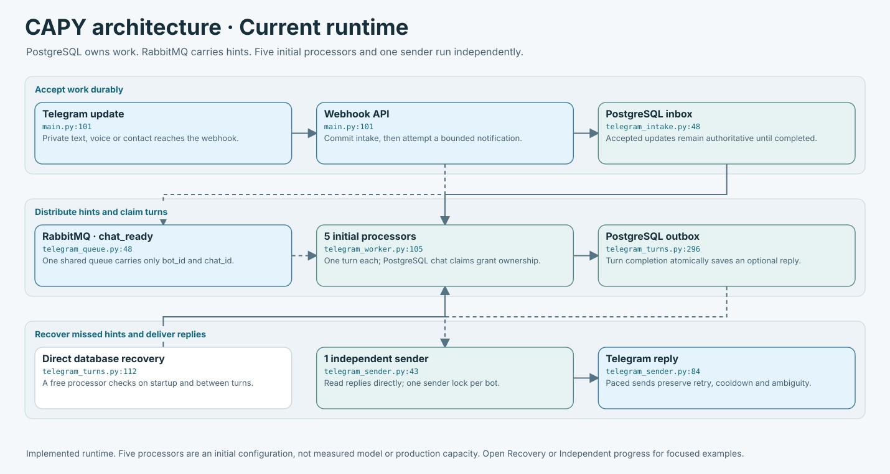

# CAPY scale study: 100,000 monthly active customers

> **Status:** Planning exercise only. The workload figures are assumptions. No hosted availability, latency objective or 100,000-customer capacity has been established.

## Current runtime in the repository

The authenticated webhook commits updates to PostgreSQL and attempts a bounded, post-commit publication to one RabbitMQ queue, `telegram.chat_ready`. Notifications contain only bot/chat IDs. Five initial processing instances claim chats in PostgreSQL; each runs one turn across notification handling and direct database recovery. One independent sender reads the existing PostgreSQL outbox, retaining conservative pacing of about one send per second. Redis holds attempt-specific conversation checkpoints.



See the [interactive atlas](codebase-atlas/index.html#architecture-overview), [recovery flow](codebase-atlas/index.html#notification-recovery), and [production guide](production.md). The previous partitioned queues, publication relay, outgoing broker queue and bot registry are historical implementations. They are absent from this runtime; the current notification adapter adds no database tables.

Five processors are a deployment choice. Concurrency and independent delivery improve progress across chats, while RabbitMQ adds notification distribution and an operational dependency. These facts do not establish hosted throughput or a highly available deployment.

## Workload estimate

These values are an example to show how to size work. Replace them with measured customer behavior before choosing infrastructure.

| Input or result | Assumption |
| --- | ---: |
| Monthly active customers | 100,000 |
| Conversations per customer per month | 3 |
| Incoming messages per conversation | 8 |
| Incoming messages per month | 2,400,000 |
| Average incoming rate over 30 days | About 0.93 messages/second |
| Illustrative peak at 20 times the average | About 20 messages/second |
| Voice share and average duration | 10% at 15 seconds |
| Derived monthly audio | About 240,000 recordings or 1,000 audio hours |

At 20 incoming messages per second, a text turn that uses one Gemma request and one Laya request needs roughly 40 model requests per second before retries. Voice adds transcription work. Measure the actual requests, audio duration, tokens, and provider latency for the configured models.

For a mean end-to-end processing time of 3 seconds, Little's Law estimates about 60 turns in progress at 20 turns per second:

```text
in-progress turns ≈ arrival rate × mean processing time
                 ≈ 20 turns/second × 3 seconds
                 ≈ 60 turns
```

This is a workload estimate, not a worker count. Per-chat ordering, per-business limits, database capacity, model throughput, and Telegram delivery limits determine how many workers are useful.

## Constraints that shape scaling

- **Conversation order:** A voice turn can hold its chat until transcription and processing finish. More workers help other chats, but they cannot safely process later messages in the same chat at the same time.
- **One shared queue:** Available consumers receive hints; PostgreSQL claims serialize each chat. Queue depth counts notifications, which can be duplicated or absent, rather than exact unfinished turns. Measure database backlog and oldest age.
- **Model throughput:** Adding workers can make the inference queue longer if Gemma or Laya is already saturated. Measure both model wait time and execution time.
- **Database connections and locks:** Worker replicas share PostgreSQL. Budget each process's connection pool and watch lock waits on booking and claim transactions.
- **Telegram delivery:** More sender processes do not increase a bot's allowed send rate. Account for replies, retries, and rate-limit responses.
- **Audio:** Track recording duration and decoded memory, not only the number of queued recordings. Keep audio and text latency separate in reports.

## What the current evidence shows

The [controlled benchmark](production.md#local-verification) exercises the current processor/sender entry points with real PostgreSQL and RabbitMQ and simulated inference and delivery. Its one-versus-five comparison separates turn concurrency from the paced sender bottleneck. Earlier partition/relay benchmark figures do not describe this runtime.

The [scenario evaluation framework](evaluation-framework.md) checks multi-turn behavior with isolated scheduling fixtures. Database and broker integration tests check persistence and recovery. These checks demonstrate behavior and correctness, not sustained production throughput.

The evidence in this repository does not establish a 100k monthly active user deployment, five-second response SLO, or 99.9% availability SLO. Those are possible targets from the original scale brief, not verified service commitments. Define the measurement window and use a measurable boundary such as webhook receipt to Telegram accepting the correct final reply; the bot cannot confirm that a customer saw it on their device. Measure voice separately by recording duration.

## Measurements needed before making a capacity claim

1. Measure actual conversation size, burst shape, audio share and duration, and replies per completed journey. Keep synthetic and production data separate.
2. Define the text and voice response targets, availability window, and what counts as a successful customer journey.
3. Run increasing and sustained loads against PostgreSQL, Redis, RabbitMQ, and representative Gemma/Laya endpoints. Include a hot chat, a hot business, slow audio, provider failures, Telegram rate limits, and broker or worker restarts.
4. Record end-to-end latency percentiles, PostgreSQL backlog age, notification queue depth, model wait and execution time, database connections and lock waits, delivery failures, retries, and operating cost.
5. Choose worker counts, pool sizes, and hosted redundancy from those results. Retest the failure and recovery behavior after each deployment change.

Do not add a deployment platform or autoscaling layer solely because the estimate says 100,000 monthly active customers. First identify the measured bottleneck and confirm that the application, model provider, and Telegram limits can support the target workload.

## Related guides

- [Architecture](architecture.md) — current components and booking flow
- [Production guide](production.md) — worker roles, recovery, and local benchmark
- [Model contracts](model-contracts.md) — Gemma and Laya inputs and outputs
- [Evaluation framework](evaluation-framework.md) — behavioral checks and reports
