# Telegram worker

You ask for a massage tomorrow. CAPY offers **1. 14:00** and **2. 16:00**. When you reply **“1”**, CAPY needs to recover that offer, find your customer account, and check whether 14:00 is still available. This guide follows that reply through the code.

The `telegram-worker` is the background process that runs the conversation. The API accepts the incoming message, the relay passes queue notifications, and the sender delivers the reply. The API can confirm receipt while the worker is still processing the previous audio or checking the schedule.

[Message path](#the-message-path) · [Code walkthrough](#start-reading-the-code) · [Recovery](#when-the-flow-changes) · [Logs](#follow-a-message-in-the-logs) · [Offline example](#run-the-example-without-telegram) · [Full sequence](#full-call-sequence)

## The message path

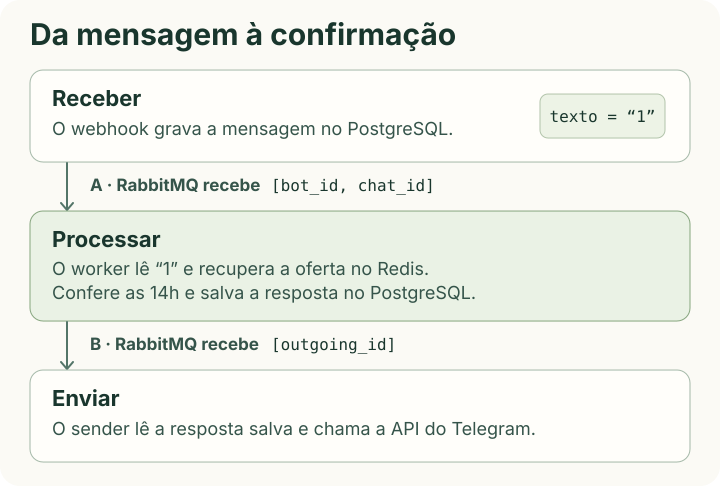

**A** tells the worker which bot and chat to check. **B** tells the sender which reply to deliver. The relay publishes these notifications to RabbitMQ. Both consumers use the IDs to fetch the corresponding records from PostgreSQL.

A **turn** is the processing of one customer message. Asking for times and replying “1” are two turns in the same chat. A **checkpoint** is saved conversation state. It includes the offered times that connect those two turns. The booking itself goes in PostgreSQL. [Conversation graph](graph.md) · [Database tables](database.md)

## Start reading the code

In the demo Compose file, `telegram-worker` runs `python -m app.telegram_service process`. In `main()`, line 449 selects `run_broker_worker()` for the RabbitMQ transport. [Compose command](../docker-compose.yml#L112-L117) · [Worker selection in `main()`](../app/telegram_service.py#L425-L450)

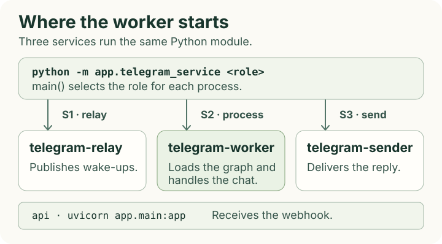

**S1** starts the relay that publishes pending notifications. **S2** creates the graph and model clients once per process and registers `process_chat_turn()` for incoming notifications. **S3** registers `send_outgoing()` for outgoing notifications. The `api` service receives Telegram's HTTP POST. [Roles in `run_broker_worker()`](../app/telegram_service.py#L239-L270) · [API in Compose](../docker-compose.yml#L70-L74)

The same module also has `run_worker()`, which runs the reminder scheduler and the roles using `--transport postgres`. [Transport selection](../app/telegram_service.py#L408-L450) · [PostgreSQL worker loop](../app/telegram_service.py#L273-L307)

### 1. The webhook saves “1” and the relay wakes the worker

`telegram_webhook()` receives the POST, checks the route and bot secret, and calls `save_update()`. The figure follows a new private message. [`telegram_webhook()`](../app/main.py#L76-L108)

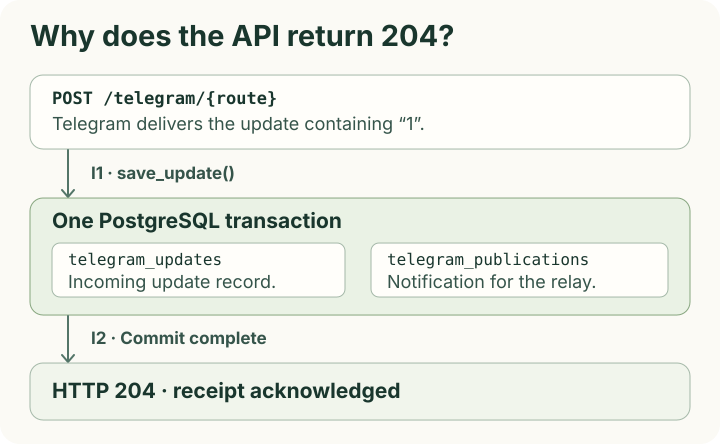

**I1** saves the update in `telegram_updates` and the pending notification in `telegram_publications` so both become visible together. **I2** returns `204` to Telegram after the commit. If Telegram repeats the POST while the original record exists, the unique `(bot_id, update_id)` key prevents a second record or notification for that event. [Storage and deduplication in `save_update()`](../app/channels/telegram_intake.py#L67-L102)

The relay reads pending notifications with `publish_due()`. For incoming work, `publish_wakeup()` sends `[bot_id, chat_id]` to RabbitMQ. The text “1” stays in the update record. The relay deletes the pending notification after RabbitMQ confirms the publication. If the relay stops between confirmation and deletion, it can publish the same notification again. [`publish_due()`](../app/channels/telegram_publications.py#L39-L70) · [`publish_wakeup()`](../app/channels/telegram_broker.py#L62-L85) · [RabbitMQ confirmations](https://www.rabbitmq.com/docs/confirms)

### 2. The worker takes the next message in the chat

RabbitMQ delivers the bot and chat IDs to `process_chat_turn()`. In this excerpt, line 262 tries to get a **claim**, which gives a worker temporary authority to process the next message. Lines 263–264 start the turn when the database grants the claim. [`process_chat_turn()`, lines 260–264](../app/telegram_service.py#L260-L264)

```python
claim = turns.claim_chat(bot_id, chat_id, per_business=args.per_business)
if claim:
    process_turn(turns, claim, runtime)
```

`claim_chat()` checks the first unfinished turn in that chat. A turn already in progress goes first. For waiting messages, the database orders by message time and uses the update ID to break ties. The **lease** is the time limit on the worker's authority to process a turn. [Message ordering](../app/channels/telegram_turns.py#L221-L247)

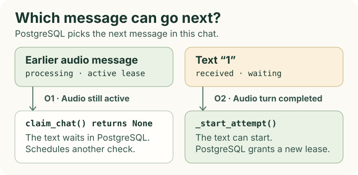

**O1** shows what happens if `claim_chat()` runs while the audio turn holds an active lease. It schedules another check and returns `None`. It also postpones work when the business has reached its limit of concurrent turns. **O2** follows the text after the audio turn finishes. Once the text is ready and there is capacity, `_start_attempt()` marks it `processing` and stores the new lease, update ID, and attempt number. [`claim_chat()`](../app/channels/telegram_turns.py#L157-L218) · [`_start_attempt()`](../app/channels/telegram_turns.py#L272-L327)

**What does `TurnClaim` carry?** The bot, the message record (`row`), the attempt number (`generation`), the last published checkpoint reference, and the `interrupted` and `late` flags. The worker passes this object to functions that need to know which attempt is running. The generation increases with each claim in the same chat, including when a worker takes over the same update. The database keeps the current authority in `telegram_conversations`. [`TurnClaim`](../app/channels/telegram_turns.py#L67-L116)

The initial lease lasts 90 seconds. A **heartbeat** tries to renew it every 30 seconds. The initial database transaction has already closed while the worker waits for the model. [Lease duration](../app/channels/telegram_turns.py#L28) · [Background renewal](../app/telegram_service.py#L189-L217)

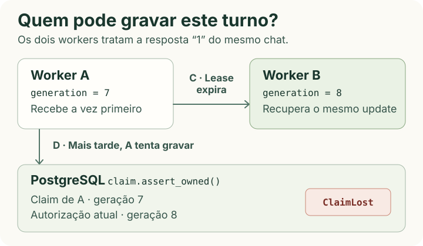

**C** shows B taking over the same update after the lease expires. **D** shows A trying to write later. `claim.assert_owned(session)` checks the bot, chat, update, generation, and expiry inside the transaction. With generation 8 in the database, attempt 7 raises `ClaimLost`. [Write authorization](../app/channels/telegram_turns.py#L88-L116)

### 3. The worker restores the offer and runs the graph

`process_turn()` associates the logs with the bot and update. `_process_turn()` checks whether the message can proceed, starts the lease renewal, and calls `_process_private_message()`. [`process_turn()`](../app/telegram_service.py#L66-L95)

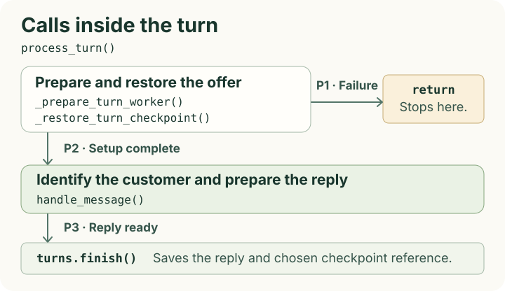

**P1** returns from the current attempt before calling the models if setup or restoration fails. **P2** uses the prepared worker to resolve the customer and generate the reply. **P3** passes the reply and the chosen checkpoint reference to `turns.finish()`. [Excerpt below, lines 102–112](../app/telegram_service.py#L102-L112)

```python
worker = _prepare_turn_worker(turns, claim, runtime)
if worker is None or not _restore_turn_checkpoint(turns, claim, worker):
    return

identity = worker._ensure_customer(message["from"], claim.row["telegram_user_id"])
debug_event("telegram.turn.customer_resolved")
reply = worker._reply_to_message(claim.row, identity, message)
checkpoint_to_publish = (
    worker.checkpoint_thread if worker.checkpoint_completed else claim.checkpoint_thread
)
turns.finish(claim, reply, checkpoint_to_publish)
```

1. **Lines 102–104. Prepare an attempt.** `_prepare_turn_worker()` creates a `TelegramWorker` for this turn. It reuses the graph and model clients and passes `claim.assert_owned` to the services that write customer and booking data. [Prepare the worker](../app/telegram_service.py#L120-L161)

   The attempt gets its own LangGraph `thread_id` for checkpoints. This protects the last published offer from changes in an attempt still in progress. [Copy the checkpoint in Redis](../app/graph/redis_checkpoint.py#L44-L58) · [LangGraph persistence](https://docs.langchain.com/oss/python/langgraph/persistence)

2. **Lines 106–108. Identify the customer and generate the reply.** `_ensure_customer()` resolves the sender to a customer for this bot and business, creating the link if needed. The `customer_id` ties the booking to that customer. `_reply_to_message()` handles `/start` and contact cards directly. For “1”, it calls `_run_turn()`. [Link the customer](../app/channels/telegram_repository.py#L37-L81) · [`_reply_to_message()`](../app/telegram_worker.py#L43-L88)
3. **Lines 109–112. Choose which checkpoint the next turn can read.** When the graph completes, the worker passes the current attempt's key to `finish()`. A direct reply such as `/start` keeps the previous reference because it bypasses the graph. [Choose the checkpoint](../app/telegram_service.py#L109-L112) · [Record graph completion](../app/telegram_worker.py#L160-L168)

#### How “1” finds the earlier offer

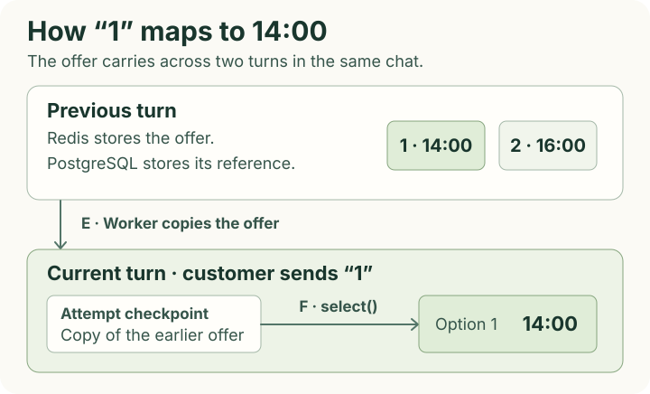

**E** copies the published checkpoint to the current attempt's `thread_id` in `_restore_turn_checkpoint()`. **F** is the graph's `select()` node reading the offered times to resolve the choice. [Restore the offer](../app/telegram_service.py#L164-L180) · [Read the selected option](../app/graph/steps.py#L569-L578)

#### How text and audio reach the models

Inside `_run_turn()`, the worker gets the **catalog** of services, staff, and business settings. It builds `TurnContext` with the customer, input type, and local date. It uses `telegram:{bot_id}:{update_id}` as the booking **idempotency key**. Reusing the same key and request data lets the booking service return the result of an earlier write. [`_run_turn()`](../app/telegram_worker.py#L127-L168) · [Idempotency and recovery](idempotency.md)

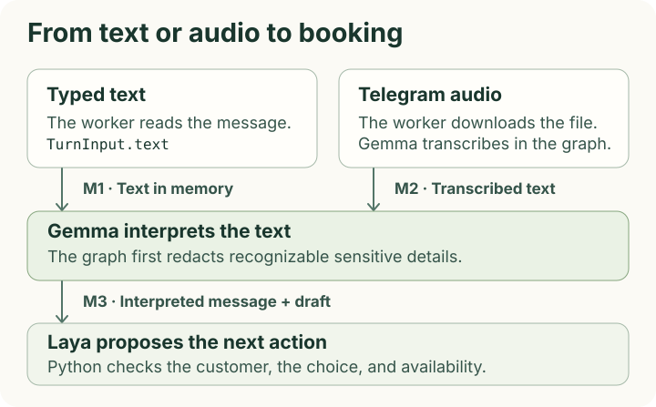

**M1** uses the text read by `_message_input()`. **M2** uses the recording the worker downloaded and Gemma transcribed. `handle_turn()` passes the raw input to the graph in memory, and the graph redacts recognizable sensitive details from the text before interpretation. **M3** gives Laya the interpreted message and the **draft**, which holds details collected so far, such as the service and date. [Read the input](../app/telegram_worker.py#L104-L125) · [`handle_turn()`](../app/graph/workflow.py#L13-L40) · [Interpretation node](../app/graph/steps.py#L97-L135) · [Laya contract](model-contracts.md)

For a successful “1”, the booking service checks that 14:00 is still available and saves the booking for the customer. `_run_turn()` gives the worker `result.text`. [Booking write](../app/booking.py#L152-L214)

### 4. The worker saves the reply and releases the chat

`turns.finish(claim, reply, checkpoint_to_publish)` checks the claim again. The **outbox** is the `telegram_outbox` table where the sender finds the reply that the worker prepared. Saving it there lets the sender retry delivery without running the booking workflow again. [Saving the reply in `finish()`](../app/channels/telegram_turns.py#L384-L416)

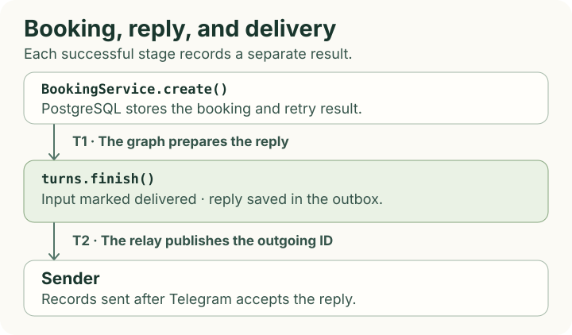

**T1** connects two transactions. The booking service commits the appointment before the graph prepares the reply. Then `finish()` saves the reply and a notification for the sender, publishes the checkpoint reference, releases the lease, and marks the incoming update `delivered`. **T2** takes the reply ID to the sender. The outbox records `sent` after Telegram accepts the message. [Booking transaction](../app/booking.py#L152-L214) · [Complete the turn](../app/channels/telegram_turns.py#L384-L454)

`finish()` discards the raw incoming payload and keeps the ID to recognize a repeated webhook. Cleanup can remove the completed record after 30 days once its reply has no pending send. If another turn is waiting, `finish()` also saves a notification for that chat. The consumer calls `basic_ack()` after the callback completes successfully, including when the callback only scheduled another check. [Retain the ID and notify the next turn](../app/channels/telegram_turns.py#L417-L454) · [Cleanup eligibility](../app/telegram_service.py#L310-L323) · [Broker acknowledgement](../app/channels/telegram_broker.py#L105-L134)

### 5. The sender delivers the reply

The relay publishes the reply ID to an outgoing queue. The `send_outgoing()` callback passes that ID to `claim_by_id()`, which reserves an eligible delivery and enforces chat order and rate limits. `deliver_claimed()` calls `TelegramDelivery.send()`, which uses `send_message()` to contact Telegram. [`send_outgoing()`](../app/telegram_service.py#L248-L256) · [Reserve the delivery](../app/channels/telegram_delivery.py#L111-L124) · [`send_message()`](../app/channels/telegram_delivery.py#L77-L80)

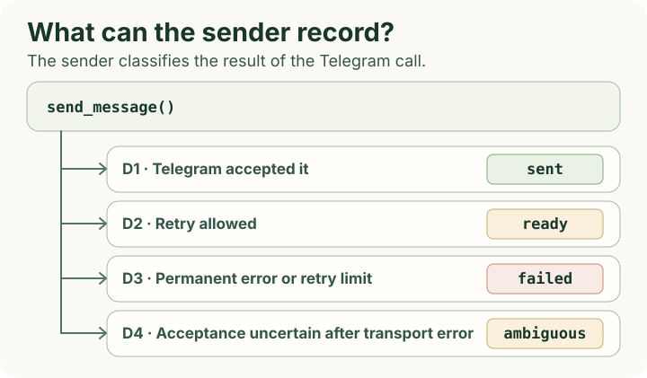

- **D1** records `sent` when Telegram accepts the message.
- **D2** returns the same reply to `ready` after a retryable error and sets the time for the next attempt.
- **D3** records `failed` for a permanent rejection, a configuration error, or exhausted attempts.
- **D4** records `ambiguous` when a transport error leaves the result unknown.

The outgoing queue lets the sender deliver replies while a conversation worker handles audio. If the sender tries to record a result after its lease expires, the result log shows `claim_lost`. [Classify the outcome](../app/channels/telegram_delivery.py#L350-L383) · [Check the send lease](../app/channels/telegram_delivery.py#L260-L300)

## When the flow changes

| Situation | What to read |
| --- | --- |
| The customer replies “1” after the offer expires in Redis. | `_restore_turn_checkpoint()` ends the turn with a prompt to ask for new times. [Restore the checkpoint](../app/telegram_service.py#L164-L180) |
| Redis is unavailable during restoration, or the bot credentials are missing. | The worker defers the turn for one minute and releases the chat before touching customer or booking data. [Defer the turn](../app/channels/telegram_turns.py#L349-L381) |
| A new worker takes over an interrupted attempt. | The booking may already have committed because the booking write and `finish()` use separate transactions. The worker clears the checkpoint reference and asks the customer to check their bookings. [`claim.interrupted`](../app/telegram_service.py#L85-L88) · [Test the gap between commits](../tests/integration/test_telegram_production.py#L187-L221) |
| “1” arrives after the chat has already processed a newer message. | `claim.late` prompts the customer to ask for a fresh offer so the number is applied to the right list. [`claim.late`](../app/telegram_service.py#L89-L92) |
| RabbitMQ delivers the same notification again. | The worker checks what is still pending. If the original turn finished, the notification can wake the next turn or find the chat empty. [Queue and duplicate notification test](../tests/integration/test_telegram_broker.py#L61) |
| The sender stops after reserving a reply and its lease expires. | `recover_expired()` marks the send `ambiguous` with `dispatch_expired`. Automatic retries stop because Telegram may already have accepted the reply. [Recover an expired send](../app/channels/telegram_delivery.py#L302-L331) |

### What keeps running while the model responds

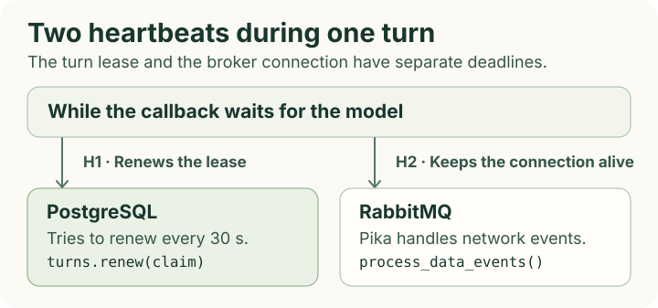

**H1** runs in a `Thread` created by `_keep_turn_claim_alive()` and tries to keep the claim valid. **H2** runs on the thread that owns the RabbitMQ connection. The callback can wait for the models in a `ThreadPoolExecutor` while the connection continues to process network events. The LangGraph `thread_id` identifies stored checkpoint state. [Renew the claim](../app/telegram_service.py#L189-L217) · [RabbitMQ connection](../app/channels/telegram_broker.py#L122-L149) · [Checkpoint key](../app/graph/workflow.py#L29-L35)

## Follow a message in the logs

Set up a test bot. Then start the demo with debug logs and reply “1” to an offer. [Telegram demo setup](../README.md#try-the-telegram-voice-demo)

```bash
CAPY_LOG_LEVEL=DEBUG docker compose --profile telegram up -d --build
docker compose --profile telegram logs -f api telegram-worker telegram-sender
```

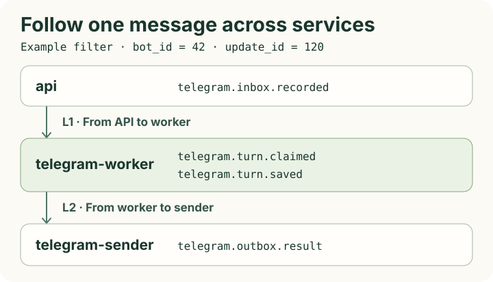

**L1** starts at `telegram.inbox.recorded`. Take the `bot_id` and `update_id` for “1” and look for the same pair in the worker logs. **L2** uses this pair to find the outcome in the sender logs. The initial request for times has its own `update_id`. [How logs get these IDs](../app/observability.py#L73-L91)

| Event | What to check |
| --- | --- |
| `telegram.inbox.recorded` | `inserted=True` marks a new update record. |
| `telegram.turn.claimed` | `attempt` is the claim generation. |
| `workflow.checkpoint.forked` | `found=True` means the worker copied the previous offer. |
| `workflow.slot.matched` | `option_number=1` is the selected option. |
| `availability.slot.validated` | The time passed the current availability check. |
| `booking.saved` | The booking transaction committed. |
| `telegram.turn.saved` | `has_reply=True` means the worker saved a reply for the sender. |
| `telegram.outbox.result` | `outcome=sent` means Telegram accepted the reply and the sender recorded the result. |

Run `CAPY_LOG_LEVEL=INFO docker compose --profile telegram up -d` to restore the default logging level. Compose recreates the containers whose environment changes.

## Run the example without Telegram

This example uses scripted model outputs and simulated booking services to exercise the local graph. The Telegram demo above lets you observe the webhook, lease, and sender.

```bash
CAPY_LOG_LEVEL=DEBUG uv run --locked python -m app.evals.runner \
  --understanding deterministic --routing deterministic
```


**V1** supplies the date needed for the test to offer times. **V2** selects the first time. Find `eval.turn.started` with `number: 3` and follow the events for that turn. [Test conversation](../evals/data/smoke-text.jsonl#L1) · [Set up the local environment](../README.md#run-the-offline-example)

| Event | What to check in `en-booking` |
| --- | --- |
| `workflow.draft.operation` | `reason: time_choice_for_new_booking` identifies a selection for a new booking. |
| `workflow.route.booking_choice` | `reason: action_does_not_target_existing_booking` indicates that the choice refers to offered times. |
| `workflow.route.rule_applied` and `workflow.route.selected` | `reason: choose_from_offered_times` and `route: select` lead to the node that reads the offer. |
| `workflow.slot.matched` and `workflow.action.executing` | `option_number: 1` identifies the chosen time. `operation: create` triggers the simulated booking service. |
| `workflow.turn.completed` | `has_booking: True` means the graph returned a booking. The runner prints `PASS  en-booking`. |

If routing fails during the demo, the `stage` field of `workflow.route.failed` shows where the error occurred. [Routing code](../app/graph/steps.py#L252)

To follow two turns with PostgreSQL and Redis, open `test_completed_checkpoint_carries_slot_offer_into_next_attempt`. It creates an offer, processes “1”, and counts the bookings saved. It also covers an expired offer and a crash after committing the booking. [Python integration test](../tests/integration/test_telegram_production.py#L159-L221)

## Full call sequence

Read from top to bottom. Q01–Q08 cover the incoming turn. For a reply, jump from Q07 to the outgoing notification at Q10. Q09 shows how the hosted reminder scheduler adds work to the same outgoing queue.

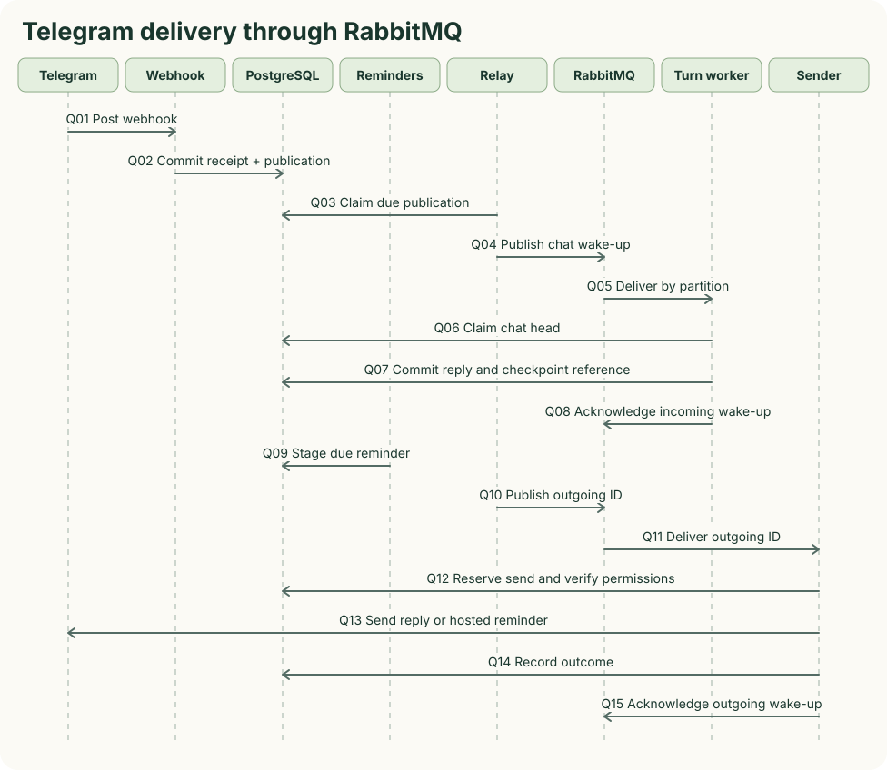

| Arrow | What passes and why |
| --- | --- |
| **Q01** | Telegram posts the update to the registered webhook, which checks the bot route and secret. [Webhook](../app/main.py#L76-L108) |
| **Q02** | The API saves the incoming record and the notification in one transaction so the new private message can reach the worker. [Store the update](../app/channels/telegram_intake.py#L78-L96) |
| **Q03** | The relay briefly claims a due publication so another relay can recover it if needed. [Reserve the publication](../app/channels/telegram_publications.py#L39-L61) |
| **Q04** | The relay sends `[bot_id, chat_id]` to the incoming queue and waits for broker confirmation. [Publish](../app/channels/telegram_broker.py#L62-L85) |
| **Q05** | RabbitMQ delivers the notification to the active consumer for the chat's partition. A partition is a queue that serves a group of chats. [Partition selection](../app/channels/telegram_broker.py#L22-L30) |
| **Q06** | The worker uses those IDs to look up the next message in PostgreSQL and try to get its lease. [Claim the chat](../app/channels/telegram_turns.py#L157-L218) |
| **Q07** | The worker saves the reply, checkpoint reference, and next notifications together in PostgreSQL. [Complete the turn](../app/channels/telegram_turns.py#L384-L454) |
| **Q08** | The consumer acknowledges the notification. If the connection drops before acknowledgement, RabbitMQ can deliver it again. [Acknowledgement](../app/channels/telegram_broker.py#L122-L134) |
| **Q09** | The hosted scheduler saves a send for a due reminder and schedules a publication for the relay. [Schedule a reminder](../app/reminders.py#L71) |
| **Q10** | The relay publishes the reply or reminder ID to the dedicated outgoing queue. [Outgoing publication](../app/channels/telegram_broker.py#L68-L74) |
| **Q11** | RabbitMQ delivers that ID to a sender. [Sender loop](../app/telegram_service.py#L248-L256) |
| **Q12** | The sender looks up the saved message and checks rate limits and chat order. For a reminder, it also checks that the reminder version is current. [Authorize delivery](../app/channels/telegram_delivery.py#L160-L184) |
| **Q13** | The sender calls Telegram with the saved message through the registered bot. [Send](../app/channels/telegram_delivery.py#L77-L80) |
| **Q14** | The sender records the outcome or a safe retry in PostgreSQL. [Complete the send](../app/channels/telegram_delivery.py#L260-L300) |
| **Q15** | The sender acknowledges the notification. A redelivery checks the state of the same saved send. [Acknowledgement](../app/channels/telegram_broker.py#L122-L134) |

The demo starts with one incoming partition and one consumer. That consumer handles one notification at a time, so a long audio turn can delay another chat on the same partition. To process separate partitions in parallel, run an active consumer for each one. [Compose defaults](../docker-compose.yml#L1-L5) · [Partition option](../app/telegram_service.py#L408-L414) · [Consumer loop](../app/channels/telegram_broker.py#L137-L149)

## References

- Diátaxis recommends teaching through a concrete task and using explanations to connect steps to design decisions. [Tutorials](https://diataxis.fr/tutorials/) · [Explanation](https://diataxis.fr/explanation/)
- Google's technical writing course describes how to introduce the main scenario before adding more detail. [Organizing large documents](https://developers.google.com/tech-writing/two/large-docs#disclose-information-progressively)
