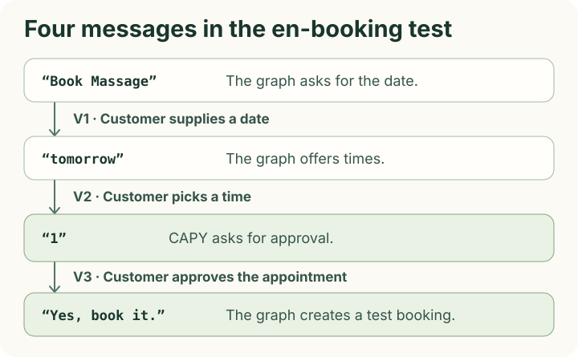

# Telegram worker

The API accepts incoming Telegram messages. One background process checks PostgreSQL for eligible messages and replies. It uses Redis to restore each chat's LangGraph checkpoint and sends replies through the Telegram Bot API.

## Start reading the code

| Step | Code | What happens |
| --- | --- | --- |
| Receive | [Webhook](../app/main.py#L93) · [Save update](../app/channels/telegram_intake.py#L41) | Authenticate the webhook. Insert a receipt and create a chat record if needed. Return HTTP 204 after the transaction commits. |
| Process | [Worker loop](../app/telegram_worker.py#L63) · [Turn claims](../app/channels/telegram_turns.py#L104) | Look for the oldest eligible message in a chat. Reserve the chat while the turn runs. |
| Save | [Complete the turn](../app/channels/telegram_turns.py#L284) | Record the reply, the completed receipt and the pointer to the new Redis checkpoint in one PostgreSQL transaction. |
| Deliver | [Reserve a reply](../app/channels/telegram_delivery.py#L23) · [Send to Telegram](../app/telegram_sender.py#L15) | Send the saved reply after checking chat order and delivery timing. Record the result. |

## Tables used by this worker

| Table | What it holds |
| --- | --- |
| `telegram_inbox` | Update receipts with status `received`, `processing`, or `processed`. The key `(bot_id, update_id)` deduplicates Telegram retries. |
| `telegram_chat_processing_state` | The current turn claim, last processed message position and the last completed checkpoint reference for each chat. |
| `telegram_outbox` | Reply text, dispatch status, retry time and send result. |

Redis holds the checkpoint itself. When the worker finishes a message, it clears the raw payload and keeps the receipt for deduplication. After a terminal send result, it clears the reply content. Cleanup later removes completed rows. [Schema](database.md)

## Full call sequence

1. Compose starts the API and runs `python -m app.telegram_service process` to start the worker.
2. Telegram sends a private message. The webhook authenticates it and commits a receipt with its content.
3. The worker reads eligible work in PostgreSQL. A long audio turn can delay the next chat because one process handles one turn at a time.
4. The worker restores the last completed Redis checkpoint, runs the turn and commits the reply together with the updated checkpoint reference.
5. The same worker reads the pending reply, calls Telegram and records the result. A safe retry is scheduled via the reply's `ready_at`.

The worker holds a PostgreSQL session lock for the configured bot so a second instance cannot start work. Chat and reply claims have deadlines to distinguish work that is still running from work interrupted by a restart. An expired send becomes ambiguous because Telegram may already have delivered it.

## Follow a message in the logs

Use `CAPY_LOG_LEVEL=DEBUG` and correlate `bot_id` and `update_id`.

| Event | What to check |
| --- | --- |
| `telegram.inbox.recorded` | `inserted=True` marks a new update record. |
| `telegram.turn.claimed` | `attempt` identifies the claim generation. |
| `workflow.checkpoint.forked` | `found=True` means the worker restored the previous state. |
| `booking.saved` | The booking transaction committed. |
| `telegram.turn.saved` | `has_reply=True` means the reply is ready for delivery. |
| `telegram.outbox.result` | `outcome=sent` means Telegram accepted it and the worker saved the result. |

## Run the example without Telegram

This example uses scripted model outputs and simulated booking services to exercise the local graph. The Telegram demo above lets you observe the webhook, chat claim, and delivery.

```bash
CAPY_LOG_LEVEL=DEBUG uv run --locked python -m app.evals.runner \
  --understanding deterministic --routing deterministic
```



**V1** supplies the date needed to offer times. **V2** selects the first time in turn three; the reply has intent `request_booking_confirmation` and makes no booking write. **V3** sends “Yes, book it.” in turn four; only this approval allows the create operation. Find `eval.turn.started` with `number: 3`, then follow turn four to compare selection with creation. [Test conversation](../evals/data/smoke-text.jsonl#L1) · [Set up the local environment](../README.md#run-the-offline-example)

| Event | What to check in `en-booking` |
| --- | --- |
| `workflow.draft.operation` | `reason: time_choice_for_new_booking` identifies a selection for a new booking. |
| `workflow.route.booking_choice` | `reason: action_does_not_target_existing_booking` indicates that the choice refers to offered times. |
| `workflow.route.rule_applied` and `workflow.route.selected` | `reason: choose_from_offered_times` and `route: select` lead to the node that reads the offer. |
| `workflow.slot.matched` and `workflow.reply.prepared` | Turn three matches `option_number: 1`, then returns intent `request_booking_confirmation` without a booking write. |
| `workflow.action.executing` | Turn four reaches `operation: create` after explicit approval and calls the simulated booking service. |
| `workflow.turn.completed` | `has_booking: True` means the graph returned a booking. The runner prints `PASS  en-booking`. |

If routing fails during the demo, the `stage` field of `workflow.route.failed` shows where the error occurred. [Routing code](../app/graph/steps.py#L266)

For database-backed consent behavior, read the [booking journey test](../tests/integration/test_workflow_booking_journey.py). For worker checkpoint recovery, read `test_completed_checkpoint_carries_slot_offer_into_next_attempt`; it uses a stub workflow to isolate checkpoint publication, expiry, and interrupted-turn recovery rather than exercising the real consent logic. [Checkpoint integration test](../tests/integration/test_telegram_production.py#L159-L221)
